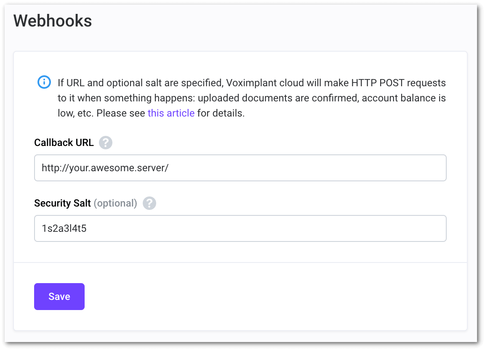
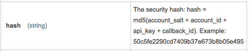

HTTP callbacks allow getting important notifications without frequently sending HTTP requests from your backend to the Voximplant cloud. Instead of creating additional scripts that send requests to the Voximplant HTTP Management API. It is more practical to rely on the already existing automation features, such as callbacks. 

Voximplant offers you a variety of callbacks and, in this article, you learn how to use `MinBalanceCallback`. With callbacks, the Voximplant HTTP Management API becomes even more useful in terms of better integration and monitoring.

## Prerequisites

- Voximplant developer account. You can [sign up here](https://manage.voximplant.com/auth/sign_up)
- Basic knowledge of the [Voximplant Management API](/reference/management-api/reference)
- A simple backend. In this article, it is a node.js server 

## Setup

Go to the [Webhooks](https://manage.voximplant.com/settings/webhooks) section of the Voximplant control panel and click **Add**. The two boxes appear: **Callback URL** and **Security salt**. Technically, only the **Callback URL** box is required to enable callbacks while the **Security salt** box is optional. However, in this article, you check the hash, which is why both boxes should be filled in.



In the Callback **URL** box, specify the URL of your backend server. The **Security salt** box can contain [cryptographic salt](https://en.wikipedia.org/wiki/Salt_%28cryptography%29), which is an arbitrary text string of up to 40 characters.

A callback uses the **Security salt** value to calculate the **MD5** `hash`, which is retrieved by your backend server as part of an `AccountCallback` JSON object.



When you fill in both boxes, click **Save**. Now you can use the Voximplant callbacks and check the hash.

## Usage

The Voximplant cloud sends HTTP POST requests with one or several callbacks to your backend server.

The request body contains a `callbacks` array with the `AccountCallback` JSON object. The object has the following fields:

- **type** – a callback type that determines which properties contain data. The min_balance type means `MinBalanceCallback`
- **hash** – a hash calculated by the Voximplant cloud
- **сallbackId** – a unique number of the callback that you use to calculate the hash

For more information, see the [Management API reference](/reference/management-api/reference).

For example, if the balance reaches the specified threshold, the callback list contains a `MinBalanceCallback` callback. The backend server can do anything with that information: send a letter to your support team, store the alert timestamp, etc. The handlers are up to you — set up any handling rules you want. For illustrative purposes, write a debug message to the server console.

## Backend

The Voximplant HTTP Management API can communicate with the PHP/Node.js/nginx and other backend solutions. To do that quickly, you can use the Express framework for node.js.

Install [node.js](https://nodejs.org/en/) and [express.js](https://expressjs.com/) on any server platform (AWS, Azure, or any VDS, etc.). You can also test the solution locally via [ngrok](https://ngrok.com/), which allows testing demo applications from your local computer without deploying them with a public IP address.

Since you set the **Security salt** value, it is possible to save it to the backend server to check the hash later. Calculate the hash with the **MD5** algorithm:

```javascript
md5(Security salt + account_id + api_key + callback_id)
```

The backend server stores the **Security salt**, **account_id**, and **api_key** values. When a callback is triggered, the server receives **hash** and **callback_id**. Then the server calculates the hash and compares the calculated value with the received one. If the values match, everything is OK; otherwise, the callback is corrupted or triggered not from the Voximplant cloud.

Create a file with the following backend code:

```javascript title="Backend code"
const express = require('express');
const crypto = require('crypto');

const app = express();
const salt = '<salt string>';
const accountId = '<account id string>';
const apiKey = '<api key string>';

app.use(express.json());

app.post('/', (req, res) => {
  for (callback of req.body.callbacks) {
    const data = salt + accountId + apiKey + callback.callback_id;
    hash = crypto.createHash('md5').update(data).digest('hex');
    if (hash === callback.hash) {
      res.sendStatus(200);
      if (callback.type === 'min_balance') {
        console.log('WARNING! The balance is under the threshold!');
      }
    }
  }
});

app.get('/', (req, res) => {
  res.sendStatus(200);
});

app.listen(3000);

```

Make your server communicate with the Voximplant HTTP Management API to get even more control of your account. Receive the alerts on time or check the information manually – the callbacks aid you in keeping the account data close at hand.
