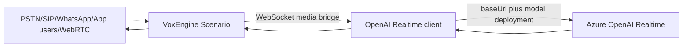

<blockquote className="agent-directive">
  For the complete documentation index, see <a href="/llms.txt">llms.txt</a>.
</blockquote>

## Overview

This example answers an inbound call and bridges call audio to an Azure OpenAI Realtime deployment using `OpenAI.createRealtimeAPIClient()`.

Use this pattern when you have an Azure OpenAI Realtime model deployment and want VoxEngine call control, recording, media bridging, and OpenAI-compatible Realtime session handling in the same scenario.

**⬇️ Jump to the [Full VoxEngine scenario](#full-voxengine-scenario).**

## Prerequisites

- An Azure subscription with access to [Azure OpenAI in Microsoft Foundry Models](https://learn.microsoft.com/en-us/azure/foundry/foundry-models/concepts/models-sold-directly-by-azure?pivots=azure-openai#azure-openai-in-microsoft-foundry-models).
- A Microsoft Foundry or Azure OpenAI resource in a region that supports GPT Realtime models. Check Microsoft's [Realtime audio model and region documentation](https://learn.microsoft.com/en-us/azure/foundry/openai/how-to/realtime-audio#supported-models) before creating the deployment.
- Quota for the selected Realtime model and deployment type. Azure OpenAI quota is region-specific, so confirm the requested model has available quota in the target region. See [Azure OpenAI quotas and limits](https://learn.microsoft.com/en-us/azure/foundry/openai/quotas-limits).
- An Azure OpenAI Realtime model deployment, for example `gpt-realtime-1.5`. The `model` value in this VoxEngine scenario must match the Azure deployment name.
- The Azure OpenAI resource endpoint from Foundry. The current Azure v1 API format uses `/openai/v1` in the endpoint URL. See [Azure OpenAI v1 API](https://learn.microsoft.com/en-us/azure/foundry/openai/api-version-lifecycle).
- Store the Azure OpenAI API key in Voximplant [Secrets](/platform/storage/secret-storage) under `AZURE_API_KEY`.
- Store the Azure OpenAI endpoint in Voximplant [Secrets](/platform/storage/secret-storage) under `AZURE_OPENAI_BASE_URL`.
- Create a Voximplant [routing rule](/platform/getting-started/create-a-routing-rule) that points your test destination to this scenario.

## Azure setup checklist

1. Create or select a Microsoft Foundry project with an Azure OpenAI resource.
2. Confirm the target region supports your Realtime model and has quota.
3. Deploy a GPT Realtime model from the Foundry **Build** area. For `gpt-realtime-1.5`, use the deployed model name as the `AZURE_OPENAI_MODEL` value in the scenario.
4. Open the deployment details and copy both the API key and Azure OpenAI endpoint.
5. Add the API key to Voximplant [Secrets](/platform/storage/secret-storage) as `AZURE_API_KEY`.
6. Add the Azure OpenAI endpoint to Voximplant [Secrets](/platform/storage/secret-storage) as `AZURE_OPENAI_BASE_URL`.
7. Keep the `AZURE_OPENAI_MODEL` scenario constant set to the Azure deployment name, not just the model family name unless you used the same value for the deployment name.
8. Test the deployment in the Foundry Audio playground before routing live calls through Voximplant.

<Tip>
Microsoft's Azure OpenAI v1 documentation shows endpoint values like
`https://your-resource.openai.azure.com/openai/v1/`.

VoxEngine accepts the same endpoint with or without the `openai/v1` path.
Both of these are valid for `baseUrl`:

- `https://your-resource.openai.azure.com/openai/v1/`
- `https://your-resource.openai.azure.com/`
</Tip>

## Architecture

## How it works

- The scenario reads `AZURE_API_KEY` and `AZURE_OPENAI_BASE_URL` from Voximplant Secrets.
- `baseUrl` points the OpenAI Realtime client at the Azure OpenAI resource.
- `model` uses the Azure deployment name.
- `VoxEngine.sendMediaBetween(call, voiceAIClient)` bridges call audio to the Realtime client after the session is updated.
- `responseCreate(...)` after `SessionUpdated` creates the audible greeting for the caller.
- The barge-in handler clears the media buffer when the caller starts speaking.

## Usage highlights

- Create the Realtime client with `OpenAI.createRealtimeAPIClient(...)`.
- Set `baseUrl` from `AZURE_OPENAI_BASE_URL` to route the VoxEngine OpenAI module to Azure instead of OpenAI's default endpoint.
- Set `model` to the Azure deployment name.
- Use `sessionUpdate(...)` to configure Realtime instructions, voice, output modalities, and turn detection.
- Bridge audio with `VoxEngine.sendMediaBetween(call, voiceAIClient)`.
- Handle barge-in with `InputAudioBufferSpeechStarted` and `clearMediaBuffer()`.

## Full VoxEngine scenario

<Code
  src="../../../examples/openai/voxeengine-byollm-azure-openai-rt.js"
  title="voxeengine-byollm-azure-openai-rt.js"
  language="javascript"
  maxLines={0}
/>

## More info

- VoxEngine OpenAI module API: https://voximplant.com/docs/references/voxengine/openai
- Realtime client parameters: [/api-reference/voxengine/openai#createrealtimeapiclient](/reference/voxengine/openai#createrealtimeapiclient)
- Voximplant Secrets: [/platform/voxengine/secrets](/platform/storage/secret-storage)
- Voximplant routing rules: [/platform/voxengine/routing-rules](/platform/getting-started/create-a-routing-rule)
- Azure OpenAI Realtime audio: https://learn.microsoft.com/en-us/azure/foundry/openai/how-to/realtime-audio
- Azure OpenAI v1 API: https://learn.microsoft.com/en-us/azure/foundry/openai/api-version-lifecycle
- Azure OpenAI quotas and limits: https://learn.microsoft.com/en-us/azure/foundry/openai/quotas-limits
