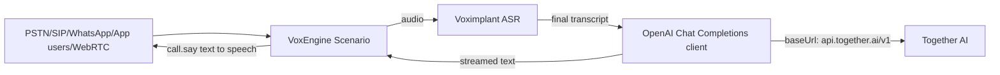

<blockquote className="agent-directive">
  For the complete documentation index, see <a href="/llms.txt">llms.txt</a>.
</blockquote>

## Overview

This full-cascade example answers an incoming call, transcribes caller speech with Voximplant ASR, sends the final transcript to Together AI through the OpenAI-compatible Chat Completions interface, and speaks the completed response back into the call.

Use this pattern when you want to keep Voximplant call control, ASR, and TTS in VoxEngine and call a third-party LLM provider that exposes an OpenAI-compatible Chat Completions API.

**⬇️ Jump to the [Full VoxEngine scenario](#full-voxengine-scenario).**

This example:
1. answers an incoming call
2. transcribes caller speech via Voximplant's built-in [ASR module](/reference/voxengine/asr)
3. sends each final transcript to Together AI through `OpenAI.createChatCompletionsAPIClient()`
4. logs streamed text deltas
5. speaks the completed response back to the caller via Voximplant's default TTS provider

## Prerequisites

- A [Together AI account](https://api.together.ai/) with active billing or credits.
- A serverless Together AI model that supports Chat Completions, for example `meta-llama/Llama-3.3-70B-Instruct-Turbo`.
- Store the Together AI API key in Voximplant [Secrets](/platform/storage/secret-storage) under `TOGETHER_API_KEY`.
- Create a Voximplant routing rule that points your test destination to this scenario.

## Architecture

## How it works

- The scenario reads `TOGETHER_API_KEY` from Voximplant Secrets.
- `baseUrl` points the OpenAI Chat Completions client at Together AI's OpenAI-compatible API root.
- `model` uses a Together AI serverless model name.
- VoxEngine ASR turns caller speech into text for the Chat Completions request.
- Streamed content deltas are logged as `===LLM_DELTA===`.
- The final response is logged as `===LLM_DONE===` and played back into the call with `call.say()`.

<Warning>
    Modern Voice AI flows utilize turn detection and more sophisticated speech engines.
    See the [Responses API example](/voice-ai/bring-your-own-llm/full-cascade-groq) for a more advanced flow that utilizes Voximplant's turn detection and external speech integrations for improved speech quality and interactivity.
</Warning>

## Usage highlights

- Create an OpenAI Chat Completions client with `OpenAI.createChatCompletionsAPIClient(...)`.
- Set `baseUrl: "https://api.together.ai/v1"` so the VoxEngine OpenAI module sends requests to Together AI.
- Use a Together model name in the `model` field instead of an OpenAI model name.
- Keep conversation state in the scenario by appending user and assistant messages to the local `messages` array.
- Use `call.say()` for a simple example response path. For lower latency and provider-specific voice selection, use a streaming TTS module instead.

## Full VoxEngine scenario

<Code
  src="../../../examples/openai/voxeengine-openai-compatible-chat.js"
  title="voxeengine-openai-compatible-chat.js"
  language="javascript"
  maxLines={0}
/>

## More info

- OpenAI module API: https://voximplant.com/docs/references/voxengine/openai
- ASR module API: https://voximplant.com/docs/references/voxengine/asr
- Voximplant Secrets: [Secret storage](/platform/storage/secret-storage)
- Together AI documentation: https://docs.together.ai/
