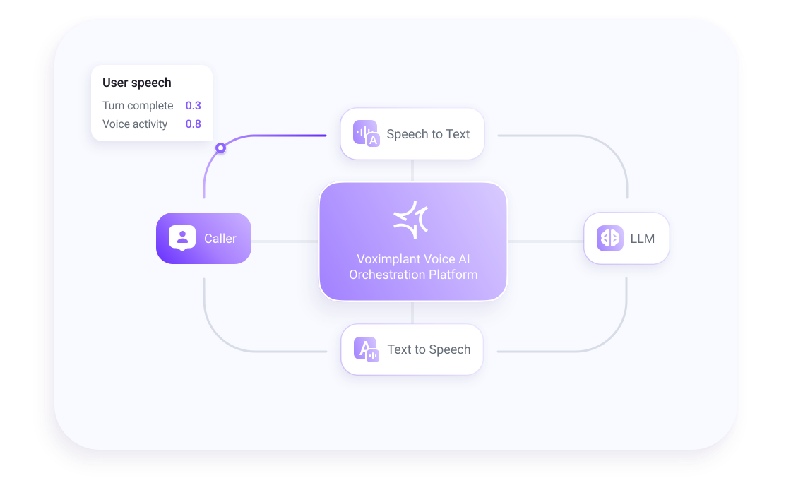

<blockquote className="agent-directive">
  For the complete documentation index, see <a href="/llms.txt">llms.txt</a>.
</blockquote>

## Overview

This full-cascade example demonstrates:
1. A full cascade Voice AI pipeline with independent Speech-to-Text (STT), Large Language Model (LLM), and Text-to-Speech (TTS) components
2. Third-party LLM calls via OpenAI compatibility mode in the VoxEngine OpenAI module
3. Turn taking with barge-in and end-of-turn detection to keep interactions natural and responsive

This specific example uses Deepgram for STT with custom vocabulary,
Groq's OpenAI-compatible Responses API via `llama-3.3-70b-versatile` for the LLM,
and Inworld for low-latency, streaming TTS.
These can be changed out for any supported VoxEngine modules or external APIs as needed.

**⬇️ Jump to the [Full VoxEngine scenario](#full-voxengine-scenario).**

## Prerequisites

- Store your Groq API key in Voximplant [Secrets](/platform/storage/secret-storage) under `GROQ_API_KEY`.
- The example imports `Modules.Agentic` and creates [VoiceDSP](/voice-ai/speech-flow-control/agentic-voicedsp) directly; no preceding helper scenario is required.

## How it works

- Deepgram transcribes caller audio with interim and final transcripts.
- `Agentic.createVoiceDSP({ asr: stt, ... })` receives the same Deepgram ASR instance used for call media. It bundles VAD and Smart Turn. `TurnStopped.content` carries the latest transcript after the configured 0.3-second ASR grace window; the sample submits one request from that event.
- The scenario sends completed user turns to Groq through `OpenAI.createResponsesAPIClient({ baseUrl: "https://api.groq.com/openai/v1" })`.
- Caller audio is sent independently to Deepgram ASR and VoiceDSP. Response text deltas are streamed into Inworld TTS and played back into the call. Optional Inworld credentials can use Voximplant provider billing when omitted.

## Full-cascade BYO LLM pattern

In a production full-cascade voice AI pipeline, you usually combine:

1. STT for caller transcription.
2. Turn-taking logic to decide when the caller has finished speaking.
3. Chat Completions or Responses for the LLM.
4. Realtime TTS for generated speech.
5. Barge-in handling to stop agent speech when the caller interrupts.

The complete scenario below implements this flow with VoiceDSP. `TurnStarted` clears TTS and marks pending LLM output as discarded. `TurnStopped` submits the transcript; `TurnInferenceTriggered` is logged rather than used for a second request because it carries no transcript. A newer completed user turn replaces the queued turn while an older Responses request completes silently. Both late text deltas and completion events from the interrupted response are ignored. The Responses adapter has no per-response cancellation method; provider inference is not cancelled.

The first accepted text delta signals `signalAssistantTurnStarted()`. After text completion and the next `AudioChunksPlaybackFinished`, the scenario calls `signalAssistantTurnEnded()`. Intermediate playback completions and `ResponseCompleted` do not mark the assistant idle. `TurnIdle` terminates only when no user turn, request, or assistant playback is active.

On call failure, disconnect, ASR/Responses/VoiceDSP/TTS error, or the three-minute demo deadline, the sample closes its clients and stops ASR/TTS. Resources that finish asynchronous setup after hangup are closed immediately.

## Notes

- This example uses an **OpenAI-compatible API**, not OpenAI's own hosted Responses API. The VoxEngine OpenAI module still works because the Groq endpoint follows the same request and event model closely enough for this flow.
- Groq's current Responses API support is still limited relative to OpenAI's full stored-context flow. In practice, you should not assume support for features such as `previous_response_id` or `storeContext`. This example keeps each turn independent to stay simple and predictable.
- If you need multi-turn memory with Groq, manage conversation history locally and resend the full structured input on each request.
- The included prompt is intentionally short for example readability. Text-expecting models such as Llama usually behave better with a more explicit system prompt that tightly defines tone, grounding, brevity, ambiguity handling, and how to respond to partial caller fragments.
- Configure bundled VAD, Smart Turn, transcript grace, interruption, and idle behavior through [Agentic VoiceDSP](/voice-ai/speech-flow-control/agentic-voicedsp). It is a VoxEngine module, so the scenario is self-contained.

## More info

- [OpenAI module](/reference/voxengine/openai)
- [VoiceDSP](/reference/voxengine/agentic/voice-dsp)
- [VoiceDSP events](/reference/voxengine/agentic/voice-dsp-events)
- [Inworld module](/reference/voxengine/inworld)
- [Deepgram ASR profiles](/reference/voxengine/asr-profile-list/deepgram)

## Full VoxEngine scenario

<Code
  src="../../../examples/openai/voxeengine-full-cascade-dg-groq-iw.js"
  title="voxeengine-full-cascade-dg-groq-iw.js"
  language="javascript"
  maxLines={0}
/>
