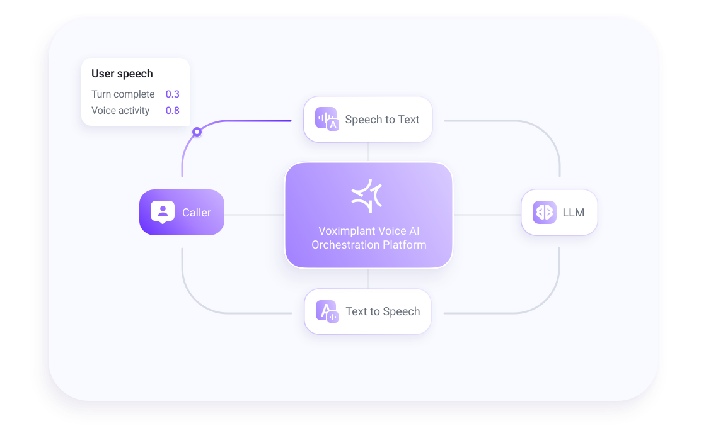

<blockquote className="agent-directive">
  For the complete documentation index, see <a href="/llms.txt">llms.txt</a>.
</blockquote>

## Overview

This cascaded pipeline uses separate components for each stage:

1. Microsoft streaming speech recognition transcribes caller audio.
2. Grok processes completed user turns through VoxEngine's OpenAI-compatible Responses client.
3. Grok realtime TTS turns the response text into speech.
4. [Agentic VoiceDSP](/voice-ai/speech-flow-control/agentic-voicedsp) coordinates speech detection, end-of-turn detection, and barge-in.

The sample uses the `grok-4.7` text model at `https://api.x.ai/v1`. Change `GROK_MODEL` to another [Responses-compatible model](https://docs.x.ai/developers/models) available to your xAI account when needed. STT, reasoning, and TTS can each be replaced with another supported provider.

<Note>
For a direct speech-to-speech integration, use the [Grok voice agent](/voice-ai/xai/overview). For standalone speech output without STT or an LLM, see [xAI realtime TTS](/voice-ai/speech/grok-tts).
</Note>

Jump to the [Full VoxEngine scenario](#full-voxengine-scenario).

## Prerequisites

- Create a [VoxEngine scenario](/platform/getting-started/create-a-scenario) and route an incoming call to it through an application's [routing rule](/platform/getting-started/create-a-routing-rule).
- Store an xAI API key with Responses API access in Voximplant [Secrets](/platform/storage/secret-storage) as `XAI_API_KEY`. This key is required for the LLM; the scenario also uses it for TTS.
- The example imports `Modules.Agentic` and creates VoiceDSP directly; no preceding helper scenario is required.

## How it works

- After the call connects, the scenario creates Microsoft ASR with interim results and phrase hints.
- It creates `OpenAI.createResponsesAPIClient({ baseUrl: "https://api.x.ai/v1" })`. Voximplant handles provider requests and exposes Responses events through the client.
- `Agentic.createVoiceDSP({ asr: stt, ... })` receives the same Microsoft ASR instance used for call media. VAD starts a user turn; Smart Turn ends it. `TurnStopped.content` supplies the latest transcript snapshot after the configured 0.3-second ASR grace window. The sample waits for this event instead of sending duplicate requests from `TurnInferenceTriggered`, which carries no transcript.
- `ResponseTextDelta` events supply text to `XAI.createRealtimeTTSPlayer()`. `ResponseTextDone` sends `text.done` to finish the TTS utterance.
- Caller media flows independently to ASR and VoiceDSP. VoiceDSP does not replace Microsoft transcription. TTS media flows back to the caller. Noise suppression is omitted.
- A greeting request starts the conversation. `storeContext: true` lets the Responses connector maintain context across requests.

## Barge-in and response lifecycle

When VoiceDSP emits `TurnStarted`, the scenario marks the caller as speaking and invalidates any pending response, including one that has not produced speech yet. The scenario calls `ttsPlayer.clearBuffer()`, which sends `text.clear` and clears queued playback. It also marks the current LLM response as discarded. Both late text deltas and late text completion events are ignored.

The current VoxEngine Responses client exposes `createResponses()` and `close()`, with no per-response cancellation method. The sample lets the interrupted request finish silently and queues the next completed user turn until `ResponseCompleted`. This prevents an old response from resuming when a later user turn ends. It does not cancel provider inference or its billing.

Requests are serialized, and a newer completed user turn replaces any queued turn. On call failure, disconnect, ASR, Responses, VoiceDSP, or TTS error, or the three-minute demo deadline, the scenario closes the Responses client and VoiceDSP, stops ASR and TTS, and terminates. If the caller hangs up during asynchronous setup, the newly created resource is closed when setup resolves.

## Playback and idle tracking

The first accepted text delta signals `signalAssistantTurnStarted()` as text is queued for speech. `ResponseCompleted` is the end of inference, not the end of playback. After `ResponseTextDone`, the next `AudioChunksPlaybackFinished` signals `signalAssistantTurnEnded()`. Intermediate chunk completions do not mark the assistant idle. Interruption clears TTS and ends that assistant turn immediately. The 30-second `TurnIdle` event ends the demo only when no user turn, response request, or assistant playback is active.

## Developer notes

- The prompt requests short, speakable text and occasional [xAI speech tags](https://docs.x.ai/developers/model-capabilities/audio/text-to-speech#speech-tags), such as `[pause]` or `<emphasis>...</emphasis>`.
- The TTS adapter uses PCM at 16 kHz. Configure `voice`, `language`, and the documented [connection options](/voice-ai/speech/grok-tts#connection-options).
- The sample logs Responses lifecycle events and TTS time to first byte. Use these logs when checking your own account and model; they do not replace listening to a test call.

## Full VoxEngine scenario

<Code
  src="../../../examples/grok/voxeengine-grok-full-cascade.js"
  title="voxeengine-grok-full-cascade.js"
  language="javascript"
  maxLines={0}
/>

## More info

- [xAI realtime TTS guide](/voice-ai/speech/grok-tts)
- [OpenAI Responses API client](/reference/voxengine/openai#responsesapiclient)
- [XAI.RealtimeTTSPlayer](/reference/voxengine/xai/realtime-tts-player)
- [VoxEngine.createASR](/reference/voxengine/voxengine#createasr)
- [Agentic VoiceDSP](/voice-ai/speech-flow-control/agentic-voicedsp)
- [PlayerEvents](/reference/voxengine/player-events)
- [xAI Responses API](https://docs.x.ai/developers/model-capabilities/text/generate-text)
