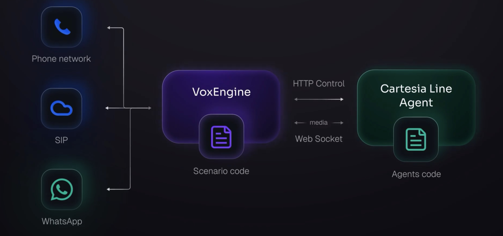

<blockquote className="agent-directive">
  For the complete documentation index, see <a href="/llms.txt">llms.txt</a>.
</blockquote>


This example answers an incoming call, connects it to Cartesia Line Agents, and uses an HTTP callback for tool actions (`end_call`, `call_transfer`).

**Jump to the [Full VoxEngine scenario](#full-voxengine-scenario).**

## Prerequisites

- Set up an incoming entrypoint for the caller:
  - [Phone number](/platform/getting-started/buy-a-phone-number)
  - [WhatsApp](/voice-ai/network-options/whatsapp)
  - [SIP user / SIP registration](/voice-ai/network-options/sip)
  - [App user](/platform/getting-started/create-users)
- Create a [routing rule](/platform/getting-started/create-a-routing-rule) that points the destination (phone number / WhatsApp / SIP username / app user alias) to this scenario.
- Deploy a Cartesia Line Agent script that sends HTTP callbacks to VoxEngine for tool actions (see the [Cartesia agent example](#cartesia-agent-example-python)).
- Store your [Cartesia API key](https://play.cartesia.ai/keys) in Voximplant [Secrets](/platform/storage/secret-storage) under `CARTESIA_API_KEY`
- Store your [Cartesia Agent ID](https://play.cartesia.ai/agents) in Voximplant `ApplicationStorage` under `CARTESIA_AGENT_ID` (the agent ID is not sensitive, so it can live in key-value storage)
- Ensure your scenario can place outgoing PSTN calls with a verified caller ID (used by transfer) - see [How can I enable Caller ID for outgoing calls](https://voximplant.com/help/faq/how-can-i-enable-caller-id-for-outbound-calls)
- Store a valid outgoing caller ID in Voximplant `ApplicationStorage` under `PSTN_CALLER_ID` for transfer PSTN dialing

## Session setup

This setup is similar to the incoming example, with one extra control-plane step for tools:

1. `AppEvents.Started`: capture per-call `accessSecureURL` as `sessionControlUrl`.
2. `AppEvents.CallAlerting`: answer the incoming call and (optionally) start recording.
3. Create `Cartesia.AgentsClient` from `ApplicationStorage`.
4. Bridge media between caller leg and Cartesia.
5. Start Cartesia session with any metadata to pass to the agent, including `vox_session_control_url`.

## Functional call execution

### Architecture

Cartesia Line Agent currently provides limited controls over its WebSocket interface. Use VoxEngine's `AppEvents.HttpRequest` as a callback endpoint so the Cartesia Agent can request telephony actions (call transfer, hang up) in VoxEngine.
This allows the Line Agent to orchestrate complex call control flows while VoxEngine retains ownership
of telephony actions and routing decisions.




### HTTP control model

This scenario uses the following control-plane pattern:

1. VoxEngine gets a unique `accessSecureURL` in `AppEvents.Started`.
2. VoxEngine passes that URL to Cartesia in `metadata.vox_session_control_url`.
3. Cartesia Python tool handlers `POST` actions such as `{"action":"end_call"}` or `{"action":"call_transfer"}`.
4. VoxEngine receives those requests in `AppEvents.HttpRequest` and executes telephony actions.

## How the scenario uses `AppEvents.HttpRequest`

`AppEvents.HttpRequest` is the handoff point where Cartesia tool decisions become telephony actions:

1. Cartesia sends an HTTPS `POST` to the per-call `vox_session_control_url`.
2. VoxEngine receives request content in `appEvent.content`.
3. Scenario parses JSON and switches on `cmd.action`.
4. Scenario executes telephony action (`hangup`, `callTransfer`, bridge).
5. Scenario returns a JSON string response (`{"ok": true}`) to acknowledge receipt.

Expected request payloads:

- `{"action":"end_call"}`
- `{"action":"call_transfer","summary":"optional short summary"}`

Minimal response payload:

- `{"ok": true}`

### Passing the control URL and metadata to Cartesia
Pass the control URL and related call metadata to Cartesia when you start the session.

```js title="Session control URL + start metadata"
VoxEngine.addEventListener(AppEvents.Started, (appEvent) => {
  sessionControlUrl = appEvent.accessSecureURL;
});

voiceAIClient.start({
  metadata: {
    from: call.callerid(),
    to: call.number(),
    vox_session_control_url: sessionControlUrl
  }
});
```
### Handling control actions in `AppEvents.HttpRequest`

```js title="HTTP control handler"
VoxEngine.addEventListener(AppEvents.HttpRequest, (appEvent) => {
  const cmd = JSON.parse(appEvent.content);
  if (cmd.action === "end_call") {
    callerLeg.hangup();
    voiceAIClient?.close();
    VoxEngine.terminate();
  } else if (cmd.action === "call_transfer") {
    callTransfer(cmd);
  }
  return JSON.stringify({ ok: true });
});
```

## High-level flows

### Hang-up flow (`end_call`)

1. Caller asks to end the call.
2. Cartesia Python agent runs `end_call()` and posts `{"action":"end_call"}`.
3. VoxEngine `AppEvents.HttpRequest` receives the action.
4. Scenario hangs up caller leg, closes Cartesia websocket, and terminates the session.

### Transfer flow (`call_transfer`)

1. Caller asks to transfer to a human.
2. Cartesia Python agent sends transfer confirmation, then posts `{"action":"call_transfer","summary":"..."}`.
3. VoxEngine `AppEvents.HttpRequest` calls `callTransfer(...)`.
4. Scenario detaches caller from Cartesia (`stopMediaBetween` + websocket close), which makes this a blind transfer handoff pattern.
5. The scenario dials the consult PSTN call with `VoxEngine.callPSTN(...)` and `PSTN_CALLER_ID`.
6. On consult answer, scenario bridges caller to consult leg with `VoxEngine.sendMediaBetween(callerLeg, consultLeg)`.
7. If consult call fails, scenario logs failure and hangs up caller leg.


## Cartesia agent example (Python)

The full Cartesia Line Python agent example used with this callback pattern:

<Code
  src="../../../examples/cartesia-line-agents/cartesia-line-tools-agent.py"
  title="cartesia-line-tools-agent.py"
  language="python"
  maxLines={0}
/>

This Python sample expects `metadata.vox_session_control_url` and uses it to call back into VoxEngine.

## Notes

**Voximplant**
- [Voximplant Cartesia module API reference](/reference/voxengine/cartesia)
- [Working with API requests guide](/reference/voxengine/api-requests)
- [HTTP Callback guide](/reference/management-api/callbacks)

**Cartesia**
- Cartesia Line Agents documentation: https://docs.cartesia.ai/line/introduction
- Cartesia Line web calls event model: https://docs.cartesia.ai/line/integrations/websocket-api

## Full VoxEngine scenario

<Code
  src="../../../examples/cartesia-line-agents/voxeengine-cartesia-tools.js"
  title="voxeengine-cartesia-tools.js"
  language="javascript"
  maxLines={0}
/>
