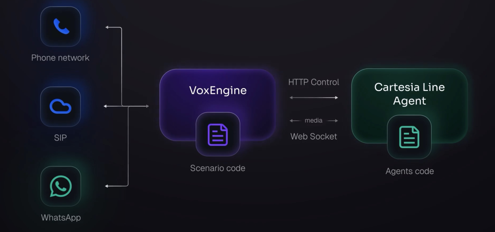

<blockquote className="agent-directive">
  For the complete documentation index, see <a href="/llms.txt">llms.txt</a>.
</blockquote>

## Benefits

The native Cartesia module connects Voximplant calls to Cartesia Line Agents for real-time, speech-to-speech conversations.
This allows one agent design to power calls across SIP trunks, WhatsApp, PSTN numbers, and app users while VoxEngine keeps call routing and control.

Capability and feature highlights:

- Connect inbound and outbound calls to one Cartesia Line Agent
- Bi-directional media streaming with telephony-ready audio format support
- Barge-in support via clear events and media buffer control
- Real-time agent events for ACK, custom metadata, DTMF, and diagnostics

## Demo video

Cartesia Line Agents demo:

Video link: [Cartesia Line Agents demo](https://www.youtube.com/watch?v=5tg83Xl2p5M)

<llms-ignore>
<iframe
  width="100%"
  height="360"
  src="https://www.youtube.com/embed/5tg83Xl2p5M"
  title="Cartesia Line Agents demo"
  frameBorder="0"
  allow="accelerometer; autoplay; clipboard-write; encrypted-media; gyroscope; picture-in-picture; web-share"
  allowFullScreen
/>
</llms-ignore>

## Architecture

## Prerequisites
- Create a Cartesia Line Agent in the [Cartesia Voice Agents portal](https://play.cartesia.ai/agents).
- Cartesia API key from the [Cartesia Platform portal](https://play.cartesia.ai/keys).
- Cartesia agent ID from the [Cartesia Voice Agents portal](https://play.cartesia.ai/agents).

## Development notes

- **Native VoxEngine module**: load `require(Modules.Cartesia)` and create a `Cartesia.AgentsClient` via `Cartesia.createAgentsClient({ apiKey, agentId, cartesiaVersion, ... })`.
- **Line Agent → VoxEngine coordination**: handle `AppEvents.HttpRequest` in your scenario to process `POST` messages sent by your Cartesia Line script for tool-call orchestration and routing decisions.
- **VoxEngine → Line Agent configuration**: pass telephony context and callback endpoints to Line using the `metadata` object in `client.start({ ... })` so the agent can request out-of-band actions from VoxEngine.
- **Barge-in and turn-taking**: interruption behavior between caller/callee and the agent is managed by the Line Agent runtime; no additional VAD or turn-taking configuration is required in VoxEngine.
- **Telephony tools for Voximplant-controlled routing**: Line built-ins like `end_call` and `transfer_call` are designed for Line-native calling flows. For Voximplant-owned flows (warm transfer, SIP handoff, post-call survey), define passthrough tools in Line that signal VoxEngine out-of-band, then execute the telephony action in VoxEngine.

The [Function Calling example](/voice-ai/cartesia/function-calling) demonstrates how to use the HTTP callback pattern for Line → VoxEngine control.
See the [Cartesia module API reference](/reference/voxengine/cartesia) for all methods and events.

## Examples

- [Example: Answering an incoming call](/voice-ai/cartesia/inbound)
- [Example: Placing an outbound call](/voice-ai/cartesia/outbound)
- [Example: Function calling](/voice-ai/cartesia/function-calling)

## Links

### Voximplant
- Cartesia Line Agents client product page: https://voximplant.com/products/cartesia-agents-client
- [Cartesia module API reference](/reference/voxengine/cartesia)
- Voice AI product overview: https://voximplant.ai/

### Cartesia

- Cartesia Line docs: https://docs.cartesia.ai/line
- Cartesia CLI deployment: https://docs.cartesia.ai/line/cli
- Web calls integration: https://docs.cartesia.ai/line/integrations/websocket-api
