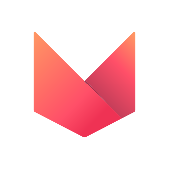

<blockquote className="agent-directive">
  For the complete documentation index, see <a href="/llms.txt">llms.txt</a>.
</blockquote>

Choose a connector based on your preferred model provider and feature set. Every connector page includes an overview, architecture notes, and code-first VoxEngine examples.

<llms-only>
## Connector directory

- [OpenAI](/voice-ai/openai/overview): direct realtime, full-cascade, and half-cascade voice pipelines.
- [Gemini Live](/voice-ai/google/overview): direct Gemini API or Vertex AI credentials with translation support.
- [Ultravox](/voice-ai/ultravox/overview): speech-native voice AI with incoming, outgoing, and function calling examples.
- [ElevenLabs agents](/voice-ai/elevenlabs/overview): conversational agents for PSTN, SIP, WebRTC, and WhatsApp flows.
- [Cartesia Line agents](/voice-ai/cartesia/overview): line-agent runtime pattern for real-time calls and tool handling.
- [Inworld Realtime](/voice-ai/inworld/overview): speech-to-speech sessions with Inworld STT, an LLM, and TTS-2 output.
- [Deepgram agents](/voice-ai/deepgram/overview): Deepgram Voice Agent integration with context history support.
- [Grok voice agent](/voice-ai/xai/overview): xAI Grok realtime voice integration with feature-control examples.
- [Qwen Cloud](/voice-ai/qwen/overview): direct realtime speech-to-speech with qwen-audio-3.1-realtime-plus.
- [Jev](/voice-ai/jev/overview): TypeSafe System One structured decisions over text. Not a realtime voice pipeline.
</llms-only>

  <a className="voice-connector-card" href="/voice-ai/openai/overview">
    
      
    
    <h3>OpenAI</h3>
    
OpenAI and OpenAI-compatible APIs with direct realtime, full-cascade, and half-cascade voice pipelines.

    Incoming | Outgoing | Function calling | <wbr /> Full-cascade | Half-cascade
  </a>

  <a className="voice-connector-card" href="/voice-ai/google/overview">
    
      
    
    <h3>Gemini Live</h3>
    
Gemini live audio sessions with support for direct Gemini API or Vertex AI credentials.

    Incoming | Outgoing | Function calling | <wbr /> Vertex | Speech translation
  </a>

  <a className="voice-connector-card" href="/voice-ai/ultravox/overview">
    
      
    
    <h3>Ultravox</h3>
    
Speech-native voice AI with examples for incoming, outgoing, and tool-driven interactions.

    Incoming | Outgoing | Function calling
  </a>

  <a className="voice-connector-card" href="/voice-ai/elevenlabs/overview">
    
      
    
    <h3>ElevenLabs agents</h3>
    
Connect ElevenLabs conversational agents to PSTN, SIP, WebRTC, and WhatsApp call flows.

    Incoming | Outgoing | Function calling
  </a>

  <a className="voice-connector-card" href="/voice-ai/cartesia/overview">
    
      
    
    <h3>Cartesia Line agents</h3>
    
Line-agent runtime pattern for real-time calls, tool handling, and external business logic.

    Incoming | Outgoing | Function calling
  </a>

  <a className="voice-connector-card" href="/voice-ai/inworld/overview">
    
      
    
    <h3>Inworld Realtime</h3>
    
Speech-to-speech sessions with Inworld speech recognition, an LLM, and TTS-2 output.

    Incoming | Outgoing | Function calling
  </a>

  <a className="voice-connector-card" href="/voice-ai/deepgram/overview">
    
      
    
    <h3>Deepgram agents</h3>
    
Deepgram Voice Agent integration with support for context history in ApplicationStorage.

    Incoming | Outgoing | Function calling
  </a>

  <a className="voice-connector-card" href="/voice-ai/xai/overview">
    
      
    
    <h3>Grok voice agent</h3>
    
xAI Grok real-time voice integration with examples for core calls and connector-specific features.

    Incoming | Outgoing | Feature controls
  </a>

  <a className="voice-connector-card" href="/voice-ai/qwen/overview">
    
      
    
    <h3>Qwen Cloud</h3>
    
Direct realtime speech-to-speech with the Qwen audio model, including incoming, outgoing, and function calling.

    Incoming | Outgoing | Function calling
  </a>

## Structured decisions

Jev is not a realtime voice connector. It returns typed answers from text you send in a request, and it does not take call audio.

  <a className="voice-connector-card compact" href="/voice-ai/jev/overview">
    <h3>Jev</h3>
    
TypeSafe System One decisions for routing, triage, and scoring.

  </a>

## Common capabilities across connectors

- Route calls from PSTN, SIP, WebRTC, or WhatsApp through VoxEngine.
- Bridge call media to a provider connector in real time.
- Handle barge-in by clearing connector output when user speech starts.
- Implement tool/function execution for CRM actions, transfers, scheduling, or custom workflows.
- Store provider API keys in Voximplant [Secrets](/platform/storage/secret-storage) and keep examples production-safe.
