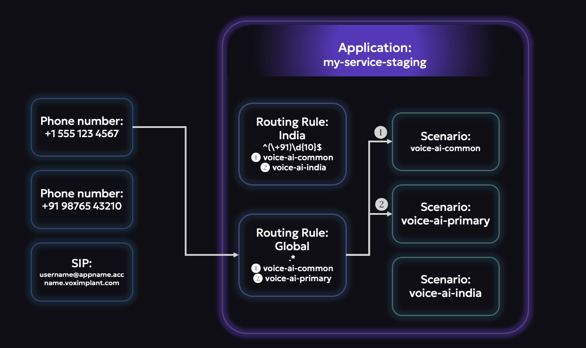
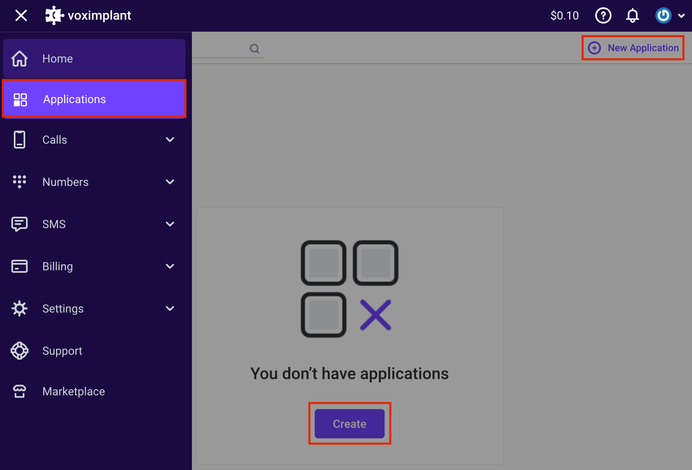
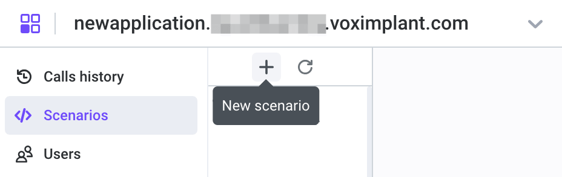
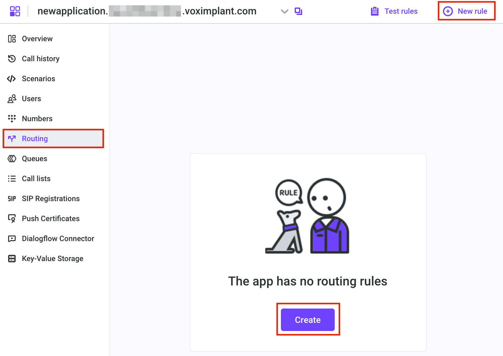
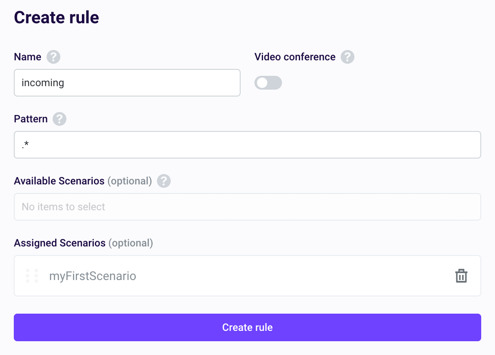
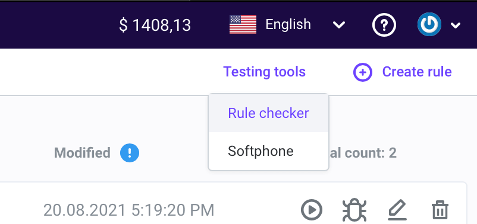
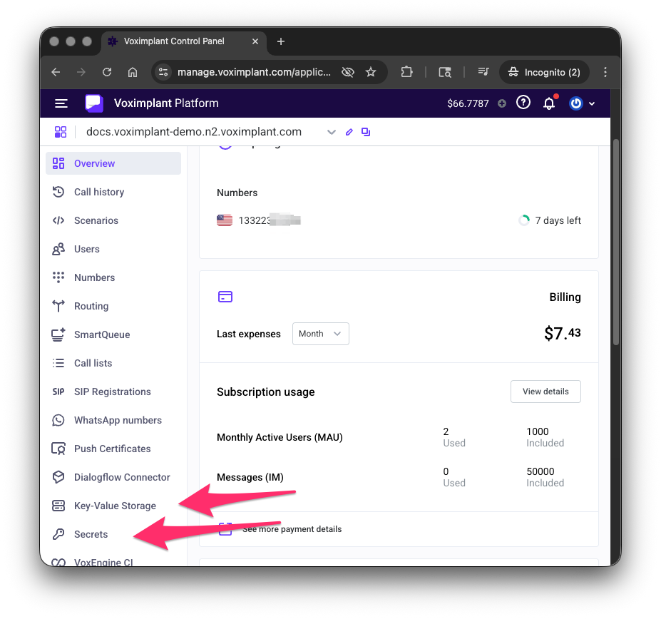

<blockquote className="agent-directive">
  For the complete documentation index, see <a href="/llms.txt">llms.txt</a>.
</blockquote>


VoxEngine setup is centered on three components:

- `Applications`: top-level containers for each environment
- `Scenarios`: JavaScript programs that control calls
- `Routing rules`: destination patterns that trigger scenarios



For your first project, we recommend configuring one application first, adding one scenario, and attaching a single routing rule that can receive test traffic.
you can start by doing this via Voximplant's Control Panel (`manage.voximplant.com`) and later use the management API to do this programmatically.

## Setup order

<Steps>
  <Step title="[Create an account](#create-an-account)" />
  <Step title="[Create an application](#create-an-application)" />
  <Step title="[Create a scenario](#create-a-scenario)" />
  <Step title="[Setup routing](#setup-routing)" />
  <Step title="[Application Storage](#application-storage)" />
</Steps>


<a id="create-an-account"></a>
## <Icon icon="fa-duotone fa-user-plus" /> Create an account

Use `manage.voximplant.com` to configure applications, scenarios, routing, channels, and storage.

<Steps>
  <Step title="Open manage.voximplant.com">
    Go to [manage.voximplant.com](https://manage.voximplant.com).
  </Step>
  <Step title="Sign in or create an account">
    Sign in with your existing account, or create a new one at [Sign up](https://manage.voximplant.com/auth/sign_up).
  </Step>
  <Step title="Verify access">
    After login, confirm you can access the application list and project navigation.
  </Step>
</Steps>

<Button href="https://manage.voximplant.com/auth/sign_up" intent="success" large full >
    <strong>Sign up for a Voximplant account</strong>
</Button>

<a id="create-an-application"></a>
## <Icon icon="../../../assets/getting-started/icon-application-grid.svg" /> Create an application

A Voximplant application is the top-level container for a task or environment. It holds scenarios, users, routing rules, and attached numbers.

<Steps>
  <Step title="Open Applications">
    In Control Panel, open **Applications**.
  </Step>
  <Step title="Create a new application">
    Click **New application** (or **Create** from the empty state).
    
  </Step>
  <Step title="Name and save the application">
    Set the application name (for example `voice-ai-staging`) and create it.
  </Step>
</Steps>


Use different applications for projects that do not share the same Voximplant resources - `prod-agent-global` vs. `new-agent-prototype` -
or for intentional isolation - such as `voice-ai-staging` vs. `voice-ai-production`.

#### <icon icon="fa-duotone fa-solid fa-link" /> More information:
- [Applications setup guide](/platform/getting-started/create-an-application)
- [Applications HTTP API reference](/reference/management-api/reference/applications)

<a id="create-a-scenario"></a>
## <Icon icon="fa-duotone fa-code" /> Create a scenario

Scenarios are JavaScript documents inside an application. VoxEngine executes them when a routing rule matches.

<Steps>
  <Step title="Open your application" />
  <Step title="Go to Scenarios">
    Select **Scenarios**.
  </Step>
  <Step title="Create a scenario">
    Click the plus button to create a scenario.
    
  </Step>
  <Step title="Name and paste code">
    Name the scenario and paste your example code.
  </Step>
</Steps>

We recommend that you keep scenario names short and specific since there are situations where you may use this channel
name elsewhere (like with SIP routing).

#### <icon icon="fa-duotone fa-solid fa-link" /> More information:
- [Scenarios setup guide](/platform/getting-started/create-a-scenario)
- [Scenarios HTTP API reference](/reference/management-api/reference/scenarios)

<a id="setup-routing"></a>
## <Icon icon="../../../assets/getting-started/icon-routing-split.svg" /> Setup routing

Routing rules decide which scenario starts for an incoming destination or a manually triggered outbound flow. For example,
`^(\+91)\d{10}$` could go to an India-specific voice AI scenario, while `^(\+1)\d{10}$` could go to a US-specific one.

<Steps>
  <Step title="Open Routing">
    Open your application and go to **Routing**.
    
  </Step>
  <Step title="Create a rule">
    Click **Create** / **New rule**.
    
  </Step>
  <Step title="Set rule and pattern">
    Set a rule name and a destination pattern.
  </Step>
  <Step title="Attach scenarios">
    Attach one or more scenarios in priority order.
  </Step>
  <Step title="Save">
    Save the rule.
  </Step>
</Steps>


<Note>
    For your first rule, we recommend a using `.*` to matches all destinations. You can create more specific rules later as needed.
</Note>

Regular Expression pattern basics:

- `.*` matches any destination (good as a starting point & fallback)
- `+?[1-9]\d{1,14}` matches E.164-style numbers
- `123.+` matches destinations starting with `123`

Routing evaluation is top-to-bottom. The first matching rule is used.

As you get more advanced with more unique situations, you can consider patterns such as:

- One explicit test rule with a unique alias/pattern
- One fallback global rule (`.*`) below it

Voximplant also includes a rule check that will help verify  your patterns.


#### <icon icon="fa-duotone fa-solid fa-link" /> More information:
- [Routing rules setup guide](/platform/getting-started/create-a-routing-rule)
- [Routing rules HTTP API reference](/reference/management-api/reference/rules)

<a id="application-storage"></a>
## <Icon icon="../../../assets/getting-started/icon-application-storage.svg" /> Application Storage and Secrets

Voximplant provides two separate stores for every application:

- **Secrets** — for sensitive values such as API keys, tokens, and passwords. Use `VoxEngine.getSecretValue('<name>')` to read them.
- **Application Storage** (`ApplicationStorage`) — a key-value store for small non-sensitive config values like destination numbers, feature flags, and shared counters across scenario instances.

The examples in this guide use **Secrets** to hold API keys for external services (for example `OPENAI_API_KEY`) and `ApplicationStorage` for non-sensitive config.




Example:

```js title="Read a secret and a config value"
require(Modules.ApplicationStorage);
const apiKey = VoxEngine.getSecretValue('OPENAI_API_KEY');
const calleeDestination = (await ApplicationStorage.get("CALLEE_DESTINATION")).value;
```


#### <icon icon="fa-duotone fa-solid fa-link" /> More information:
- [Secrets guide](/platform/storage/secret-storage)
- [ApplicationStorage VoxEngine API reference](/reference/voxengine/application-storage)
- [Voximplant key-value storage announcement blog](https://voximplant.com/blog/voximplant_key_value_storage)
