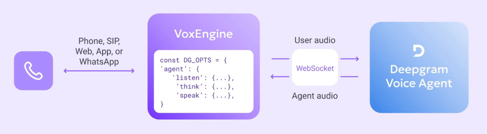

<blockquote className="agent-directive">
  For the complete documentation index, see <a href="/llms.txt">llms.txt</a>.
</blockquote>

## Benefits

The native Deepgram module connects any Voximplant call to Deepgram’s Voice Agent API for real-time, speech‑to‑speech conversations.
The integration supports bi-directional audio from phone numbers, SIP trunks, WhatsApp, or WebRTC into Deepgram’s unified agent environment (STT + LLM + TTS)
and play responses via Voximplant’s serverless runtime with minimal latency.

Capability and feature highlights:

- Delivered as a Voice AI Connector inside VoxEngine: you define Deepgram STT, LLM, and TTS parameters; Voximplant handles telephony, media conversion, and streaming WebSockets.
- Fully exposes Deepgram speech recognition, a wide variety of LLM models, and speech synthesis options from Deepgram and partners.
- Bridge PSTN, SIP, WebRTC, or WhatsApp calls into Deepgram Voice Agent using a single VoxEngine scenario.
- Keep conversations natural with low-latency turn‑taking and barge‑in.
- Apply and update agent configuration mid-call.
- Subscribe to Voice Agent events (for example `AgentThinking` and `History`).
- Handle function calls for external integrations.

## Demo video

Deepgram Voice Agent on Voximplant: Enterprise-ready Voice AI Phone Calls with Context Memory

Video link: [Deepgram Voice Agent on Voximplant](https://www.youtube.com/watch?v=cAmOmfxoTTA)

<llms-ignore>
<iframe
  width="100%"
  height="360"
  src="https://www.youtube.com/embed/cAmOmfxoTTA"
  title="Deepgram Voice Agent on Voximplant: Enterprise-ready Voice AI Phone Calls with Context Memory"
  frameBorder="0"
  allow="accelerometer; autoplay; clipboard-write; encrypted-media; gyroscope; picture-in-picture; web-share"
  allowFullScreen
/>
</llms-ignore>

## Architecture

## Prerequisites

- Deepgram account in the [Deepgram console](https://console.deepgram.com/) (create one at [signup](https://console.deepgram.com/signup) if needed).
- Deepgram API key from the [Deepgram console](https://console.deepgram.com/).

## Development notes

- **Native VoxEngine module**: load with `require(Modules.Deepgram)` and create a `Deepgram.VoiceAgentClient` via `Deepgram.createVoiceAgentClient(...)`.
- **Session setup**: pass Deepgram’s Voice Agents settings object to specify `agent.listen` (STT), `agent.think` (LLM), and `agent.speak` (TTS). Do not include `audio` settings — these are hardcoded by the connector for optimum voice quality with Voximplant.
- **Events**: all Deepgram Voice Agent events are supported under the `Deepgram.VoiceAgentEvents` enum. Subscribe to events such as `ConversationText`, `AgentThinking`, `Warning`, `Error`, and `History`. VoxEngine also provides `WebSocketMediaStarted` and `WebSocketMediaEnded` for debugging media flow.
- **Mid-session updates**: update without reconnecting using `sendUpdatePrompt` and `sendUpdateSpeak`. Inject text with `sendInjectUserMessage` and `sendInjectAgentMessage`.
- **Function calling**: define tools in Deepgram’s `think.functions` array; handle requests via `Deepgram.VoiceAgentEvents.FunctionCallRequest` and respond with `FunctionCallResponse`.
- **Barge‑in**: listen for `Deepgram.VoiceAgentEvents.UserStartedSpeaking` and call `voiceAgentClient.clearMediaBuffer()` to cancel current TTS audio when the user interrupts.
- **Deepgram ASR is a different module**: this connector is independent of VoxEngine’s existing Deepgram ASR module (`VoxEngine.createASR`). You can align ASR parameters with your Voice Agent `listen` configuration for consistent transcription before/after the agent is invoked.

See the [Deepgram module API reference](/reference/voxengine/deepgram) for full details on methods, events, and types and the examples in this section for usage.

## Examples
- [Example: Answering an incoming call](/voice-ai/deepgram/inbound)
- [Example: Placing an outbound call](/voice-ai/deepgram/outbound)
- [Example: Function calling](/voice-ai/deepgram/function-calling)
- [Example: Context history with ApplicationStorage](/voice-ai/deepgram/context-history)

## Links

### Voximplant

- Deepgram Voice AI Connector overview: https://voximplant.com/products/deepgram-client
- [Deepgram Voice Agent getting started guide](/voice-ai/deepgram/overview)
- [Deepgram module API reference](/reference/voxengine/deepgram)
- Voice AI product overview: https://voximplant.ai/

### Deepgram

- Voice Agent API docs: https://developers.deepgram.com/docs/voice-agent
