This article will demonstrate how to integrate [Dialogflow CX](https://cloud.google.com/dialogflow/cx/docs) with Voximplant for both incoming and outgoing calling.

Dialogflow, a virtual agent, facilitates conversations with your end-users. It employs a natural language understanding module that comprehends the intricacies of human language.

Dialogflow CX is an advanced agent type that is well-suited for large or extremely complex agents.

Here, we also provide instructions on how to enable Dialogflow CX’s telephony integration features within the Dialogflow CX console (as of March 2021), including:

- No speech timeout
- DTMF interaction
- Playing pre-recorded messages
- Live Agent Handoff

Dialogflow CX, Google Cloud’s latest interface for Dialogflow, is designed specifically for customer experience applications. **Dialogflow ES** users (formerly known as **Dialogflow**) are advised to refer to our [Dialogflow ES guide](/voice-ai/dialogflow/es) for more information.

<Info title="Already have one-click integration and want to go straight to outgoing calling?">
  Scroll down to the last two sections: **Outgoing calling** and **Call lists**
</Info>

This article assumes you already have a Dialogflow CX agent configured. See [Google Cloud’s documentation](https://cloud.google.com/dialogflow/cx/docs) for details on using Dialogflow CX. We recommend examining Dialogflow’s [Healthcare pre-built agent](https://cloud.google.com/dialogflow/cx/docs/concept/agents-prebuilt#healthcare), which includes many telephony features.

## One-click telephony integration

The first step to connect Dialogflow CX to Voximplant is using the *One-click Telephony integration*. Go to the [Google Cloud Dialogflow CX console](https://dialogflow.cloud.google.com/cx) and select your **agent**. Then from the **Manage** menu, select **Integrations**, and click **Connect** on Voximplant:

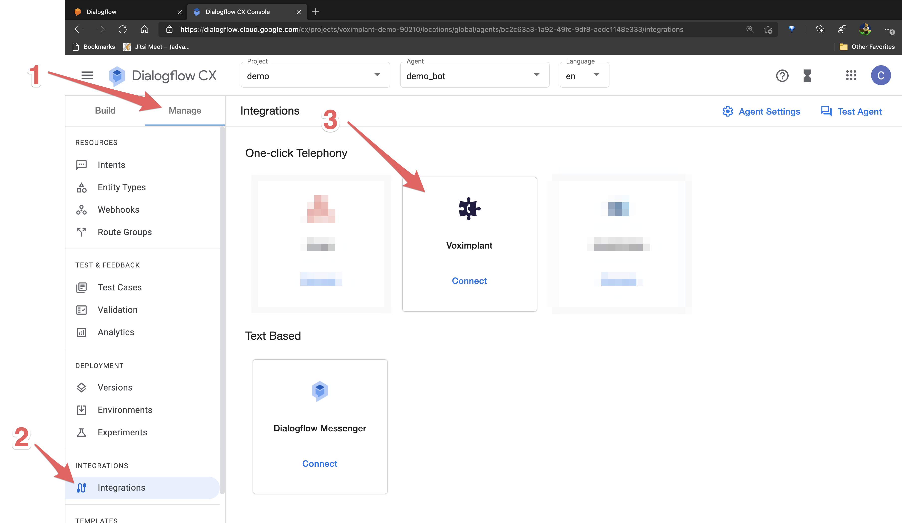

You are prompted to specify an integration name with a language and environment.

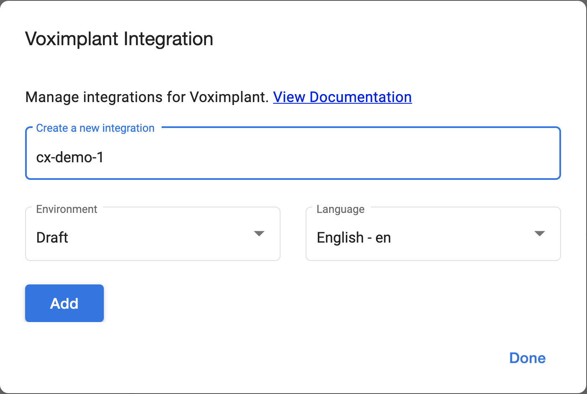

Note that you can have multiple independent integrations with Voximplant using different parameters.

You then need to give Voximplant permission to access your Dialogflow account. If you are not already [signed into Voximplant](https://manage.voximplant.com/auth/), you will be prompted to sign in or create an account.

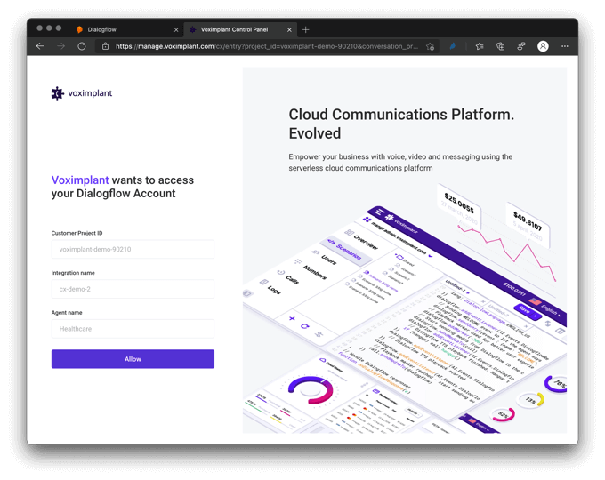

Once you are signed in, you have the option to select an existing phone number from your Voximplant account or purchase a new one. However, if you choose to use an existing phone number, please ensure that it is not already associated with any applications.

When purchasing a new phone number, choose the appropriate settings.

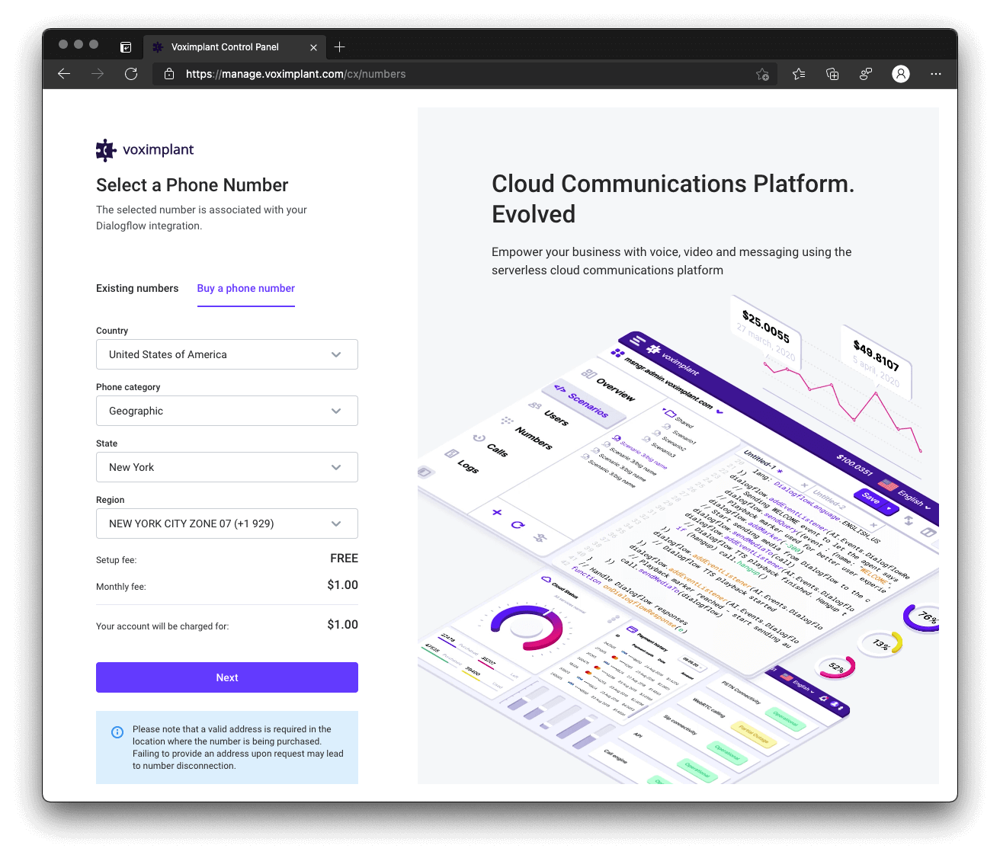

Once you select your phone number you are directed back to the Dialogflow CX console:

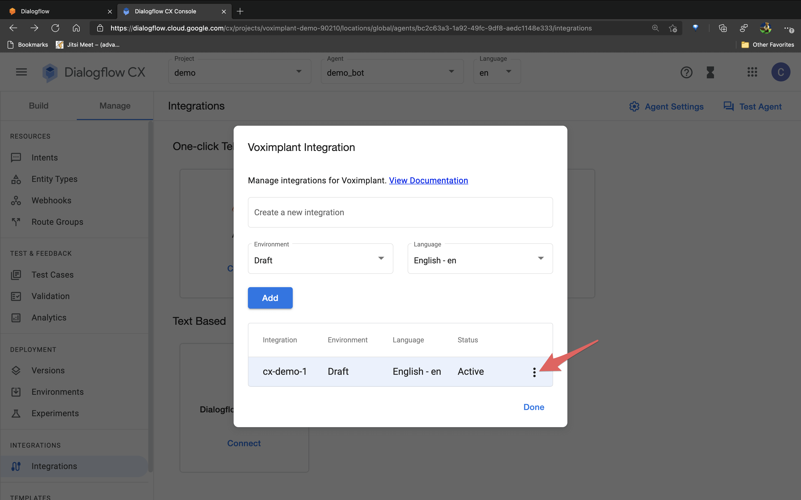

From here, you can use the three-dots menu and choose **Manage** to log in to the Voximplant Management console or **Disconnect** to destroy the connection. If you had issues or stopped during the *One-click integration* procedure, you also have the option to resume the integration process from where you left off.

If you click on **Manage** to go to the Voximplant console and click **Applications** or visit the [Voximplant control panel - Applications](https://manage.voximplant.com/applications) directly, you will see your newly created application.

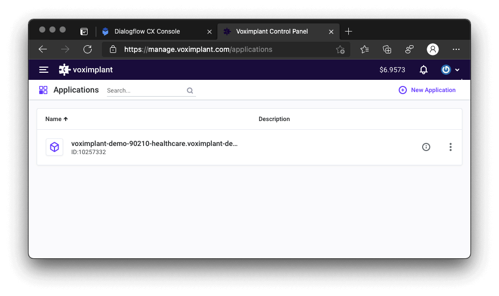

Subsequent integrations with the same Dialogflow CX agent are linked to the same application. You can always manage your numbers from within Voximplant through the **Numbers** menu.

## Use Dialogflow CX telephony integration features

The Voximplant Dialogflow CX offers a range of telephony interaction capabilities directly integrated into the agent console. These interactions are handled by the automatically generated VoxEngine code during the integration process.

### Agent settings

To configure the no speech timeout period and enable barge-in, you should first enable **Advanced Speech Settings** from the **Agent settings** screen:

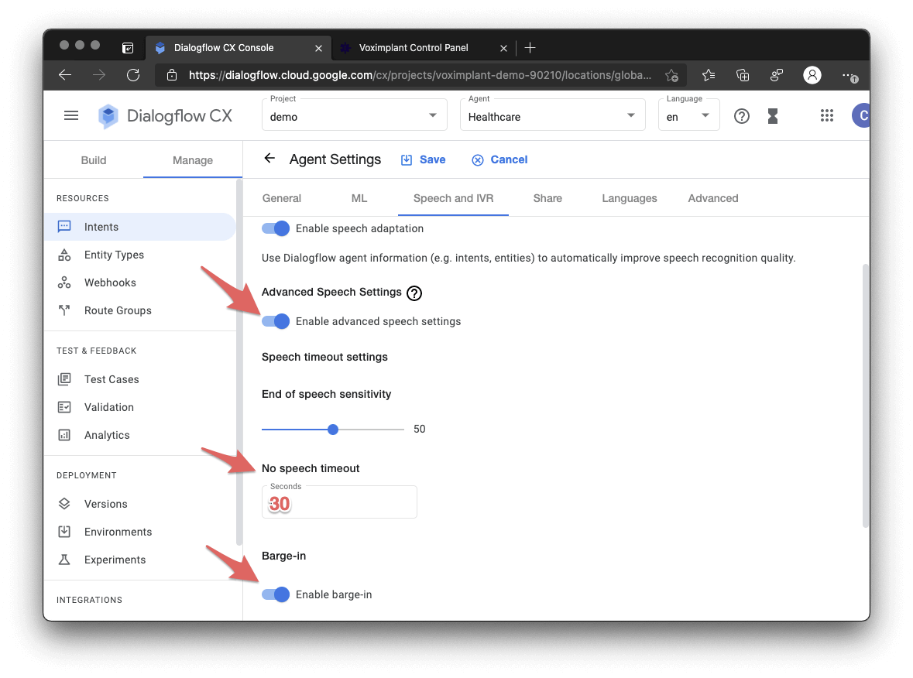

Once enabled, you can modify these settings within each flow and route.

### No-speech timeout

Dialogflow CX includes several built-in event handlers for when a user does not respond to a prompt: `sys.no-input-default`, `sys-no-input-1`, etc. See the [Dialogflow CX Handler documentation](https://cloud.google.com/dialogflow/cx/docs/concept/handler#event-built-in) for details. These events are triggered after the specified no-speech timeout.

<Warning title="Please note">
  The no-speech timeout timer begins as soon as a prompt is returned at the beginning of speech synthesis. If the no-speech timeout is too short, it can trigger before the prompt finishes playback. Make sure you set this value to a large enough number that your prompts have time to finish and your users have a chance to respond.
</Warning>

### Barge-in

CX also supports stopping playback and matching new intents if a user interrupts a response, known as barge-in. Unlike Dialogflow ES, CX does not require special handling within VoxEngine to handle speech detection or barge-in capabilities.

If enabled, intent detection begins as soon as a fulfillment message is played.

### DTMF interaction

Dialogflow CX, in conjunction with Voximplant’s Dialogflow Connector, seamlessly handles DTMF natively, eliminating the need for any specific VoxEngine code. The entered DTMF digits are conveniently managed as part of Dialogflow CX Parameters.

Pressed DTMF digits are passed into Dialogflow as text numbers and `dtmf_digits_432*` where whatever digits we pressed are added after `dtmf_digits_`.

#### Use entities to identify DTMF

Optionally, you can use an **Entity** to identify DTMF entries via a regular expression.

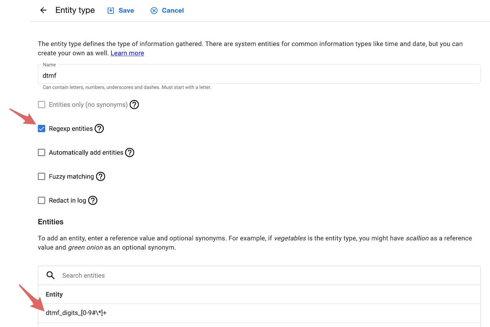

### Sending events

You can send supported events from Voximplant's side for Dialogflow CX's [event handler](https://cloud.google.com/dialogflow/cx/docs/reference/rest/v3/EventHandler) to process the event. To send the event, define `sendEvent`in the [MarkerReached](/reference/voxengine/ccai/events/participant#markerreached). Please note that you need to **stop the outgoing media** to the conversation participant for Dialogflow CX to receive the event. Then use the [analyzeContent](/reference/voxengine/ccai/participant#analyzecontent) method to send the event as shown in the code example:

```javascript title="Sending events"
conversationParticipant.addEventListener(CCAI.Events.Participant.MarkerReached, (e) => {
  if (sendEvent) {
    call.stopMediaTo(conversationParticipant);
    conversationParticipant.analyzeContent({
      eventInput: { name: 'eventName', languageCode }
    });
  }
});

```

#### Parameter setup

The Dialogflow CX console only handles DTMF entries as parameters. Make sure the parameter type accepts numbers as well as `*` and `#` if you use those DTMF keys. Find **Enable DTMF** under **Advanced Speech Settings**.

You can specify the maximum number of digits to recognize, and optionally, you can also specify the finish digit.

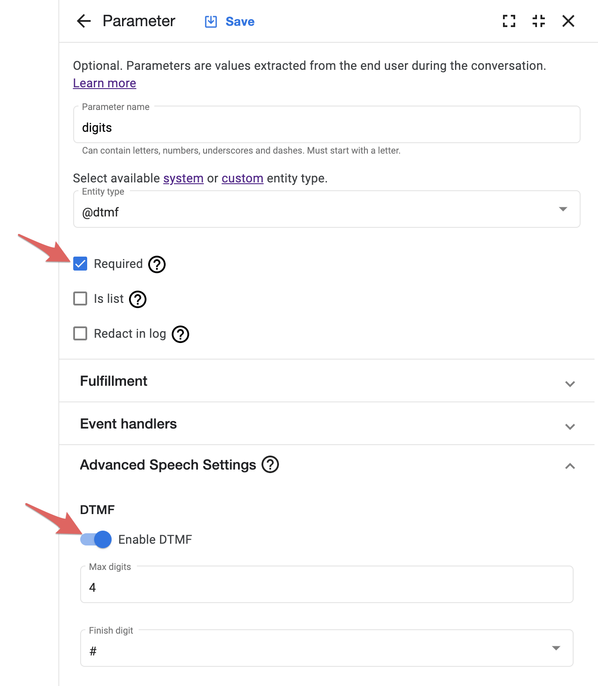

See the Dialogflow CX [parameter documentation](https://cloud.google.com/dialogflow/cx/docs/concept/parameter#dtmf) for more information.

<Warning title="Please note">
  Currently, the DTMF implementation only works if the parameter is marked as required. For handling scenarios like “press 0 for a live agent” and more complex DTMF entries, we recommend implementing a DTMF event handler in VoxEngine to trigger a custom event. See the *Modify VoxEngine interaction* example further below to see how to initiate custom events.
</Warning>

### Sending parameters to Dialogflow CX

To send data to Dialogflow CX, for example, the incoming phone number, use the following code example:

```javascript title="Sending parameters"
conversationParticipant.analyzeContent({
    eventInput: {
        name: "WELCOME",
        languageCode,
        parameters: {
            "caller_id": call.callerid(),
            "called_number": call.number()
        },
    },
});
```

### Play a recording

The Dialogflow CX console includes an option to specify an audio URL:

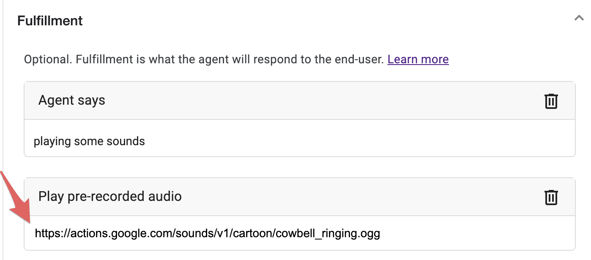

Voximplant’s Dialogflow Connector seamlessly integrates with CX telephony, enabling the playback of sounds without the need for any additional VoxEngine application logic.

### Call transfer

#### Dialogflow CX console

Dialogflow CX offers a **Live Agent handoff** option within the routes options on each page. By selecting this option, a `liveAgentHandoff` value is automatically included in the response to Voximplant, enabling the initiation of a call with the live agent.

You can also pass arbitrary data in JSON format along with the request. For instance, you could specify a particular call center or department for proper routing within VoxEngine.

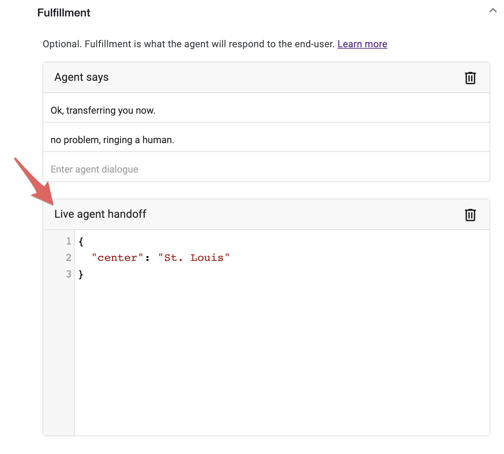

See the Dialogflow CX [fulfillment documentation](https://cloud.google.com/dialogflow/cx/docs/concept/fulfillment#handoff) for more information.

#### How it works in VoxEngine

The default VoxEngine scenario created during the *One-click integration* already includes the necessary logic to transfer the agent. All you need to do is enter the destination number and the caller ID values.

VoxEngine recognizes a `liveAgentHandoff` request as follows. The template code simply sets a global `transfer` variable to **true**.

```javascript title="Recognize a liveAgentHandoff request"
conversationParticipant.addEventListener(CCAI.Events.Participant.Response, (e) => {
  if (e.response.automatedAgentReply?.responseMessages) {
    e.response.automatedAgentReply.responseMessages.forEach((response) => {
      if (response.liveAgentHandoff) transfer = true;
      if (response.endInteraction && e.response.replyText) hangup = true;
      else if (response.endInteraction) endConversation();
    });
  }
});

```

Then, after the [PlaybackFinished](/reference/voxengine/ccai/events/participant#playbackfinished) event indicates any preceding synthesized speech or audio has been played, this `transfer` value is checked, an outgoing call is initiated with [VoxEngine.callPSTN](/reference/voxengine/voxengine#callpstn) and finally, the media is connected with [VoxEngine.easyProcess](/reference/voxengine/voxengine#easyprocess). Make sure to enter the destination phone number - such as your call center - and one of your caller IDs as part of the `callPSTN` function.

```javascript title="Initiate a call"
conversationParticipant.addEventListener(CCAI.Events.Participant.PlaybackFinished, (e) => {
  if (hangup) {
    endConversation();
  }
  if (transfer) {
    transfer = false;
    // Do an outgoing call and connect it with the incoming one
    outgoingCall = VoxEngine.callPSTN('REPLACE_WITH_PHONE_NUMBER', 'REPLACE_WITH_CALLER_ID');
    VoxEngine.easyProcess(call, outgoingCall);
  }
});

```

This code can be modified to incorporate routing logic, facilitate calls through SIP, initiate recording, and perform numerous other functionalities.

Note that the default connector template assumes that the call remains connected to the Dialogflow agent. For an example of how to modify this code, refer to the next section.

## Modify VoxEngine interaction

Voximplant, a full-featured Communications Platform as a Service (CPaaS), offers immense flexibility in managing communication with both Dialogflow and telephony networks.

In this scenario, we modify the call transfer behavior to indicate the successful completion of the transfer and subsequently return control to Dialogflow CX in the event of a call failure.

### Use VoxEngine events, callbacks, and CCAI methods

Let’s alter the `CCAI.Events.Participant.PlaybackFinished` code to show how we can monitor the telephony connection and send events to Dialogflow CX:

```javascript title="Monitor the telephony connection"
conversationParticipant.addEventListener(CCAI.Events.Participant.PlaybackFinished, (e) => {
  if (transfer) {
    transfer = false;
    // Do an outgoing call and connect it with the incoming one
    outgoingCall = VoxEngine.callPSTN(A_VALID_PHONENUMBER, YOUR_CALLERID);
    outgoingCall.addEventListener(CallEvents.Connected, () => {
      VoxEngine.easyProcess(call, outgoingCall, () => {
        conversationParticipant.analyzeContent({
          eventInput: { name: 'TRANSFER_SUCCESS', languageCode }
        });
        endConversation();
      });
    });
    outgoingCall.addEventListener(CallEvents.Failed, (e) => {
      Logger.write(`Transfer failed: ${JSON.stringify(e)}`);
      conversationParticipant.analyzeContent({
        eventInput: { name: 'TRANSFER_FAIL', languageCode }
      });
    });
  } else if (hangup) {
    endConversation();
  }
});

```

We initiate an outgoing call using the standard template `VoxEngine.callPSTN`, but we also add an event listener that starts the `easyProcess` only after the outgoing call is connected.

Then we add the optional callback function to send an event via the [conversation](/reference/voxengine/ccai/conversation) object returned from the CCAI module, [conversation.addParticipant](/reference/voxengine/ccai/conversation#addparticipant), earlier in the default template. In this case, we send a `TRANSFER_SUCCESS` event and then use the `endConversation` function from the template to end the Dialogflow CX connection.

See the Dialogflow CX [QueryInput documentation](https://cloud.google.com/dialogflow/cx/docs/reference/rpc/google.cloud.dialogflow.cx.v3#google.cloud.dialogflow.cx.v3.QueryInput) for options and the format for sending query input.

In addition to monitoring the [CallEvents.Connected](/reference/voxengine/call#connected) event, we also add a [CallEvents.Failed](/reference/voxengine/call#failed) handler, but this time we send a `TRANSFER_FAIL` event to Dialogflow.

### Dialogflow CX setup

In this scenario, we establish a separate **Live Agent** page that is loaded after a **transfer** intent. Configure the **Entry fulfillment** in a manner similar to the *Call Transfer* example provided earlier.

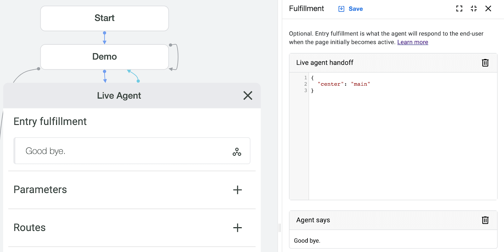

Dialogflow CX enables you to create custom events by navigating to the **Event handlers** section on your page. Click on the **plus sign** next to **Event handlers** or select **Add event handler** from the Event handlers frame.

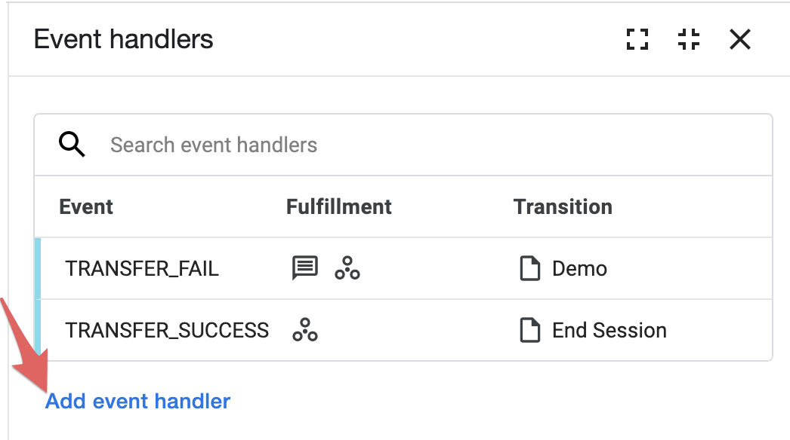

Then click on **Use custom event** and enter the event name you specified in VoxEngine. Add any fulfillment and specify the transition flow or page.

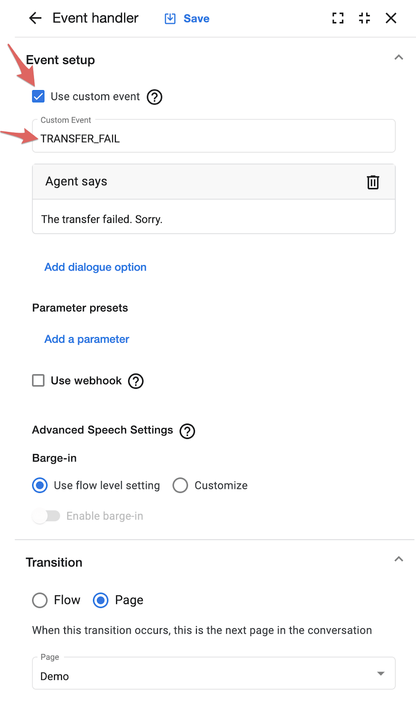

Make sure to repeat this for each custom event you specify in VoxEngine. `TRANSER_SUCCESS` might transition to **End Session**, and `TRANSFER_FAILED` could go to another page to handle the error or try different **Live agent handoff** details.

## Change your agent’s voice

Dialogflow CX lacks a user interface for selecting your agent’s synthesized voice, unlike Dialogflow ES. However, the voice can be programmatically specified within VoxEngine.

To change the text-to-speech voice, add a `synthesizeSpeechConfig` object to the `replyAudioConfig` within `dialogflowSettings` as part of the `conversation.addParticipant` configuration object. See the example for the object structure:

```javascript title="Specify the agent's voice setting"
conversationParticipant = conversation.addParticipant({
  call: call,
  options: { role: 'END_USER' },
  dialogflowSettings: {
    enableMixingAudio: true,
    lang: languageCode,
    singleUtterance: true,
    replyAudioConfig: {
      audioEncoding: 'OUTPUT_AUDIO_ENCODING_OGG_OPUS',
      // Synthesized voice configuration
      synthesizeSpeechConfig: {
        voice: { name: 'en-US-Wavenet-C' }
      }
    }
  }
});

```

Any Google Cloud text-to-speech voice can be used, including different languages. See the list of available Google Cloud text-to-speech voices [here](https://cloud.google.com/text-to-speech/docs/voices).

If you need to use a non-Google voice for any reason, you can process the agent's response event, then read the reply to your customer using Voximplant [speech synthesis](/voice-ai/speech/openai-tts) engine:

```javascript title="Use a non-default voice"
conversationParticipant.addEventListener(CCAI.Events.Participant.Response, (e) => {
  if (e.response.replyText) {
    // you can use both the call.say() and the VoxEngine.createTTSPlayer() methods
    call.say(e.response.replyText, { voice: VoiceList.Microsoft.Neural.es_CO_GonzaloNeural });
  }
}
```

Alternatively, you may use the [VoiceList.Google](/reference/voxengine/voice-list/google) equivalents instead to align with other Voximplant-based speech synthesis used in your scenario – i.e. `voice: { name: VoiceList.Google.en_US_Wavenet_C.voice }`. See the Voximplant’s [VoiceList](/reference/voxengine/voice-list/google) reference documentation for the list of available Google voices.

## Outgoing calling

If you want to use this scenario with outgoing calling, you need to remove the [AppEvents.CallAlerting](/reference/voxengine/app-events#callalerting) code block and create a new [AppEvents.Started](/reference/voxengine/app-events#started) block. The most important thing here is the [callPSTN](/reference/voxengine/voxengine#callpstn) method that we apply to make a call when the scenario has started. Use the following logic:

```javascript title="AppEvents.Started code block"
VoxEngine.addEventListener(AppEvents.Started, (e) => {
  let number = VoxEngine.customData(); // we assume that a callee's number arrives as customData in e.164 format
  call = VoxEngine.callPSTN(number, 'CALLER_ID'); // replace CALLER_ID with a real number
  isCallCreated = true;
  createParticipant();
  call.addEventListener(CallEvents.Connected, onCallConnected);
  call.addEventListener(CallEvents.Disconnected, function () {
    conversation.stop();
    VoxEngine.terminate();
  });
  call.addEventListener(CallEvents.Failed, VoxEngine.terminate);
});

```

You may wonder what to do with the old `AppEvents.Started` block. It’s simple: move its contents to the newly created `onCallConnected` function and delete the old block:

```javascript title="onCallConnected function code"
function onCallConnected(ev) {
  isCallConnected = true;
  agent = new CCAI.Agent(agentId, region);
  agent.addEventListener(CCAI.Events.Agent.Started, () => {
    conversation = new CCAI.Conversation({ agent, profile: { name: profile }, project: appName });
    conversation.addEventListener(CCAI.Events.Conversation.Created, () => {
      isConversationCreated = true;
      createParticipant();
    });
  });
}

```

Everything else remains unchanged.

Now, you simply need to initiate the scenario. To do this, navigate to the **Rules** section and execute the rule linked to your scenario:

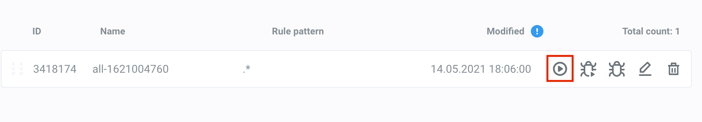

Or use the [StartScenarios](/reference/management-api/reference/scenarios/start-scenarios) method of our management API. Do not forget to specify the phone number as script custom data. Otherwise, there is no number to call.

## Call lists

Sometimes, you need to make multiple phone calls, and that is when you use call lists.

First, design a CSV file that represents your call list. The data in this file is passed to the VoxEngine scenario as a JSON string that we parse. The CSV file contains the names and phone numbers of the people you want to call.

```txt
first_name;last_name;phone_number
Jon;Snow;+16501234567
Daenerys;Targaryen;+16501234568
```

Now we can modify the scenario so it processes every string of the file and makes calls.
Your `AppEvents.Started` block should look like this (we do not need the `AppEvents.CallAlerting` block here):

```javascript title="AppEvents.Started for call lists"
VoxEngine.addEventListener(AppEvents.Started, function (ev) {
  let data = VoxEngine.customData();
  let parsedData = JSON.parse(data);
  first_name = parsedData.first_name;
  last_name = parsedData.last_name;
  phone_number = parsedData.phone_number;
  Logger.write(`Calling ${first_name} ${last_name} on ${phone_number}`);
  isCallCreated = true;
  createParticipant();
  // Make a call
  call = VoxEngine.callPSTN(phone_number, '3253280547');
  call.addEventListener(CallEvents.Connected, onCallConnected);
  call.addEventListener(CallEvents.Failed, handleCallFailed);
  call.addEventListener(CallEvents.Disconnected, handleCallDisconnected);
});

```

The `onCallConnected` function remains the same as it was for the outgoing call to one person:

```javascript title="onCallConnected for call lists"
function onCallConnected(ev) {
  isCallConnected = true;
  agent = new CCAI.Agent(agentId, region);
  agent.addEventListener(CCAI.Events.Agent.Started, () => {
    conversation = new CCAI.Conversation({ agent, profile: { name: profile }, project: appName });
    conversation.addEventListener(CCAI.Events.Conversation.Created, () => {
      isConversationCreated = true;
      createParticipant();
    });
  });
}

```

And tell the CallList processor about a successful or unsuccessful call result:

```javascript title="Call results"
function handleCallDisconnected(e) {
  conversation.stop();
  // Tell the CallList processor about a successful call result
  CallList.reportResult(
    {
      result: true,
      duration: e.duration
    },
    VoxEngine.terminate
  );
}
function handleCallFailed(e) {
  // Tell the CallList processor that we could not get a call connected
  // depending on the request options it either tries to launch the scenario again after some time
  // or writes the result (failed call) into the result_data column of the CSV file with results
  CallList.reportError(
    {
      result: false,
      msg: 'Failed',
      code: e.code
    },
    VoxEngine.terminate
  );
}

```

The final step is to select the “Call lists” section from your application menu. Create a list (either manually or automatically), upload the CSV file, and launch the list by executing the rule if it’s manual (automatic lists are automatically launched after creation).

The call results are accessible in the **Call history** section. For more information about call lists, refer to the [Call lists for automated calls](/platform/solutions/automated-call-lists) article.
