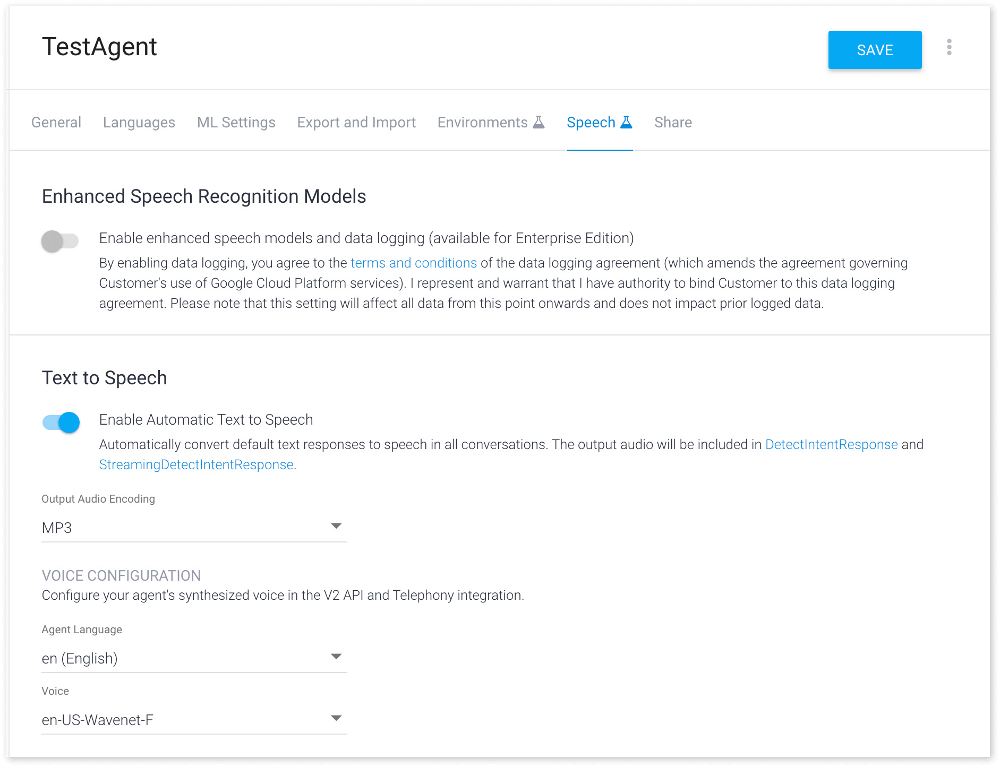
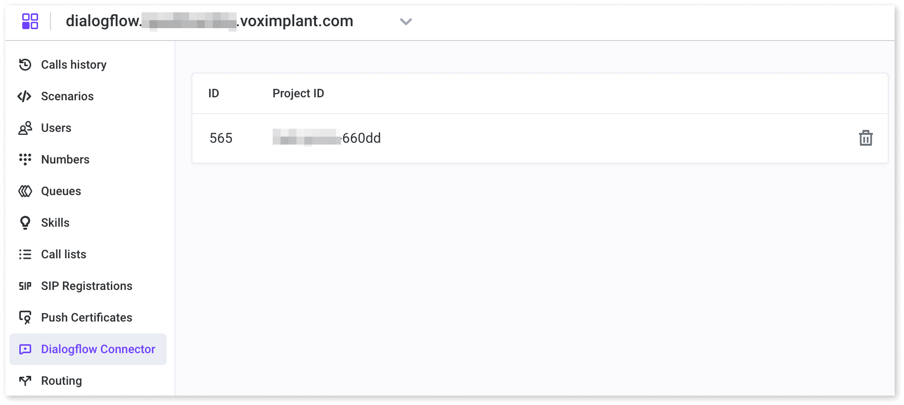
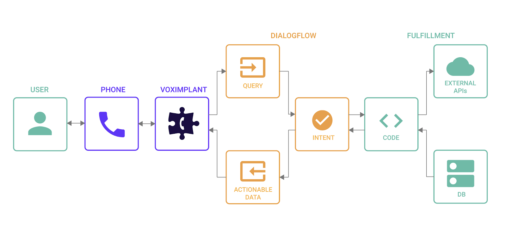
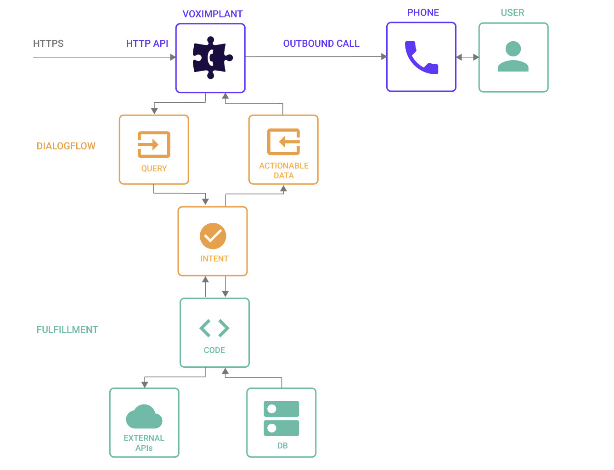
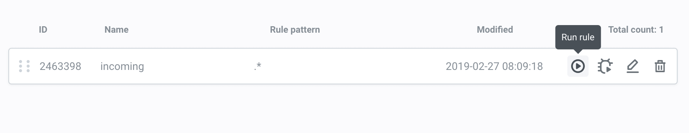
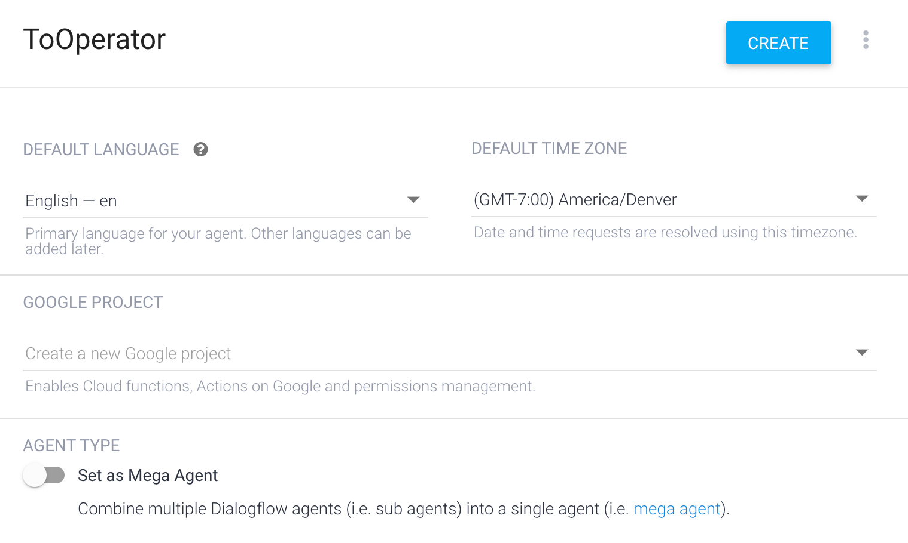
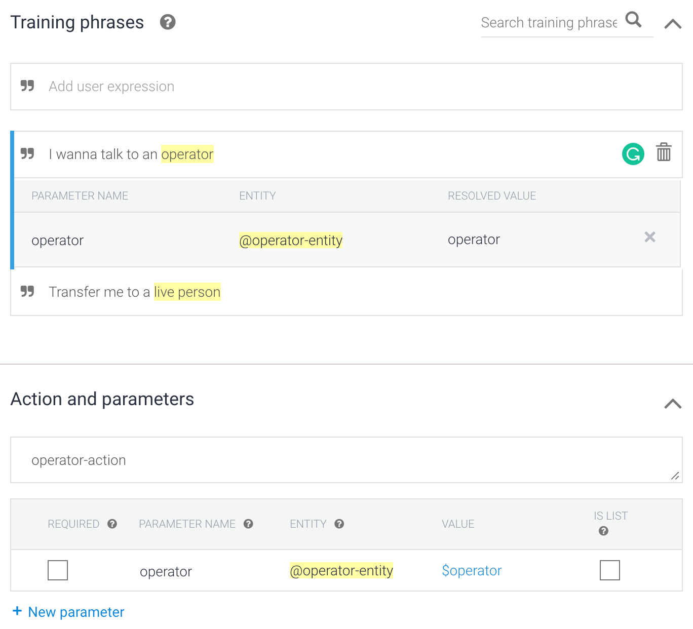
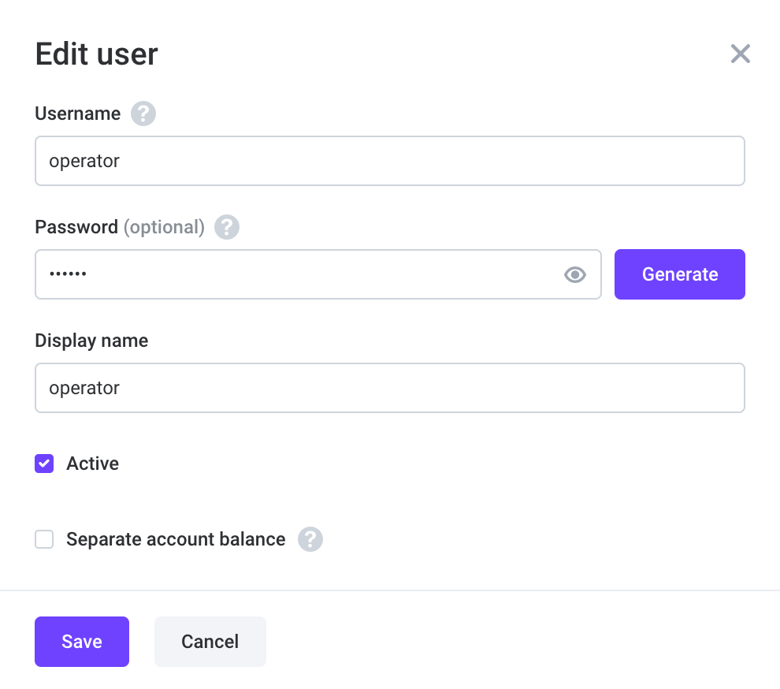

This article will guide you through the process of connecting a [Dialogflow ES](https://docs.cloud.google.com/dialogflow/es/docs) agent to incoming and outgoing calls, as well as transferring a call from a Dialogflow bot to an agent.

Dialogflow, a virtual agent, facilitates conversations with your end-users. It employs a natural language understanding module that comprehends the intricacies of human language.

Dialogflow ES is the standard agent type that is suitable for small to medium businesses and simple to moderately complex agents.

Use the Dialogflow connector to connect a call running via Voximplant with a Dialogflow agent that employs speech recognition, natural language processing (NLP), and speech synthesis based on its logic. Real-time audio streaming occurs between Voximplant and Dialogflow, and query results are promptly received by VoxEngine as soon as they are returned by the agent.

## Incoming and outgoing calls

### Set up Dialogflow

Recheck that your Dialogflow agent uses API V2. Now create and download the service account JSON file associated with the agent from the GCP console (please read the [Setup authentication](https://docs.cloud.google.com/dialogflow/es/docs/quick/setup#sa-create) article for details). Choose the "Dialogflow API Client" role while creating the service account. Voximplant requires the JSON file for authorization before sending audio data to the agent.

Click on the **Speech** tab in the agent settings to set up speech synthesis options.

<div className="themed-figure">
  
</div>

Enable automatic text-to-speech by clicking the toggle button. Choose MP3 or OGG from the **Output Audio Encoding** dropdown menu. *(IMPORTANT: Only MP3 and OGG are currently supported.)* Select one of the available voices. We highly recommend using WaveNet-powered voices, as they sound significantly better than standard options. Save your settings by clicking the **Save** button in the top right corner.

### Set up Voximplant

In the Voximplant control panel, go to [your application](https://manage.voximplant.com/applications) and switch to the Dialogflow connector tab. Here, click **Add** in the center of the screen or **Add Dialogflow agent** in the upper right corner.

The **Add Dialogflow agent** dialog then appears; next, click the **Choose a file** button or drag-drop the JSON file downloaded from the GCP console and click the **Add** button. After the file is uploaded, you can see a newly added agent on the list:

<div className="themed-figure">
  
</div>

You can also visit the Marketplace in the main menu to deploy an application and a test phone number linked to your Dialogflow agent. To do this, click the “Install” button in the relevant tile. Then, follow the instructions to conduct a test call and connect to the Dialogflow agent.

<Note title="Marketplace test app">
  If something goes wrong, you might have to delete the test application in the Applications section and the test scenario in the Scenarios section of the control panel before you try to create the test application again. Their names start with DF_ (for scenarios) or df- (for applications).
  * Please note that the default test application can work with an agent that supports English. If your Dialogflow agent uses another language, please change the test Voxengine scenario accordingly.
</Note>

To make calls to the phone network using Voximplant, you must use a **real phone number as a caller ID**. Create an app in the Voximplant control panel and a scenario within it. Then, purchase a phone number and attach it to the app. Finally, set up a rule that forwards all calls from the purchased number to the scenario.

We start with incoming calls.

<div className="themed-figure">
  
</div>

The scenario should look like this:

```javascript title="Inbound calls scenario"
require(Modules.AI);
require(Modules.ASR);

let dialogflow, call, hangup;

// Inbound call processing
VoxEngine.addEventListener(AppEvents.CallAlerting, (e) => {
  call = e.call;
  call.addEventListener(CallEvents.Connected, onCallConnected);
  call.addEventListener(CallEvents.Disconnected, VoxEngine.terminate);
  call.answer();
});

function onCallConnected(e) {
  // Create Dialogflow object
  dialogflow = AI.createDialogflow({
    agentId: 1,
    lang: DialogflowLanguage.EN_US,
    model: DialogflowModel.COMMAND_AND_SEARCH,
    singleUtterance: true
  });
  dialogflow.addEventListener(AI.Events.DialogflowResponse, onDialogflowResponse);
  // Sending WELCOME event to let the agent says a welcome message
  dialogflow.sendQuery({ event: { name: 'WELCOME', language_code: 'en' } });
  // Playback marker used for better user experience
  dialogflow.addMarker(-300);
  // Start sending media from Dialogflow to the call
  dialogflow.sendMediaTo(call);
  dialogflow.addEventListener(AI.Events.DialogflowPlaybackFinished, (e) => {
    // Dialogflow TTS playback finished. Hangup the call if hangup flag was set to true
    if (hangup) call.hangup();
  });
  dialogflow.addEventListener(AI.Events.DialogflowPlaybackStarted, (e) => {
    // Dialogflow TTS playback started
  });
  dialogflow.addEventListener(AI.Events.DialogflowPlaybackMarkerReached, (e) => {
    // Playback marker reached - start sending audio from the call to Dialogflow
    call.sendMediaTo(dialogflow);
  });
}

// Handle Dialogflow responses
function onDialogflowResponse(e) {
  // If DialogflowResponse with queryResult received - the call stops sending media to Dialogflow
  // in case of response with queryResult but without responseId we can continue sending media to dialogflow
  if (e.response.queryResult !== undefined && e.response.responseId === undefined) {
    call.sendMediaTo(dialogflow);
  } else if (e.response.queryResult !== undefined && e.response.responseId !== undefined) {
    // Do whatever required with e.response.queryResult or e.response.webhookStatus
    // If we need to hangup because end of conversation has been reached
    if (
      e.response.queryResult.diagnosticInfo !== undefined &&
      e.response.queryResult.diagnosticInfo.end_conversation == true
    ) {
      hangup = true;
    }

    // Telephony messages arrive in fulfillmentMessages array
    if (e.response.queryResult.fulfillmentMessages != undefined) {
      e.response.queryResult.fulfillmentMessages.forEach((msg) => {
        if (msg.platform !== undefined && msg.platform === 'TELEPHONY')
          processTelephonyMessage(msg);
      });
    }
  }
}

// Process telephony messages from Dialogflow
function processTelephonyMessage(msg) {
  // Transfer call to msg.telephonyTransferCall.phoneNumber
  if (msg.telephonyTransferCall !== undefined) {
    /**
     * Example:
     * dialogflow.stop()
     * let newcall = VoxEngine.callPSTN(msg.telephonyTransferCall.phoneNumber, "put verified CALLER_ID here")
     * VoxEngine.easyProcess(call, newcall)
     */
  }
  // Synthesize speech from msg.telephonySynthesizeSpeech.text
  if (msg.telephonySynthesizeSpeech !== undefined) {
    // See the list of available TTS voices at /api-reference/voxengine/voice-list
    // Example:
    // if (msg.telephonySynthesizeSpeech.ssml !== undefined) call.say(msg.telephonySynthesizeSpeech.ssml, { voice: VoiceList.Amazon.en_US_Joanna })
    // else call.say(msg.telephonySynthesizeSpeech.text, { voice: VoiceList.Amazon.en_US_Joanna })
  }
  // Play audio file located at msg.telephonyPlayAudio.audioUri
  if (msg.telephonyPlayAudio !== undefined) {
    // audioUri contains Google Storage URI (gs://), we need to transform it to URL (https://)
    let url = msg.telephonyPlayAudio.audioUri.replace('gs://', 'https://storage.googleapis.com/');
    // Example: call.startPlayback(url)
  }
}

```

This scenario sends media from an incoming call to the Dialogflow agent. Query results are returned to the [DialogflowResponse](/reference/voxengine/ai/events#dialogflowresponse) event.

Since we have enabled Speech Synthesis in the Dialogflow agent settings, there is the [DialogflowPlaybackStarted](/reference/voxengine/ai/events#dialogflowplaybackstarted) event after each **DialogflowResponse** event containing [queryResult](/reference/voxengine/ai#dialogflowresponse) with [fulfillmentText](/reference/voxengine/ai#dialogflowresult). It indicates that the audio stream with generated speech is being played. [DialogflowResponse](/reference/voxengine/ai/events#dialogflowresponse) represents [Dialogflow's QueryResult object](https://dialogflow.cloud.google.com/docs/reference/api-v2/rpc/google.cloud.dialogflow.v2#google.cloud.dialogflow.v2.QueryResult).

To initiate the scenario, simply dial the number you purchased a few moments ago.

### Demo

You can see the connector in action on [https://demos05.voximplant.com/dialogflow-connector](https://demos05.voximplant.com/dialogflow-connector). This demo is an example of an automated pizza order via a phone call. You can also download the Dialogflow agent from this demo via the following link: [PizzaOrderDelivery.zip](https://demos05.voximplant.com/dialogflow-connector/PizzaOrderDelivery.zip).

### Modify scenario for outgoing calls

<div className="themed-figure">
  
</div>

Change the scenario to make it work with outgoing calls:

```javascript title="Outbound calls scenario"
require(Modules.AI);

let dialogflow;
let call;
let hangup;
let callerid = 'your-number'; // replace this with the number we bought in previous step (the real one, test number does not work)

// Create outgoing call as soon as StartScenarios HTTP API arrives
VoxEngine.addEventListener(AppEvents.Started, (e) => {
  let number = VoxEngine.customData(); // we assume that a callee's number arrives as customData in e.164 format
  call = VoxEngine.callPSTN(number, callerid);
  call.addEventListener(CallEvents.Connected, onCallConnected);
  call.addEventListener(CallEvents.Disconnected, VoxEngine.terminate);
  call.addEventListener(CallEvents.Failed, VoxEngine.terminate);
});

function onCallConnected(e) {
  // Create Dialogflow object
  dialogflow = AI.createDialogflow({
    lang: DialogflowLanguage.ENGLISH_US
  });
  dialogflow.addEventListener(AI.Events.DialogflowResponse, onDialogflowResponse);
  // Sending WELCOME event to let the agent says a welcome message
  dialogflow.sendQuery({ event: { name: 'WELCOME', language_code: 'en' } });
  // Playback marker used for better user experience
  dialogflow.addMarker(-300);
  // Start sending media from Dialogflow to the call
  dialogflow.sendMediaTo(call);
  dialogflow.addEventListener(AI.Events.DialogflowPlaybackFinished, (e) => {
    // Dialogflow TTS playback finished. Hangup the call if hangup flag was set to true
    if (hangup) call.hangup();
  });
  dialogflow.addEventListener(AI.Events.DialogflowPlaybackStarted, (e) => {
    // Dialogflow TTS playback started
  });
  dialogflow.addEventListener(AI.Events.DialogflowPlaybackMarkerReached, (e) => {
    // Playback marker reached - start sending audio from the call to Dialogflow
    call.sendMediaTo(dialogflow);
  });
}

// Handle Dialogflow responses
function onDialogflowResponse(e) {
  // If DialogflowResponse with queryResult received - the call stops sending media to Dialogflow
  // in case of response with queryResult but without responseId we can continue sending media to dialogflow
  if (e.response.queryResult !== undefined && e.response.responseId === undefined) {
    call.sendMediaTo(dialogflow);
  } else if (e.response.queryResult !== undefined && e.response.responseId !== undefined) {
    // Do whatever required with e.response.queryResult or e.response.webhookStatus
    // If we need to hangup because end of conversation has been reached
    if (
      e.response.queryResult.diagnosticInfo !== undefined &&
      e.response.queryResult.diagnosticInfo.end_conversation == true
    ) {
      hangup = true;
    }

    // Telephony messages arrive in fulfillmentMessages array
    if (e.response.queryResult.fulfillmentMessages != undefined) {
      e.response.queryResult.fulfillmentMessages.forEach((msg) => {
        if (msg.platform !== undefined && msg.platform === 'TELEPHONY')
          processTelephonyMessage(msg);
      });
    }
  }
}

// Process telephony messages from Dialogflow
function processTelephonyMessage(msg) {
  // Transfer call to msg.telephonyTransferCall.phoneNumber
  if (msg.telephonyTransferCall !== undefined) {
    /**
     * Example:
     * dialogflow.stop()
     * let newcall = VoxEngine.callPSTN(msg.telephonyTransferCall.phoneNumber, "put verified CALLER_ID here")
     * VoxEngine.easyProcess(call, newcall)
     */
  }
  // Synthesize speech from msg.telephonySynthesizeSpeech.text
  if (msg.telephonySynthesizeSpeech !== undefined) {
    // See the list of available TTS voices at /api-reference/voxengine/voice-list
    // Example:
    // if (msg.telephonySynthesizeSpeech.ssml !== undefined) call.say(msg.telephonySynthesizeSpeech.ssml, { voice: VoiceList.Amazon.en_US_Joanna })
    // else call.say(msg.telephonySynthesizeSpeech.text, { voice: VoiceList.Amazon.en_US_Joanna })
  }
  // Play audio file located at msg.telephonyPlayAudio.audioUri
  if (msg.telephonyPlayAudio !== undefined) {
    // audioUri contains Google Storage URI (gs://), we need to transform it to URL (https://)
    let url = msg.telephonyPlayAudio.audioUri.replace('gs://', 'https://storage.googleapis.com/');
    // Example: call.startPlayback(url)
  }
}

```

### Run the rule

You can initiate an outgoing call programmatically via the [StartScenarios](/reference/management-api/reference/scenarios/start-scenarios) method of the Management API, or you can run the rule from the control panel. While in your application, switch to **Routing** on the left menu and click **Run rule**:

<div className="themed-figure">
  
</div>

The "Run rule" dialog is displayed. In the dialog, specify a callee's phone number in **Script Custom Data** and click the **Run rule** button to initiate a call.

If everything is in order, the call reaches the designated phone number, and you’re greeted by your agent.

You can also use [CallLists](/reference/voxengine/call-list) if you need to initiate many calls.

## Transfer a call from a Dialogflow bot to an agent

Use the Dialogflow connector to connect a call running via Voximplant to a Dialogflow bot and control the bot’s behavior. Real-time audio streaming from Voximplant to Dialogflow and back ensures timely delivery of query results to VoxEngine as soon as the agent returns them.

### Set up Dialogflow

Go to [https://dialogflow.gloud.google.com/](https://dialogflow.cloud.google.com/) and create a new agent. Let us name it "ToOperator", for example, and click **Create**.

<div className="themed-figure">
  
</div>

After that, you need to set up your entities. Our bot reacts to the words “agent” and its synonyms, such as “agent” and “live person.” In the Intents tab, enter the parameter name used in our code and select the entity you created earlier. Then, add some training phrases to Dialogflow so it can easily find and highlight the relevant words and assign corresponding mappings in the returned JSON. The more phrases you add, the better.

<div className="themed-figure">
  
</div>

Voximplant uses the JSON file to perform authorization before sending audio data to the agent.
Create and download the service account JSON file associated with the agent from the GCP console (please read the [Setup authentication](https://cloud.google.com/dialogflow/docs/quick/setup#sa-create) article for details). Choose the "Dialogflow API Client" role when creating a service account.

### Set up Voximplant

In the Voximplant control panel, go to [your application](https://manage.voximplant.com/applications) and switch to the Dialogflow connector tab. Here, upload the JSON file downloaded from the GCP console and click the **Add** button.

Now, you need to create a user (an agent) to whom you make calls. Ensure that the user is online when you make the call. If you’re calling from the web, create a second user (a callee). Users can log in here at [https://phone.voximplant.com/](https://phone.voximplant.com/).

<div className="themed-figure">
  
</div>

Now you need to create a rule, a scenario, buy a number, and bind them all together.
The JavaScript code sample of how to transfer a call to an agent is as follows:

```javascript title="Usage sample"
require(Modules.AI);
require(Modules.ASR);

let mycall = null;
let voice = VoiceList.Amazon.en_US_Joanna;
let flow;
let player;

VoxEngine.addEventListener(AppEvents.CallAlerting, (e) => {
  mycall = e.call;
  mycall.addEventListener(CallEvents.Connected, handleCallConnected);
  mycall.answer();
});

function startASR() {
  mycall.removeEventListener(CallEvents.PlaybackFinished, startASR);
  mycall.sendMediaTo(flow);
}

function handleCallConnected(e) {
  flow = AI.createDialogflow({
    lang: DialogflowLanguage.EN_US,
  });

  if (AI.Events.DialogflowResponse !== undefined)
    flow.addEventListener(AI.Events.DialogflowResponse, (event) => {
      if (event.response.queryResult !== undefined) {
        let result = event.response.queryResult;
        if (result.queryText === undefined) {
          if (result.languageCode !== undefined) startASR();
          return;
        }
        if (result.parameters.operator !== undefined) {
          let out = VoxEngine.callUser({ username: 'operator', callerid: e.call.callerid });
          out.addEventListener(CallEvents.Connected, function () {
            // call logic
          });
          out.addEventListener(CallEvents.Disconnected, function () {
            VoxEngine.terminate();
          });
        }
      }
    });
  player = VoxEngine.createTTSPlayer('hi! How can I help?!', voice);
  player.addMarker(-500);
  player.addEventListener(PlayerEvents.PlaybackMarkerReached, startASR);
  player.sendMediaTo(e.call);

  mycall.record();
  mycall.addEventListener(CallEvents.Disconnected, (event) => {
    VoxEngine.terminate();
  });
}

```
