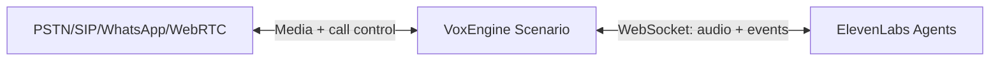

<blockquote className="agent-directive">
  For the complete documentation index, see <a href="/llms.txt">llms.txt</a>.
</blockquote>

## Benefits

The native ElevenLabs module connects Voximplant calls to ElevenLabs Agents for real-time, speech-to-speech conversations.
The connector streams audio between Voximplant and ElevenLabs while keeping call control in VoxEngine.

Capability and feature highlights:

- Connect inbound and outbound calls to a single ElevenLabs agent ID.
- Bi-directional audio streaming with low latency and built-in media conversion.
- Barge-in support using interruption events and media buffer control.
- Real-time events for transcripts, responses, tool calls, and diagnostics.
- Client-side tool execution with `ClientToolCall` and `clientToolResult`.

## Architecture

ElevenLabs Agents is a stateful WebSocket service. VoxEngine opens a session and streams audio while receiving audio, transcripts, and events on the same connection.

## Prerequisites

- ElevenLabs account and API key from [ElevenLabs](https://elevenlabs.io/app/settings/api-keys).
- ElevenLabs Agent created in the [ElevenLabs Agents console](https://elevenlabs.io/app/agents/agents).
- Agent ID for the specific ElevenLabs agent you want to run in Voximplant.

## Development notes

- **Native VoxEngine module**: load with `require(Modules.ElevenLabs)` and create an `ElevenLabs.AgentsClient` via `ElevenLabs.createAgentsClient({ xiApiKey, agentId })`.
- **Custom endpoint**: optionally pass `baseUrl` to `ElevenLabs.createAgentsClient(...)` when you need to use a non-default ElevenLabs Agents endpoint. Leave it unset for the default ElevenLabs endpoint.
- **Agent configuration**: prompts, voices, and tools are configured in the [ElevenLabs Agent console](https://elevenlabs.io/app/agents/agents). Use `agentId` to select the agent to run.
- **Barge-in**: listen for `ElevenLabs.AgentsEvents.Interruption` and call `agentsClient.clearMediaBuffer()` to stop current TTS audio.
- **Context and user text**: optionally call `conversationInitiationClientData`, `contextualUpdate`, or `userMessage` to inject metadata or text.
- **Function calling**: handle `ElevenLabs.AgentsEvents.ClientToolCall` and respond with `clientToolResult`.

See the [ElevenLabs module API reference](/reference/voxengine/elevenlabs) for full details on methods, events, and types.

## Examples
- [Example: Answering an incoming call](/voice-ai/elevenlabs/inbound)
- [Example: Placing an outbound call](/voice-ai/elevenlabs/outbound)
- [Example: Function calling](/voice-ai/elevenlabs/function-calling)

## Links

### Voximplant

- [ElevenLabs Agents docs](/voice-ai/elevenlabs/overview)
- [ElevenLabs module API reference](/reference/voxengine/elevenlabs)
- Voice AI product overview: https://voximplant.ai/

### ElevenLabs

- ElevenLabs documentation: https://elevenlabs.io/docs
