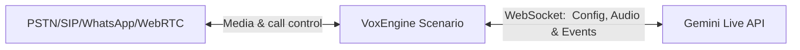

<blockquote className="agent-directive">
  For the complete documentation index, see <a href="/llms.txt">llms.txt</a>.
</blockquote>

## Benefits

The native Gemini module connects Voximplant calls to Google’s Gemini Live API for real‑time, speech‑to‑speech conversations.
This integration supports inbound and outbound calls and is designed to bridge telephony to Gemini with low latency while keeping call control inside VoxEngine.

Capability and feature highlights:

- **Connect inbound and outbound calls to a Gemini‑powered agent** with a real‑time, speech‑to‑speech interface.
- **Minimal audio latency** by sending media directly from Voximplant media servers to Gemini in the required audio format.
- **Endpoint flexibility** across phone calls, Web SDK, SIP, and WhatsApp Business Calling.
- **Barge‑in and playback interruption** to keep conversations natural.
- **Real‑time event streaming** for Gemini session events.

## Architecture

Gemini Live API is a stateful WebSocket API: VoxEngine opens a session and streams audio to Gemini while receiving audio, text, and tool call requests back over the same connection.

Voximplant's Gemini Live API integration uses a WebSocket connection to stream audio between VoxEngine and Gemini.
The Voice AI connector handles connection establishment, media conversion, playback, and audio capture.

Tool calls detected by Gemini are signaling in events where you can implement custom logic and provide a response in your VoxEngine scenario.

## Prerequisites

- **Gemini Developer API path**: Google AI Studio account and Gemini API key from [Google AI Studio](https://aistudio.google.com/).
- **Vertex AI path**: Google Cloud project with Vertex AI enabled and service-account credentials for Gemini Live.

## Development notes

<Info title="Current model path">
  The primary examples in this section target `gemini-3.8-live` on the Gemini Developer API. Google’s reference page for that model is:
  https://ai.google.dev/gemini-api/docs/models/gemini-3.8-live

  `gemini-3.8-live` is the default low-latency Live model. Use `gemini-3.8-live-extended-thinking` when the session needs higher background reasoning. That model accepts `thinkingLevel` values `low`, `medium`, and `high`. `gemini-3.8-live` does not accept `thinkingLevel`.
</Info>

### Gemini Developer API and Vertex AI support

Voximplant supports both the Gemini Developer API and Vertex AI backends for the Gemini Live API.
The Gemini Developer API backend uses an API key for authentication, while the Vertex AI backend requires Google Cloud credentials.

See the examples for details on each approach.

- **WebSocket session config**: Live API session configuration includes response modalities, system instructions, and tools in the initial setup message.
- **Audio‑to‑audio responses**: Use `responseModalities: ["AUDIO"]` to receive audio responses from the model.
- **Input/output transcriptions**: The Live API can return input and output audio transcriptions when enabled in the session config.
- **Turn detection and barge‑in**: Automatic activity detection can be configured (prefix padding and silence duration) and is used to detect speech activity.
- **Function calling**: Live API sessions can receive function call requests from the model.

<Warning title="Vertex AI">
  `gemini-3.8-live` works on the Gemini Developer API (AI Studio). Vertex AI does not serve this model unless the Google Cloud project has Gemini Enterprise early access. The Vertex example stays on a Vertex-supported Live model.
</Warning>

<Warning title="Gemini 2.5 and 3.1">
  If you are migrating older `gemini-2.5-flash-native-audio-preview-12-2025` or `gemini-3.1-flash-live-preview` examples to `gemini-3.8-live`:
  omit `thinkingConfig` — `gemini-3.8-live` rejects `thinkingLevel`;
  `3.1` samples use `sendRealtimeInput(...)` for the startup prompt, where older `2.5` samples used `sendClientContent(...)`.
</Warning>

## Examples

- [Example: Answering an incoming call](/voice-ai/google/inbound)
- [Example: Using Vertex AI](/voice-ai/google/vertex-ai)
- [Example: Placing an outbound call](/voice-ai/google/outbound)
- [Example: Function calling](/voice-ai/google/function-calling)
- [Example: Speech-to-speech translation](/voice-ai/google/speech-translation)

## Links

### Voximplant

- Google Gemini Live API Client overview: https://voximplant.com/products/gemini-client
- Voice AI product overview: https://voximplant.ai/

### Google

- Gemini 3.8 Live: https://ai.google.dev/gemini-api/docs/models/gemini-3.8-live
- Gemini Live API (Get started): https://ai.google.dev/gemini-api/docs/live
- Gemini Live API capabilities: https://ai.google.dev/gemini-api/docs/live-guide
- Gemini Live API WebSocket reference: https://ai.google.dev/api/live
- Vertex AI Live API overview: https://cloud.google.com/vertex-ai/generative-ai/docs/live-api
