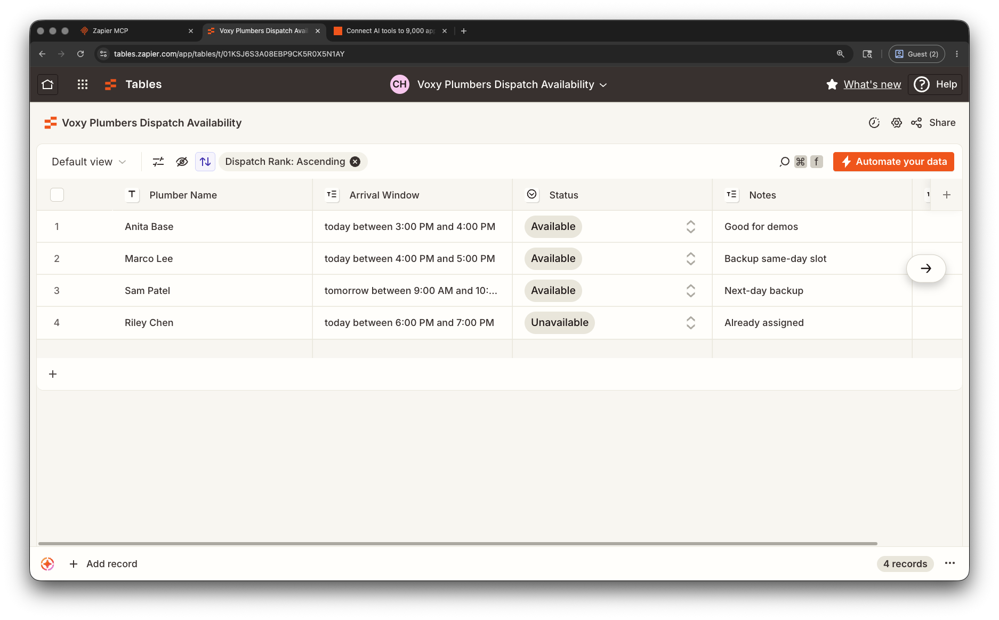
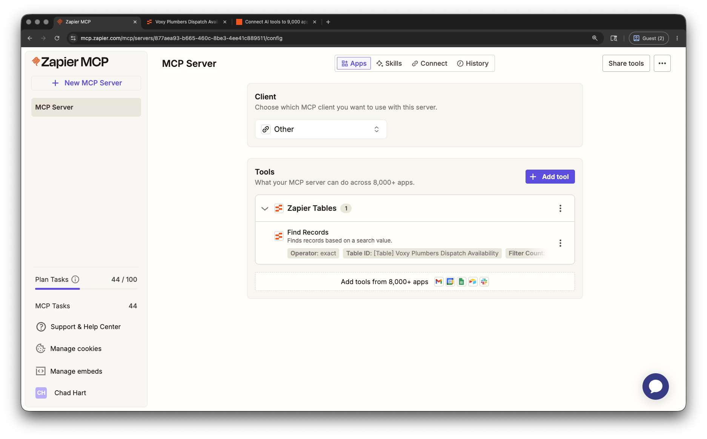

<blockquote className="agent-directive">
  For the complete documentation index, see <a href="/llms.txt">llms.txt</a>.
</blockquote>


The demo uses Zapier Tables as a simple dispatch stand-in. A caller reaches Voxy Plumbers, reports a plumbing issue, and the voice agent checks dispatch availability through Zapier MCP before responding.

Video link: [MCP Client demo](https://www.youtube.com/watch?v=fyjSWILjyMQ)

## Prerequisites

- A Voximplant application with an inbound route to this scenario.
- Vertex AI credentials for Gemini Live stored in Voximplant Secrets: `GCP_CREDENTIALS`, `GCP_PROJECT_ID`, and `GCP_REGION`.
- A Zapier Table.
- A Zapier MCP Server with a Find Records action connected to the table.
- Store the Zapier MCP server URL in Voximplant Secrets under `ZAPIER_MCP_URL`.

### Zapier configuration

Create a Zapier table with the following fields:



Then, configure a [Zapier MCP server](https://mcp.zapier.com/mcp/servers/) with a Find Records action.


## Scenario walkthrough

<Steps>
  <Step title="Create the MCP client with the Zapier MCP endpoint.">
  </Step>
  <Step title="List the MCP server tools and keep only the Zapier tools needed for this demo.">
  </Step>
  <Step title="Create the Gemini Live client with those MCP tools plus a local `hangup_call` tool.">
  </Step>
  <Step title="Answer the inbound call.">
  </Step>
  <Step title="Bridge call audio to Gemini Live after setup completes.">
  </Step>
  <Step title="Let Gemini inspect the enabled Zapier action through `list_enabled_zapier_actions`.">
  </Step>
  <Step title="When Gemini calls `execute_zapier_read_action`, forward the request to the Zapier MCP server and play a short hold prompt.">
  </Step>
  <Step title="When the MCP `ToolResult` arrives, send the result back to Gemini as a tool response.">
  </Step>
  <Step title="Gemini suggests the returned plumber and arrival window to the caller.">
  </Step>
  <Step title="If the caller accepts or says goodbye, Gemini calls `hangup_call`, says goodbye, and the scenario closes the call.">
  </Step>
</Steps>

<Note>
The best flow for your Voice AI agent may vary based on your LLM and MCP server behavior.
</Note>

## Calling MCP ToolList first

Some LLMs require tool definitions when the agent is created. Others allow tools to be updated via a session update or equivalent function. Gemini Live currently only allows tool definition on agent creation. To avoid delay, we immediately connect to the MCP server, wait for the `MCP.ServerEvents.ConnectorInformation` event to verify the connection, then call `mcpClient.listTools({})`. When the `MCP.ServerEvents.ToolsList` event is returned, we then start the call.

This may result in an extra ring. In a production environment, this should be guarded with timers and fallback logic in case there is an error or excessive delay in this path.

## Adjusting MCP Tool inputSchema for Gemini
The MCP Tool output object generally can not be fed into a LLM without adjustment.
Gemini's live's tool calling expects a `parametersJsonSchema` field describing the tool parameters, but Zapier's MCP tools use `inputSchema`.
While the LLM may adapt to adapt the schema, to avoid confusion and potential hallucinations, we copy the `inputSchema` from Zapier's MCP tools into the `parametersJsonSchema` field when we adapt the tools for Gemini.

We adjust this using a simple `map` after filtering the tools:
```js
const mcpFunctionDeclarations = mcpTools.map((tool) => ({
  name: tool.name,
  description: tool.description,
  parametersJsonSchema: tool.inputSchema,
}));
```


## Adapting MCP Tools

Zapier's MCP tool descriptions are designed for broad agentic use.
In our testing, the `list_enabled_zapier_actions` description could draw Gemini toward Zapier management tools that are not needed for this voice demo.
Since we cannot change the metadata returned by Zapier, we adapt the tool metadata before giving it to Gemini.
We also copy each MCP `inputSchema` into Gemini's `parametersJsonSchema` field to reduce potential field mapping hallucinations.

```js
const mcpFunctionDeclarations = tools.map((tool) => ({
  name: tool.name,
  description: tool.name === "list_enabled_zapier_actions"
    ? "List enabled Zapier actions and their exact action keys. Use only the tools available in this session."
    : "Execute an enabled Zapier read action using an action key and params returned by list_enabled_zapier_actions.",
  parametersJsonSchema: tool.inputSchema,
}));
```

Similar filters and maps could be used to remove Personally Identifiable Information (PII) or make other compliance adaptations.

## Checking MCP tools

Our agent is only set up to work if these 2 tools are available. As a last step, we will check that both tools are available.

```js
// Verify Zapier returned our 2 required tools
if (mcpFunctionDeclarations.length !== requiredMcpTools.length) {
  Logger.write("===MCP_REQUIRED_TOOLS_MISSING===");
  terminate();
  return;
}
```

## Debugging MCP tools

When first implementing MCP, it is often helpful to have a deterministic input to verify the server's functionality and performance without the variable behavior introduced by the LLM.
In developing this demo, we started with the MCP call tool immediately below to check the table lookup features:

```js
await mcpClient.callTool({
  name: "execute_zapier_read_action",
  arguments: {
    action: "find_record",
    instructions: "Find the first available plumber in the Voxy Plumbers Dispatch Availability table.",
    output: "plumber name and arrival window",
    params: {
      field_data_key: "Status",
      filter_count: "1",
      lookup_value: "Available",
      operator: "exact",
      table_id: "[Table] Voxy Plumbers Dispatch Availability",
      use_stored_order: true,
    },
  },
});
```

## Full scenario code

<Code
  src="../../../examples/mcp-client/voxengine-vertex-mcp-demo.js"
  title="voxengine-vertex-mcp-demo.js"
  language="javascript"
  maxLines={0}
/>
