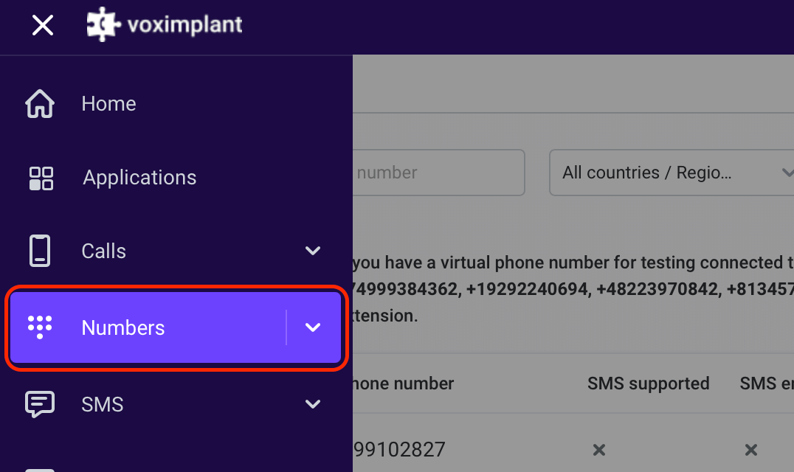
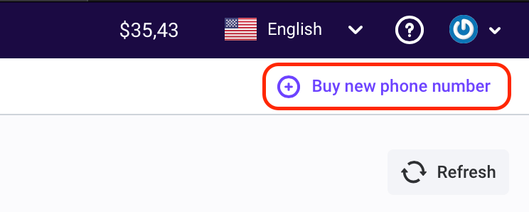
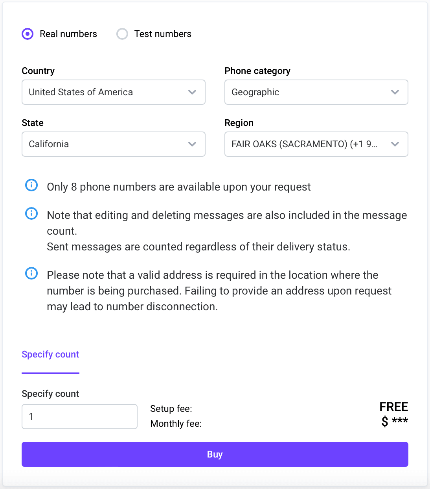
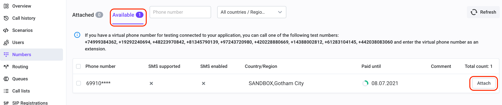
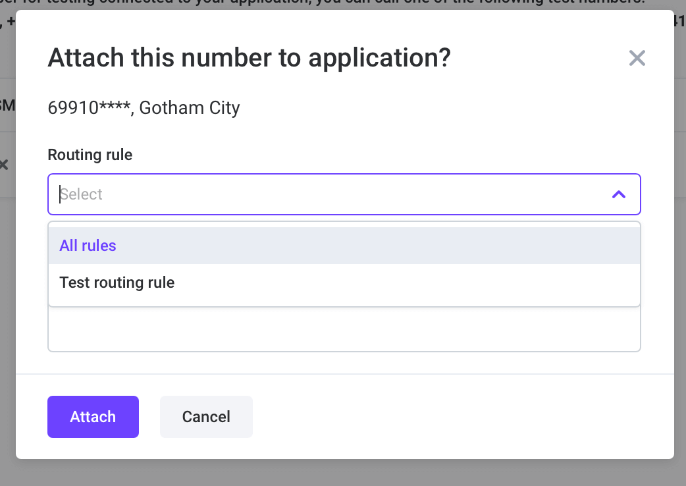

<blockquote className="agent-directive">
  For the complete documentation index, see <a href="/llms.txt">llms.txt</a>.
</blockquote>


## <Icon icon="fa-duotone fa-phone" /> Overview

To make and receive calls to public mobile and landline numbers, attach a phone number to your Voximplant application.
For inbound calls, this number is your entry point. For outbound PSTN calls, this number is your caller ID.

<a id="buy-a-number"></a>
## <Icon icon="fa-duotone fa-cart-shopping" /> Buy a number

<Steps>
  <Step title="Open Numbers in Control Panel">
    In [manage.voximplant.com](https://manage.voximplant.com), open **Numbers** from the main menu.
    
  </Step>
  <Step title="Choose Buy a new phone number">
    Click **Buy a new phone number**.
    
  </Step>
  <Step title="Filter and select number type">
    Choose country/region and select either real or test numbers.
    
  </Step>
</Steps>

<Note>
    Some regions require additional verification steps to buy real numbers.
</Note>

<Note>
Test numbers require extra dialing steps and cannot be used as outbound caller ID.
    We recommend starting with a real number.
</Note>

<a id="attach-number"></a>
## <Icon icon="fa-duotone fa-link" /> Attach the number to your application

<Steps>
  <Step title="Open your application">
    Go to **Applications**, select your app, then open the **Numbers** tab.
  </Step>
  <Step title="Attach number">
    Select an available number and click **Attach**.
    
  </Step>
  <Step title="Set routing rule">
    Attach a routing rule now or configure it after.
    
  </Step>
</Steps>

### Outbound specifics

For outbound PSTN, place calls with `VoxEngine.callPSTN(destination, callerId)` and use a valid rented/verified caller ID.

```js title="Outbound PSTN"
const call = VoxEngine.callPSTN("+15551234567", "+15557654321");
```

#### <icon icon="fa-duotone fa-solid fa-link" /> More information:
- [Phone numbers basic concepts](/platform/getting-started/buy-a-phone-number)
- [VoxEngine Call class](/reference/voxengine/call)
- [VoxEngine.callPSTN](/reference/voxengine/voxengine#callpstn)
