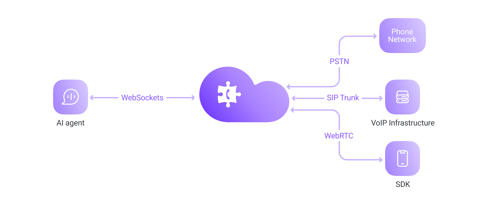
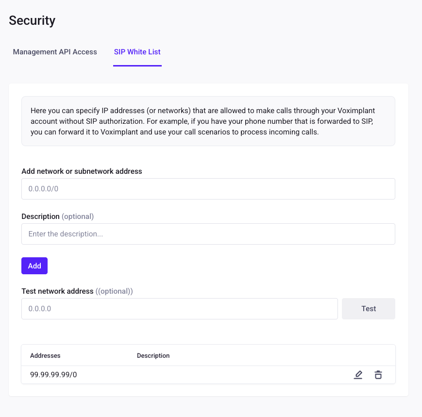
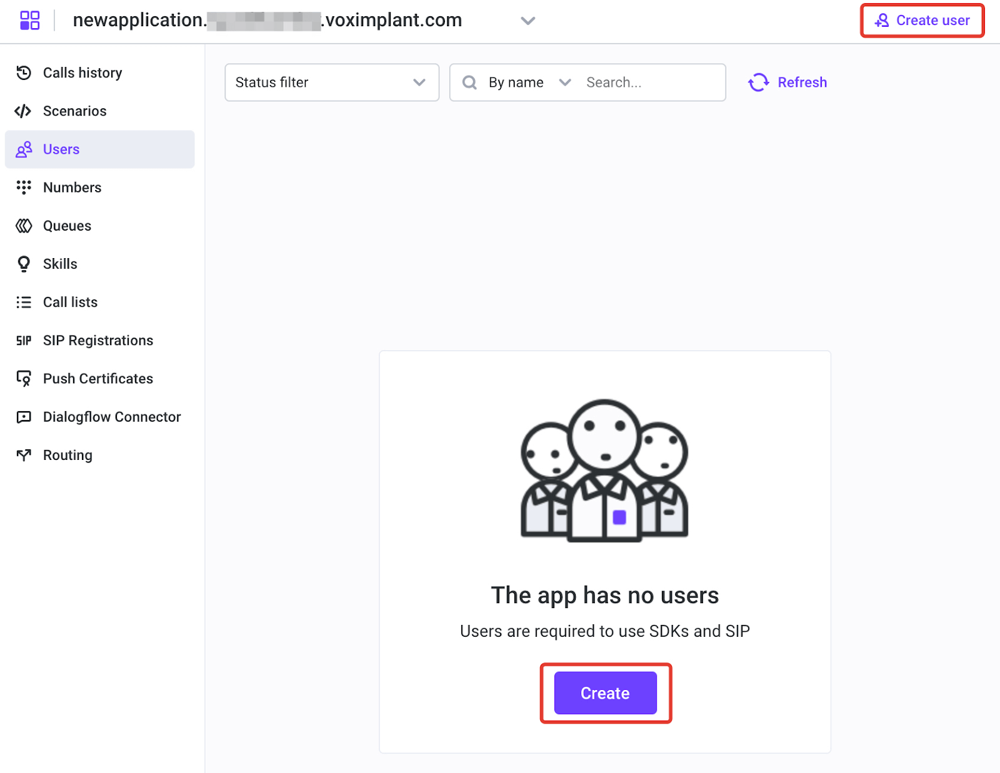
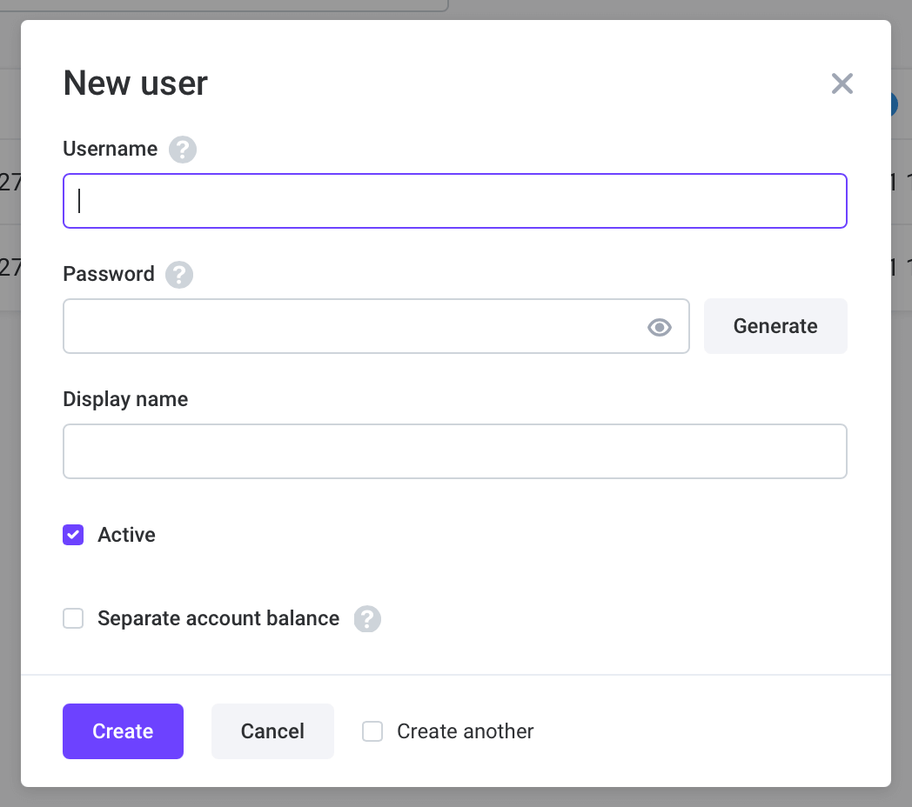
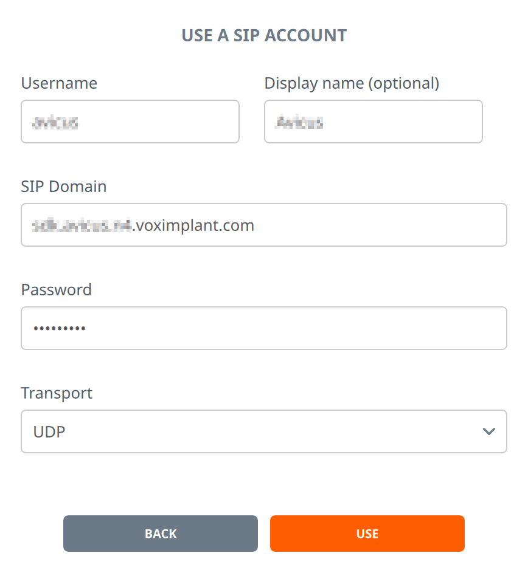
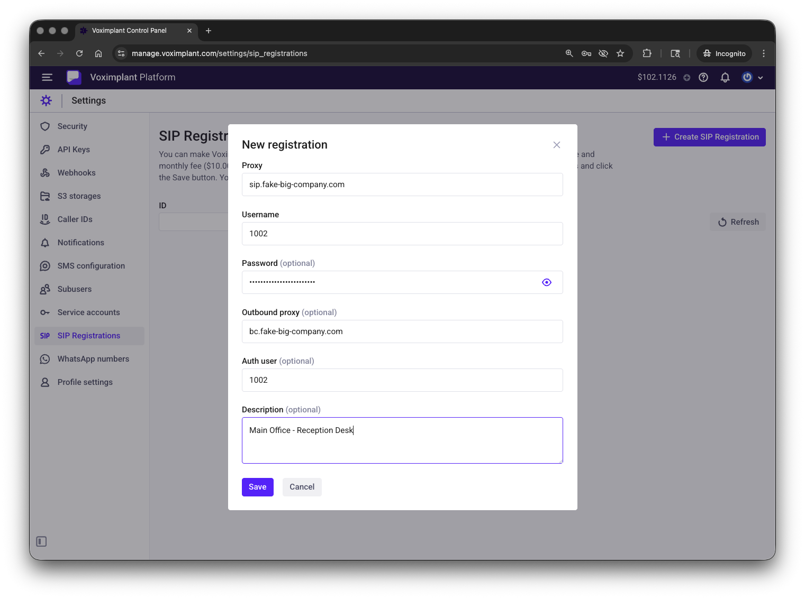

<blockquote className="agent-directive">
  For the complete documentation index, see <a href="/llms.txt">llms.txt</a>.
</blockquote>


# <Icon icon="fa-duotone fa-phone-volume" /> SIP and SIP Trunking overview

Use SIP when you need to connect PBX infrastructure, enterprise SBCs, cloud telephony providers, or existing SIP trunks.
`SIP Trunking` is the common production pattern for routing calls between your telephony core and Voximplant-managed Voice AI scenarios.

Voximplant supports SIP calling in three distinct models:
- [SIP trunking based on number-based routing](#sip-trunking-number-based)
- [User-based SIP routing](#sip-user-based) where you create a Voximplant user for each SIP endpoint and route based on username
- [SIP registration](#sip-registration-extension) where Voximplant registers on external SIP infrastructure and is treated like an extension


# Handling SIP calls with external SIP Infrastructure

## <Icon icon="fa-duotone fa-shield-check" /> Security and allow-listing

If your SIP infrastructure uses a fixed public IP, add it to the SIP allow-list in Voximplant security settings.
For firewall configuration, use the official Voximplant SIP/media IP sources below:

- [Where can I get IP information about Voximplant servers?](https://voximplant.com/help/faq/where-can-i-get-ip-information-about-voximplant-servers)
- [Media/SBC endpoint API (`getMediaResources`)](https://api.voximplant.com/getMediaResources?with_sbcs)


<a id="sip-trunking-number-based"></a>
## <Icon icon="fa-sharp fa-solid fa-circle-1" /> SIP trunking with number-based routing



Use this when your PBX/trunk forwards calls by dialed number.

<Steps>
  <Step title="Create routing rule for destination pattern">
    In your Voximplant application, create a routing rule whose pattern matches the inbound destination number format you expect - i.e. `^\\+1[2-9]\\d{9}$`.
  </Step>
  <Step title="Attach Voice AI scenario to the rule">
    Attach your inbound Voice AI scenario to that rule.
    See [Configure Voximplant - Create a scenario](/voice-ai/configure-voximplant/overview#setup-routing) for details.
  </Step>
  <Step title="Forward SIP calls from PBX/trunk to Voximplant">
    Route calls to:
    `number@application.account.voximplant.com`
    where `number` matches the routing-rule pattern, `application` is your Voximplant [application name](/voice-ai/configure-voximplant/overview#create-an-application), and `account` is your Voximplant account name.
      Alternatively, you can also use this format `app_id#account_id#destination@sip.voximplant.com` where `destination` must be a number
      and `app_id` and `account_id` are the numeric ids found in your application settings.
  </Step>
  <Step title="Allow-list source IPs if needed">
    If your PBX has fixed public IPs, allow-list them in
    `Settings -> Security -> SIP White List` in `manage.voximplant.com`.
    
  </Step>
</Steps>

<a id="sip-user-based"></a>
## <Icon icon="fa-sharp fa-solid fa-circle-2" /> User-based SIP routing (Voximplant user per endpoint)

Use this when each SIP endpoint should authenticate as a distinct user and route by username or a pattern based on usernames.

Create one Voximplant user per SIP endpoint (agent seat, extension, or softphone identity).

<Steps>
  <Step title="Open Users in your application">
    In `manage.voximplant.com`, go to **Applications**, open your app, then open **Users**.
    
  </Step>
  <Step title="Create user credentials for each SIP endpoint">
    Create one user per endpoint (for example: `support01`, `support02`) and set a strong password.
    Keep this username/password pair because SIP clients will use it for registration.
    
  </Step>
  <Step title="Create routing rule by username">
    Create routing rules that match the target username or alias and attach the relevant scenario.
    See [Configure Voximplant - Create a scenario](/voice-ai/configure-voximplant/overview#setup-routing) for details.
  </Step>
  <Step title="Login from your SIP software with these credentials">
    Login to this account on your SIP software using
    `user@application.account.voximplant.com`
    and the Voximplant user password.
    
      You can specify UDP/TCP transport, or specify TLS transport to secure your connection.
      Some SIP infrastructure may require that you specify the password and options in the address: `sip:username:password@domain:5061;transport=tls`
  </Step>
  <Step title="Place calls to that user">
    Now you can place calls with your SIP software to and from that user.
  </Step>
</Steps>

If you automate provisioning, you can also create users via the Management API: [AddUser](/reference/management-api/reference/users/add-user).

<a id="sip-registration-extension"></a>
## <Icon icon="fa-sharp fa-solid fa-circle-3" /> SIP registration (Voximplant as registered extension)

Use this when Voximplant should register to external SIP infrastructure (such as a PBX) and behave like a phone connected to that infrastructure.

<Steps>
  <Step title="Create extension/user in external SIP system">
    In your PBX or SIP provider, create the extension / ID Voximplant will use.
  </Step>
  <Step title="Create SIP registration in Voximplant">
    In Voximplant settings, create a SIP registration with that extension's domain, username, and password.
    
  </Step>
  <Step title="Attach SIP registration to application">
    Attach the SIP registration to your application. This is available from the `SIP Registrations` tab in the left pane.
      When you do this, you will need to select the desired routing rule that handles calls to this registration.
      Note that you do not need to configure the rule pattern in this case — the rule works for all the calls to this SIP registration.
  </Step>
  <Step title="Check the registration status">
    Open `SIP Registrations` in Control Panel and verify the registration shows as connected/active before testing calls.
      You should see s status of `Success` if the registration is active.
    You can also verify status via Management API:
    [GetSipRegistrations](/reference/management-api/reference/sip-registration/get-sip-registrations).
  </Step>
    <Step title="Place calls to this registration">
        Now you can place calls to and from this registration just like you would with any other phone / device connected to your SIP infrastructure.
    </Step>
</Steps>

<Warning title="Pricing note">
    Please note that you pay for SIP registrations monthly according to our price list. So if you create a SIP registration and delete it immediately, your account is charged for the SIP registration monthly fee.
</Warning>

<Note>
    When a SIP registration status changes from Successful to Failed and vice versa, you get an email notification to the contact email addresses and the HTTP callback invokes.
    You can learn more about HTTP callbacks in [this article](/platform/management-api/callbacks).
</Note>


# Placing outbound SIP calls from Voximplant

Use `VoxEngine.callSIP()` for outbound SIP dialing.

<Steps>
  <Step title="Check registration status">
    Before placing outbound calls through a SIP registration, confirm the registration is active in Control Panel (`SIP Registrations`) or via
    [GetSipRegistrations](/reference/management-api/reference/sip-registration/get-sip-registrations).
  </Step>
  <Step title="How to make calls with SIP registration">
    To place an outbound SIP call through a registration, pass `regId` in the third argument of `VoxEngine.callSIP(...)`.
    You can find `regId` in the SIP registration list in Control Panel, or in
    [GetSipRegistrations](/reference/management-api/reference/sip-registration/get-sip-registrations) and
    [CreateSipRegistration](/reference/management-api/reference/sip-registration/create-sip-registration) responses.
    Usually you only need to specify the destination username/number of the called party.
  </Step>
</Steps>

```js title="Outbound SIP via URI"
const call = VoxEngine.callSIP("sip:1001@pbx.example.com", "+15557654321");
```

```js title="Outbound SIP via registration (regId)"
const regId = 1234567; // from SIP Registrations list or HTTP API response
const destination = "1001"; // usually extension/username in your SIP system
const call = VoxEngine.callSIP(`sip:${destination}`, "+15557654321", { regId });
```

For programmable outbound launching, start the routing rule from GUI or call `startScenarios` and pass custom data (for example destination/caller ID) to the scenario.

```json title="Example script_custom_data"
{"callerid":"+15557654321","number":"1001"}
```

SIP Voice AI connector example:
- [Ultravox SIP trunking guide](/voice-ai/ultravox/inbound)

# <icon icon="fa-duotone fa-solid fa-link" /> More information:
- [VoxEngine Call class](/reference/voxengine/call)
- [SIP calls and registrations guide](/voice-ai/network-options/sip)
- [Voximplant SIP server IP allow-list FAQ](https://voximplant.com/help/faq/where-can-i-get-ip-information-about-voximplant-servers)
- [VoxEngine.callSIP](/reference/voxengine/voxengine#callsip)
