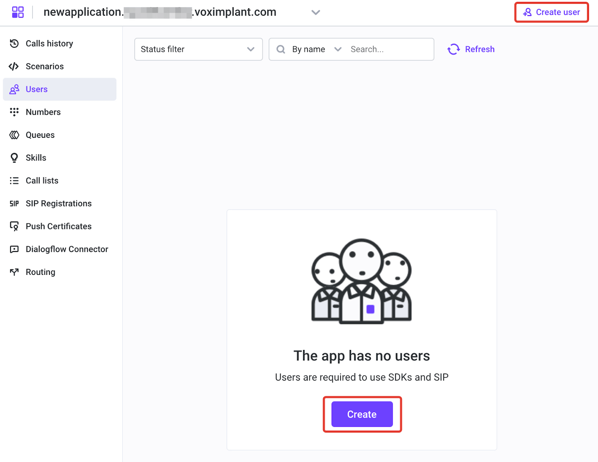
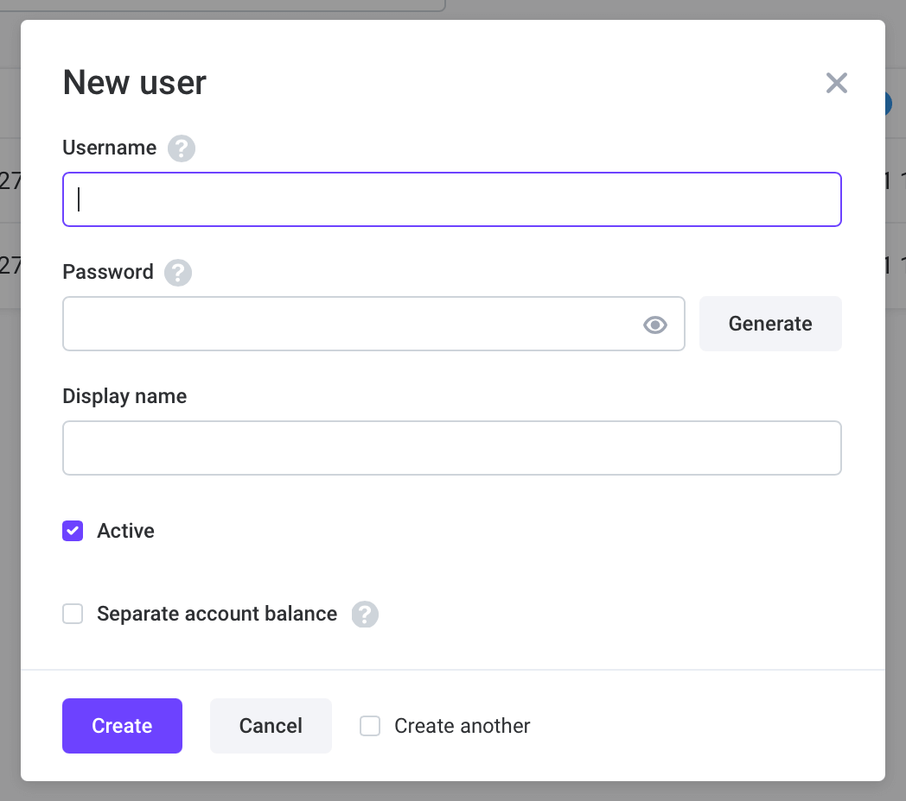
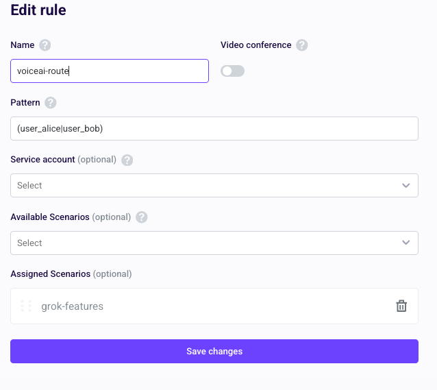

<blockquote className="agent-directive">
  For the complete documentation index, see <a href="/llms.txt">llms.txt</a>.
</blockquote>


## <Icon icon="fa-duotone fa-user" /> Overview

Voximplant supports users that are registered and authenticated on the Voximplant platform.
By default, web and mobile SDKs use these users for authentication and routing.
Users are scoped to each application, so you can have the same username in different applications as needed.


You can also use users for SIP calling, because every user gets a unique SIP address.
See the [SIP calling guide](/voice-ai/network-options/sip#sip-user-based) for how Voximplant users work with SIP.


This is the standard path for in-app calls, authenticated customer sessions, and app-to-app voice AI experiences.


## SDK guides

Voximplant currently supports these SDKs for web and mobile app development. Each SDK has a quickstart guide:

<CardGroup cols={3}>
  <Card title="Web SDK guide" href="/reference/web-sdk/overview" icon="fa-duotone fa-globe"/>
  <Card title="iOS SDK guide" href="/reference/i-os-and-mac-os-sdk/overview" icon="fa-brands fa-apple"/>
  <Card title="Android SDK guide" href="/reference/android-sdk/overview" icon="fa-brands fa-android"/>
  <Card title="React Native SDK guide" href="/reference/react-native-sdk/overview" icon="fa-brands fa-react"/>
  <Card title="Flutter SDK guide" href="/reference/flutter-sdk/overview" icon="../../../assets/getting-started/icon-flutter.svg"/>
</CardGroup>

## <Icon icon="fa-duotone fa-user-plus" /> Create app users

Voximplant's Media Client SDKs need to be authenticated to a user.
When you call a user, VoxEngine directs media and signaling information to any SDK clients who are signed in under that user.
Outgoing calls that the client SDKs start carry the user identity. Use that identity for routing and personalization in your Voice AI scenarios.
You can create users in Control Panel or via Management API.

Users are scoped at the Application level, so you can have different users with the same username in different applications if needed.


<Steps>
  <Step title="Open application users">
    In Control Panel, open **Applications**, select your app, then open **Users**.
    
  </Step>
  <Step title="Configure user profile">
    Set username, password, and display name, then create the user.
    
  </Step>
  <Step title="Use user alias in routing">
    Route incoming app-user calls by alias to the target Voice AI scenario.
    See [Getting started](/voice-ai/getting-started) for rule pattern and scenario assignment details.
    
  </Step>
</Steps>

## <Icon icon="fa-duotone fa-arrow-up-right" /> Outgoing specifics

Use `VoxEngine.callUser()` to place outgoing calls to Voximplant user aliases.

```js title="Outgoing to app user"
const call = VoxEngine.callUser({
  username: "alice",
  callerid: "voice-ai-app"
});
```

## <Icon icon="fa-duotone fa-user-group" /> Working with users

Voximplant users and client SDKs support a wide range of use cases, but here are some best practices and additional features to consider when working with users:

- **Authentication and token lifecycle**<br />
  Use token-based auth and refresh flows instead of storing passwords in client apps. More info: [Renewable tokens](/sdk/overview), [One-time key](/sdk/overview)

  <table style={{ margin: "8px auto 0", borderCollapse: "collapse" }}>
    <tbody>
      <tr>
        <td style={{ border: 0, padding: "4px 10px", textAlign: "center" }}>
          <button type="button" aria-label="Web client auth methods" title="Web client auth methods" onClick={() => window.open("/reference/web-sdk/overview", "_blank", "noopener,noreferrer")} style={{ border: "none", background: "transparent", cursor: "pointer", padding: 0, lineHeight: 1 }}>
            <span style={{ fontSize: "1.5em", display: "inline-flex" }}><Icon icon="fa-duotone fa-globe" /></span>
          </button>
        </td>
        <td style={{ border: 0, padding: "4px 10px", textAlign: "center" }}>
          <button type="button" aria-label="iOS client auth methods" title="iOS client auth methods" onClick={() => window.open("/reference/i-os-and-mac-os-sdk/overview", "_blank", "noopener,noreferrer")} style={{ border: "none", background: "transparent", cursor: "pointer", padding: 0, lineHeight: 1 }}>
            <span style={{ fontSize: "1.5rem", display: "inline-flex" }}><Icon icon="fa-brands fa-apple" /></span>
          </button>
        </td>
        <td style={{ border: 0, padding: "4px 10px", textAlign: "center" }}>
          <button type="button" aria-label="Android client auth methods" title="Android client auth methods" onClick={() => window.open("/reference/android-sdk/overview", "_blank", "noopener,noreferrer")} style={{ border: "none", background: "transparent", cursor: "pointer", padding: 0, lineHeight: 1 }}>
            <span style={{ fontSize: "1.5rem", display: "inline-flex" }}><Icon icon="fa-brands fa-android" /></span>
          </button>
        </td>
        <td style={{ border: 0, padding: "4px 10px", textAlign: "center" }}>
          <button type="button" aria-label="React Native client auth methods" title="React Native client auth methods" onClick={() => window.open("/reference/react-native-sdk/overview", "_blank", "noopener,noreferrer")} style={{ border: "none", background: "transparent", cursor: "pointer", padding: 0, lineHeight: 1 }}>
            <span style={{ fontSize: "1.5rem", display: "inline-flex" }}><Icon icon="fa-brands fa-react" /></span>
          </button>
        </td>
        <td style={{ border: 0, padding: "4px 10px", textAlign: "center" }}>
          <button type="button" aria-label="Flutter client auth methods" title="Flutter client auth methods" onClick={() => window.open("/reference/flutter-sdk/overview", "_blank", "noopener,noreferrer")} style={{ border: "none", background: "transparent", cursor: "pointer", padding: 0, lineHeight: 1 }}>
            <span style={{ width: "24px", height: "24px", display: "inline-flex" }}><Icon icon="../../../assets/getting-started/icon-flutter.svg" /></span>
          </button>
        </td>
      </tr>
    </tbody>
  </table>
- **Online/offline presence**<br />
  Track client connection and auth events, then handle reconnect paths before routing calls.

  <table style={{ margin: "8px auto 0", borderCollapse: "collapse" }}>
    <tbody>
      <tr>
        <td style={{ border: 0, padding: "4px 10px", textAlign: "center" }}>
          <button type="button" aria-label="Web SDK events and state API" title="Web SDK events and state API" onClick={() => window.open("/reference/web-sdk/overview", "_blank", "noopener,noreferrer")} style={{ border: "none", background: "transparent", cursor: "pointer", padding: 0, lineHeight: 1 }}>
            <span style={{ fontSize: "1.5rem", display: "inline-flex" }}><Icon icon="fa-duotone fa-globe" /></span>
          </button>
        </td>
        <td style={{ border: 0, padding: "4px 10px", textAlign: "center" }}>
          <button type="button" aria-label="Android client state API" title="Android client state API" onClick={() => window.open("/reference/android-sdk/overview", "_blank", "noopener,noreferrer")} style={{ border: "none", background: "transparent", cursor: "pointer", padding: 0, lineHeight: 1 }}>
            <span style={{ fontSize: "1.5rem", display: "inline-flex" }}><Icon icon="fa-brands fa-android" /></span>
          </button>
        </td>
        <td style={{ border: 0, padding: "4px 10px", textAlign: "center" }}>
          <button type="button" aria-label="React Native client state API" title="React Native client state API" onClick={() => window.open("/reference/react-native-sdk/overview", "_blank", "noopener,noreferrer")} style={{ border: "none", background: "transparent", cursor: "pointer", padding: 0, lineHeight: 1 }}>
            <span style={{ fontSize: "1.5rem", display: "inline-flex" }}><Icon icon="fa-brands fa-react" /></span>
          </button>
        </td>
        <td style={{ border: 0, padding: "4px 10px", textAlign: "center" }}>
          <button type="button" aria-label="Flutter client state API" title="Flutter client state API" onClick={() => window.open("/reference/flutter-sdk/overview", "_blank", "noopener,noreferrer")} style={{ border: "none", background: "transparent", cursor: "pointer", padding: 0, lineHeight: 1 }}>
            <span style={{ width: "24px", height: "24px", display: "inline-flex" }}><Icon icon="../../../assets/getting-started/icon-flutter.svg" /></span>
          </button>
        </td>
      </tr>
    </tbody>
  </table>

- **User-to-user routing patterns**<br />
  Use `VoxEngine.callUser()` for direct app-user calls, with fallback to SIP/PSTN/WhatsApp when needed. More info: [VoxEngine.callUser](/reference/voxengine/voxengine#calluser), [Outgoing calling options](/voice-ai/inbound-vs-outbound/outbound-calls)

- **Multi-device behavior**<br />
  Expect one user identity to be active on multiple clients and design first-answer/fallback behavior accordingly.

  <table style={{ margin: "8px auto 0", borderCollapse: "collapse" }}>
    <tbody>
      <tr>
        <td style={{ border: 0, padding: "4px 10px", textAlign: "center" }}>
          <button type="button" aria-label="iOS push guide" title="iOS push guide" onClick={() => window.open("/platform/sdks/push-notifications-ios", "_blank", "noopener,noreferrer")} style={{ border: "none", background: "transparent", cursor: "pointer", padding: 0, lineHeight: 1 }}>
            <span style={{ fontSize: "1.5rem", display: "inline-flex" }}><Icon icon="fa-brands fa-apple" /></span>
          </button>
        </td>
        <td style={{ border: 0, padding: "4px 10px", textAlign: "center" }}>
          <button type="button" aria-label="Android push guide" title="Android push guide" onClick={() => window.open("/platform/sdks/push-notifications-android", "_blank", "noopener,noreferrer")} style={{ border: "none", background: "transparent", cursor: "pointer", padding: 0, lineHeight: 1 }}>
            <span style={{ fontSize: "1.5rem", display: "inline-flex" }}><Icon icon="fa-brands fa-android" /></span>
          </button>
        </td>
        <td style={{ border: 0, padding: "4px 10px", textAlign: "center" }}>
          <button type="button" aria-label="React Native client reference" title="React Native client reference" onClick={() => window.open("/reference/react-native-sdk/overview", "_blank", "noopener,noreferrer")} style={{ border: "none", background: "transparent", cursor: "pointer", padding: 0, lineHeight: 1 }}>
            <span style={{ fontSize: "1.5rem", display: "inline-flex" }}><Icon icon="fa-brands fa-react" /></span>
          </button>
        </td>
        <td style={{ border: 0, padding: "4px 10px", textAlign: "center" }}>
          <button type="button" aria-label="Flutter client reference" title="Flutter client reference" onClick={() => window.open("/reference/flutter-sdk/overview", "_blank", "noopener,noreferrer")} style={{ border: "none", background: "transparent", cursor: "pointer", padding: 0, lineHeight: 1 }}>
            <span style={{ width: "24px", height: "24px", display: "inline-flex" }}><Icon icon="../../../assets/getting-started/icon-flutter.svg" /></span>
          </button>
        </td>
      </tr>
    </tbody>
  </table>

- **Push notifications for mobile users**<br />
  Register device tokens and handle wake-up flows so incoming calls reach users while apps are backgrounded.

  <table style={{ margin: "8px auto 0", borderCollapse: "collapse" }}>
    <tbody>
      <tr>
        <td style={{ border: 0, padding: "4px 10px", textAlign: "center" }}>
          <button type="button" aria-label="iOS push notifications" title="iOS push notifications" onClick={() => window.open("/platform/sdks/push-notifications-ios", "_blank", "noopener,noreferrer")} style={{ border: "none", background: "transparent", cursor: "pointer", padding: 0, lineHeight: 1 }}>
            <span style={{ fontSize: "1.5rem", display: "inline-flex" }}><Icon icon="fa-brands fa-apple" /></span>
          </button>
        </td>
        <td style={{ border: 0, padding: "4px 10px", textAlign: "center" }}>
          <button type="button" aria-label="Android push notifications" title="Android push notifications" onClick={() => window.open("/platform/sdks/push-notifications-android", "_blank", "noopener,noreferrer")} style={{ border: "none", background: "transparent", cursor: "pointer", padding: 0, lineHeight: 1 }}>
            <span style={{ fontSize: "1.5rem", display: "inline-flex" }}><Icon icon="fa-brands fa-android" /></span>
          </button>
        </td>
        <td style={{ border: 0, padding: "4px 10px", textAlign: "center" }}>
          <button type="button" aria-label="iOS push token APIs" title="iOS push token APIs" onClick={() => window.open("/reference/i-os-and-mac-os-sdk/overview", "_blank", "noopener,noreferrer")} style={{ border: "none", background: "transparent", cursor: "pointer", padding: 0, lineHeight: 1 }}>
            <span style={{ fontSize: "1.5rem", display: "inline-flex" }}><Icon icon="fa-brands fa-apple" /></span>
          </button>
        </td>
        <td style={{ border: 0, padding: "4px 10px", textAlign: "center" }}>
          <button type="button" aria-label="Android push token APIs" title="Android push token APIs" onClick={() => window.open("/reference/android-sdk/overview", "_blank", "noopener,noreferrer")} style={{ border: "none", background: "transparent", cursor: "pointer", padding: 0, lineHeight: 1 }}>
            <span style={{ fontSize: "1.5rem", display: "inline-flex" }}><Icon icon="fa-brands fa-android" /></span>
          </button>
        </td>
        <td style={{ border: 0, padding: "4px 10px", textAlign: "center" }}>
          <button type="button" aria-label="React Native push APIs" title="React Native push APIs" onClick={() => window.open("/reference/react-native-sdk/overview", "_blank", "noopener,noreferrer")} style={{ border: "none", background: "transparent", cursor: "pointer", padding: 0, lineHeight: 1 }}>
            <span style={{ fontSize: "1.5rem", display: "inline-flex" }}><Icon icon="fa-brands fa-react" /></span>
          </button>
        </td>
        <td style={{ border: 0, padding: "4px 10px", textAlign: "center" }}>
          <button type="button" aria-label="Flutter push APIs" title="Flutter push APIs" onClick={() => window.open("/reference/flutter-sdk/overview", "_blank", "noopener,noreferrer")} style={{ border: "none", background: "transparent", cursor: "pointer", padding: 0, lineHeight: 1 }}>
            <span style={{ width: "24px", height: "24px", display: "inline-flex" }}><Icon icon="../../../assets/getting-started/icon-flutter.svg" /></span>
          </button>
        </td>
      </tr>
    </tbody>
  </table>

- **Permissions and media setup**<br />
  Request mic/audio permissions early and align call UX with platform-specific media constraints.

  <table style={{ margin: "8px auto 0", borderCollapse: "collapse" }}>
    <tbody>
      <tr>
        <td style={{ border: 0, padding: "4px 10px", textAlign: "center" }}>
          <button type="button" aria-label="Web mic access event" title="Web mic access event" onClick={() => window.open("/reference/web-sdk/overview", "_blank", "noopener,noreferrer")} style={{ border: "none", background: "transparent", cursor: "pointer", padding: 0, lineHeight: 1 }}>
            <span style={{ fontSize: "1.5rem", display: "inline-flex" }}><Icon icon="fa-duotone fa-globe" /></span>
          </button>
        </td>
        <td style={{ border: 0, padding: "4px 10px", textAlign: "center" }}>
          <button type="button" aria-label="iOS SDK setup" title="iOS SDK setup" onClick={() => window.open("/reference/i-os-and-mac-os-sdk/overview", "_blank", "noopener,noreferrer")} style={{ border: "none", background: "transparent", cursor: "pointer", padding: 0, lineHeight: 1 }}>
            <span style={{ fontSize: "1.5rem", display: "inline-flex" }}><Icon icon="fa-brands fa-apple" /></span>
          </button>
        </td>
        <td style={{ border: 0, padding: "4px 10px", textAlign: "center" }}>
          <button type="button" aria-label="Android SDK setup" title="Android SDK setup" onClick={() => window.open("/reference/android-sdk/overview", "_blank", "noopener,noreferrer")} style={{ border: "none", background: "transparent", cursor: "pointer", padding: 0, lineHeight: 1 }}>
            <span style={{ fontSize: "1.5rem", display: "inline-flex" }}><Icon icon="fa-brands fa-android" /></span>
          </button>
        </td>
        <td style={{ border: 0, padding: "4px 10px", textAlign: "center" }}>
          <button type="button" aria-label="React Native SDK setup" title="React Native SDK setup" onClick={() => window.open("/reference/react-native-sdk/overview", "_blank", "noopener,noreferrer")} style={{ border: "none", background: "transparent", cursor: "pointer", padding: 0, lineHeight: 1 }}>
            <span style={{ fontSize: "1.5rem", display: "inline-flex" }}><Icon icon="fa-brands fa-react" /></span>
          </button>
        </td>
        <td style={{ border: 0, padding: "4px 10px", textAlign: "center" }}>
          <button type="button" aria-label="Flutter SDK setup" title="Flutter SDK setup" onClick={() => window.open("/reference/flutter-sdk/overview", "_blank", "noopener,noreferrer")} style={{ border: "none", background: "transparent", cursor: "pointer", padding: 0, lineHeight: 1 }}>
            <span style={{ width: "24px", height: "24px", display: "inline-flex" }}><Icon icon="../../../assets/getting-started/icon-flutter.svg" /></span>
          </button>
        </td>
      </tr>
    </tbody>
  </table>
- **Security and abuse controls**<br />
  Restrict operational permissions with service-account roles, protect Management API access, and validate outgoing destinations in app logic. More info: [Management API authorization](/reference/management-api/authorization), [Role system API](/reference/management-api/reference/role-system), [Getting started](/voice-ai/getting-started)
