<blockquote className="agent-directive">
  For the complete documentation index, see <a href="/llms.txt">llms.txt</a>.
</blockquote>


## <Icon icon="fa-brands fa-whatsapp" /> Overview

WhatsApp integration lets you process WhatsApp calls/messages with VoxEngine logic and route them to your Voice AI scenarios.
Use the integration flow to connect Meta credentials, complete verification, and attach numbers.


## Prerequisites

- Meta developer account with a WhatsApp Business app in [developers.facebook.com](https://developers.facebook.com/apps).
- A WhatsApp Business phone number in WhatsApp Manager, ready for verification.
- Meta Cloud API credentials: **Temporary Access Token** and **Phone Number ID**.

## Incoming

### <Icon icon="fa-duotone fa-video" /> Full incoming setup walkthrough video

Use this step-by-step video to see the full setup in Meta and Voximplant.

Video link: [WhatsApp Business calling setup overview](https://www.youtube.com/watch?v=HgJqTYfWq30)

<llms-ignore>
<iframe
    width="100%"
    height="360"
    src="https://www.youtube.com/embed/HgJqTYfWq30"
    title="WhatsApp Business calling setup overview"
    frameBorder="0"
    allow="accelerometer; autoplay; clipboard-write; encrypted-media; gyroscope; picture-in-picture; web-share"
    allowFullScreen
/>
</llms-ignore>


### <Icon icon="fa-duotone fa-screwdriver-wrench" /> Setup flow (incoming)


<Steps>
    <Step title="Prepare WhatsApp Cloud API in Meta">
        In [developers.facebook.com/apps](https://developers.facebook.com/apps), create a **Business** app, add
        **WhatsApp**, and open **WhatsApp > API Setup**.
        Keep your **Temporary Access Token** and **Phone Number ID** available.
        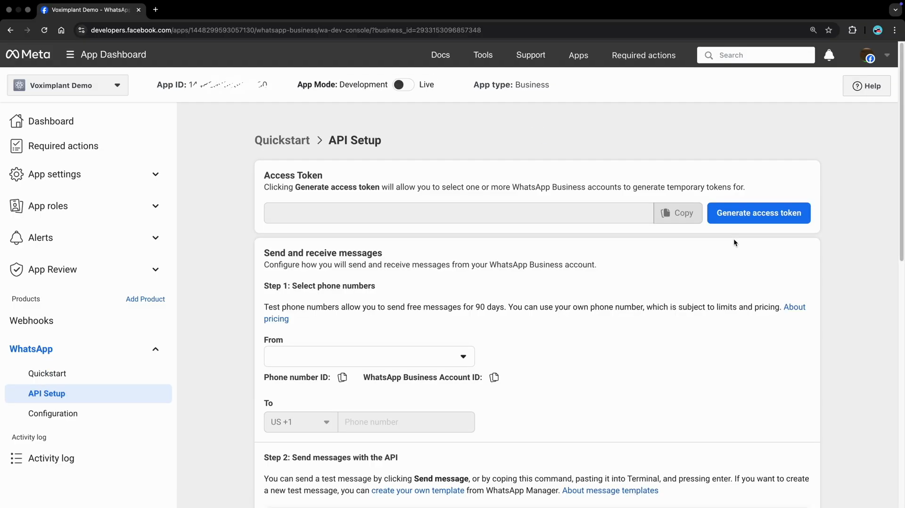
        {/*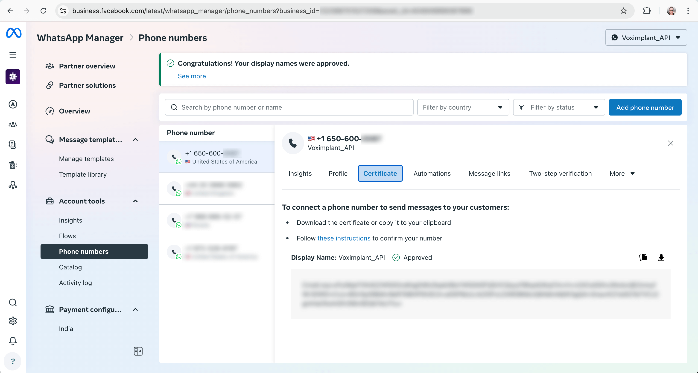*/}
    </Step>
    <Step title="Verify and register the WhatsApp number on the Meta side">
        In WhatsApp Manager, complete verification and registration on the WhatsApp Cloud API side:
        1. In the **Profile** tab, click **Send verification code**.
        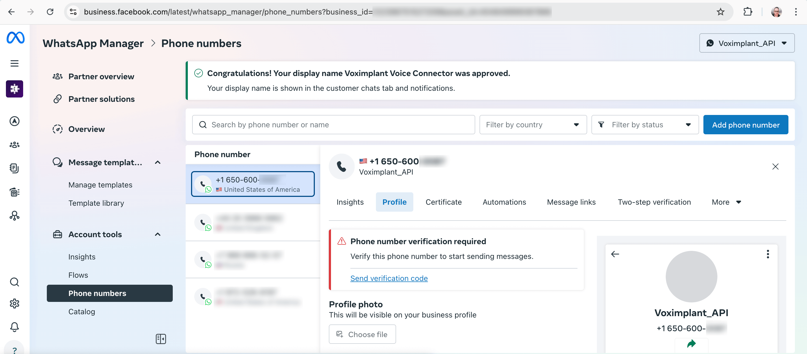

        2. Choose how to receive the code (**SMS** or **phone call**).
        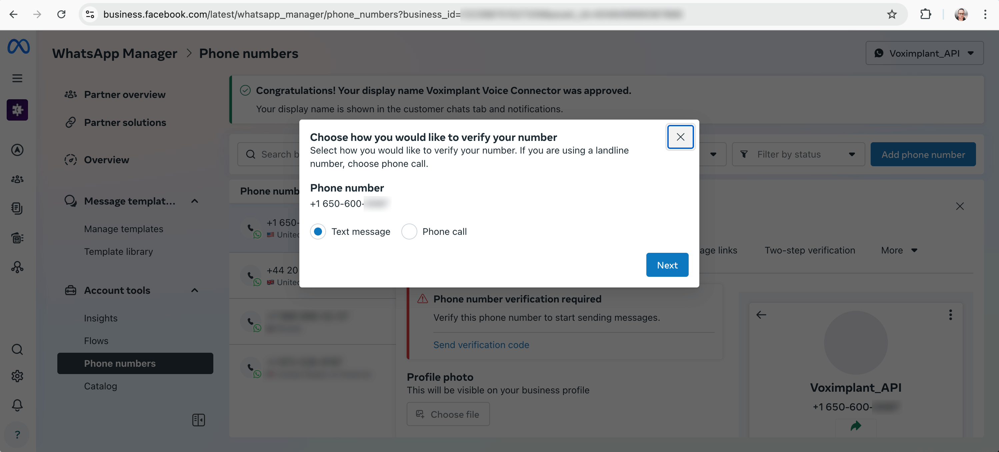

        3. Enter the received code and keep it for the registration step.
        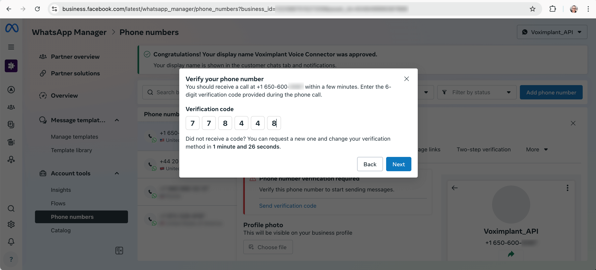

        4. Open the **Certificate** tab and wait until **Display Name** status becomes **Approved**.
        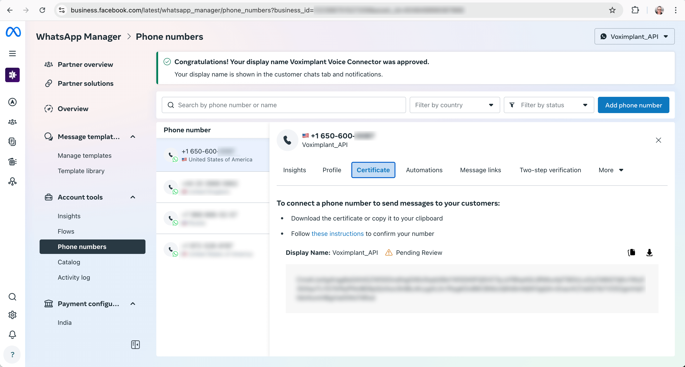

        5. After approval, register the phone number with the Meta Graph API request in the guide or modal.
        

        6. Refresh the phone numbers page and confirm the number status is **Connected**.
        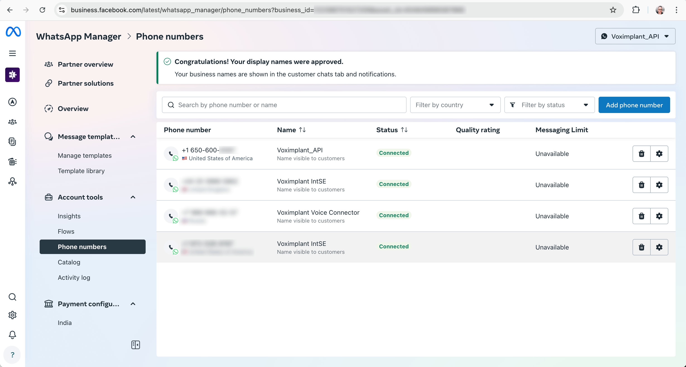
    </Step>
    <Step title="Create Voximplant application">
        In [manage.voximplant.com](https://manage.voximplant.com), create or open an application for this WhatsApp
        incoming flow.
        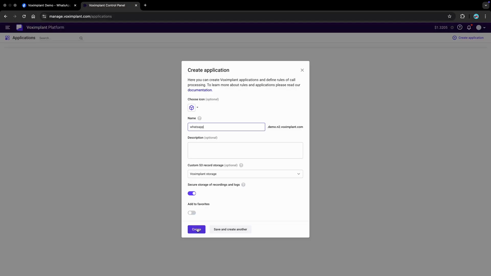
    </Step>
    <Step title="Create an incoming scenario">
        Create your incoming scenario (for example `whatsapp-inbound`) and add the call handling logic.
        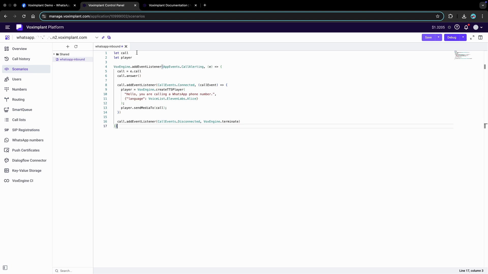

        ```js title="Minimal incoming WhatsApp scenario"
        VoxEngine.addEventListener(AppEvents.CallAlerting, (event) => {
            const call = event.call;
            call.answer();
            call.say("Hello, this WhatsApp call is connected to Voximplant.", {voice: VoiceList.Amazon.en_US_Joanna});
            call.addEventListener(CallEvents.Disconnected, () => VoxEngine.terminate());
        });
        ```
    </Step>
    <Step title="Connect the WhatsApp number in Voximplant">
        Open **WhatsApp numbers** in your application and click **Add WhatsApp number**.
        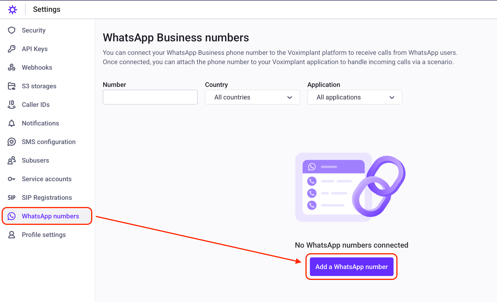

        Follow the modal instructions:
        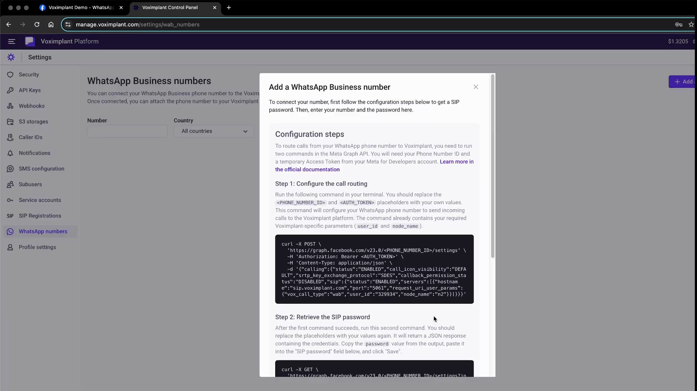

        Execute the Meta Graph API requests via cURL.
        <video
            src="../../../assets/getting-started/terminal-curl.mp4"
            width="100%"
            autoPlay
            loop
            playsInline
            muted
            controls
        />
        Then copy the returned `password` into **SIP password**, set the WhatsApp number, and click **Save**.
        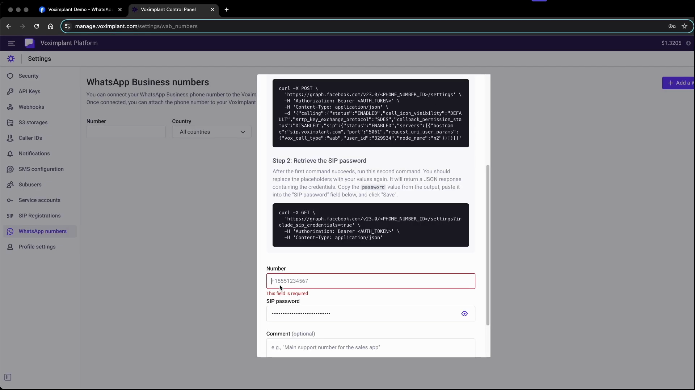
    </Step>
    <Step title="Create routing rule">
        Create a routing rule and attach the incoming scenario.
        Open your application and go to **Routing**.
        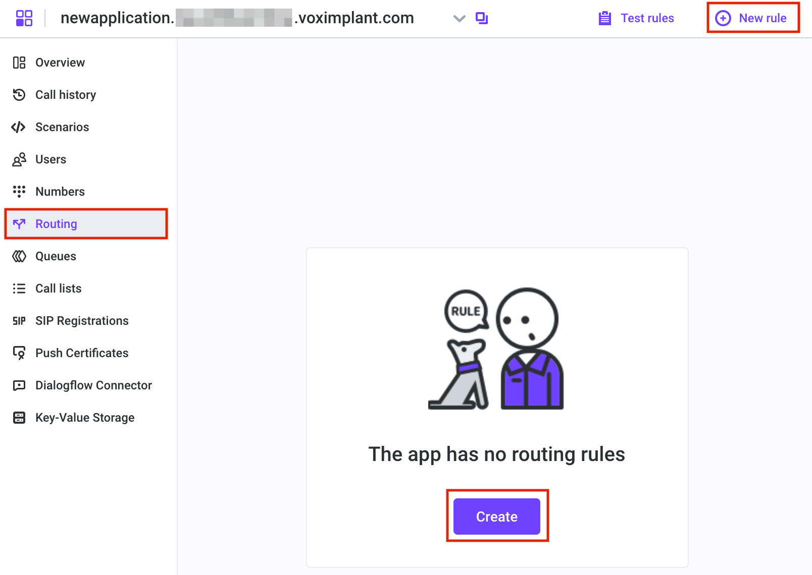

        Click **Create** / **New rule**. The default mask `.*` is fine to process all incoming calls.
        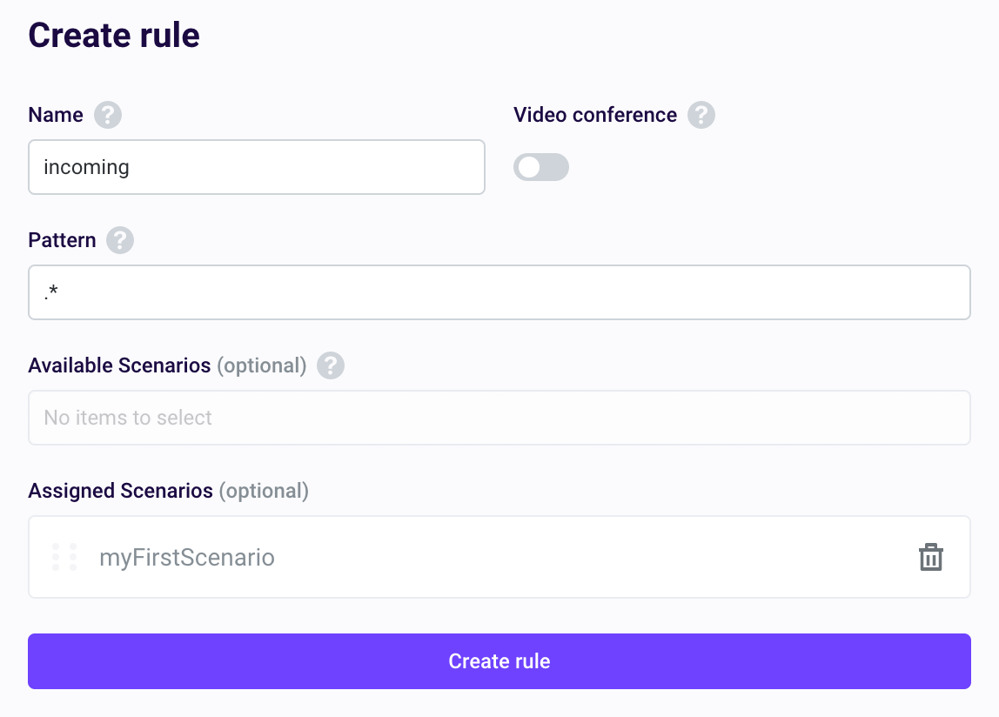
    </Step>
    <Step title="Attach the WhatsApp number to your application">
        Select the available WhatsApp number and attach it to the current application.
        <video
            src="../../../assets/getting-started/attach-whatsapp-number.mp4"
            width="100%"
            autoPlay
            loop
            playsInline
            muted
            controls
        />
    </Step>
    <Step title="Test incoming calling">
        Now you can place a call to your WhatsApp Business number and see it hit your VoxEngine scenario!
    </Step>
</Steps>


## <Icon icon="fa-duotone fa-arrow-up-right" /> Outgoing specifics

Outgoing calls use the same setup as incoming calls. Call `VoxEngine.callWhatsappUser()` to start an outgoing call to WhatsApp users from one of your WhatsApp Business phone numbers.

```js title="Outgoing WhatsApp"
const call = VoxEngine.callWhatsappUser({
  number: "+15551234567",
  callerid: "15557654321"
});
```

### <Icon icon="fa-duotone fa-video" /> Outgoing video walkthrough:

Video link: [Outgoing WhatsApp calling walkthrough](https://www.youtube.com/watch?v=K5PmVQJGoLc)

<llms-ignore>
<iframe
    width="100%"
    height="360"
    src="https://www.youtube.com/embed/K5PmVQJGoLc"
    title="Outgoing WhatsApp calling walkthrough"
    frameBorder="0"
    allow="accelerometer; autoplay; clipboard-write; encrypted-media; gyroscope; picture-in-picture; web-share"
    allowFullScreen
/>
</llms-ignore>

### <Icon icon="fa-duotone fa-solid fa-link" /> More information:
- [Processing calls in scenarios guide](/voice-ai/inbound-vs-outbound/inbound-calls)
- [VoxEngine Call class](/reference/voxengine/call)
- [VoxEngine.callWhatsappUser](/reference/voxengine/voxengine#callwhatsappuser)


## Multimodal simultaneous voice and messaging support
The WhatsApp integration supports both calls and messages, so you can create multi-modal scenarios that handle voice and text in the same flow.
For example, you can answer the call, send a welcome message, then continue with voice prompts and responses.

### Architecture

This follows a similar setup procedure as above, but requires an additional server to proxy messages.

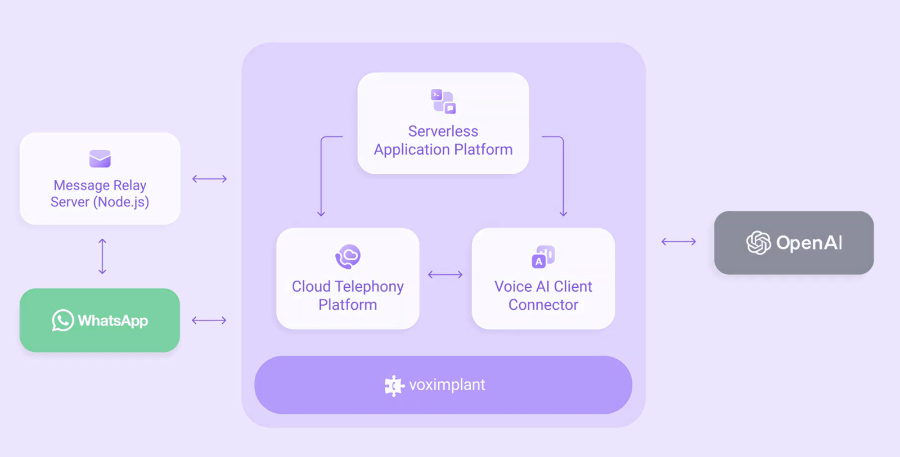


### <Icon icon="fa-duotone fa-video" /> Walkthrough and demo
See here for a quick walkthrough and demo of this capability:
Video link: [Incoming WhatsApp calling demo](https://www.youtube.com/watch?v=aPw7_aqZBhE)

<llms-ignore>
<iframe
    width="100%"
    height="360"
    src="https://www.youtube.com/embed/aPw7_aqZBhE"
    title="Incoming WhatsApp calling demo"
    frameBorder="0"
    allow="accelerometer; autoplay; clipboard-write; encrypted-media; gyroscope; picture-in-picture; web-share"
    allowFullScreen
/>
</llms-ignore>

### <Icon icon="fa-duotone fa-code" /> Example code

VoxEngine code sample for the WhatsApp multimodal voice and text flow with `gpt-realtime-2.1`:

<Code
    src="../../../examples/whatsapp/voxengine_openai_ga.js"
    title="voxengine_openai_ga.js"
    language="javascript"
/>

Node.js proxy server code:
- [WhatsApp multimodal proxy server](/voice-ai/network-options/whatsapp-multimodal-server)
