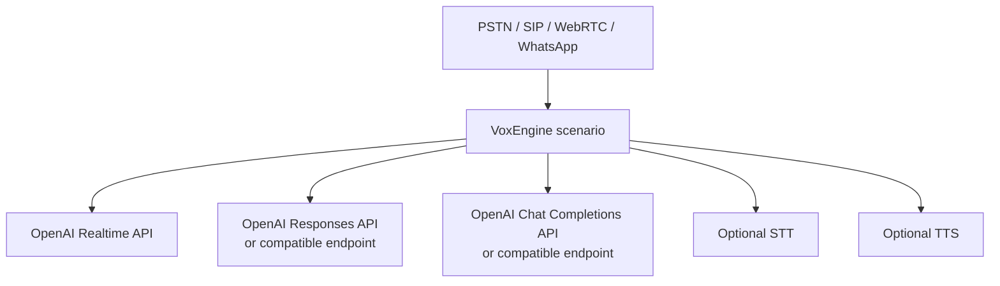

<blockquote className="agent-directive">
  For the complete documentation index, see <a href="/llms.txt">llms.txt</a>.
</blockquote>

## Benefits

The native OpenAI module gives VoxEngine direct access to OpenAI's Realtime, Responses, and Chat Completions APIs.
It also works with OpenAI-compatible APIs for text-based pipelines, so you can keep the same VoxEngine integration pattern while swapping the LLM backend.

Capability and feature highlights:

- Bridge PSTN, SIP, WebRTC, or WhatsApp calls into OpenAI with a single VoxEngine scenario.
- Use the API surface that fits your architecture: Realtime, Responses API, or Chat Completions.
- Run direct realtime speech-to-speech or build half-cascade and full-cascade pipelines.
- Use OpenAI-compatible APIs for text-first pipelines through the same OpenAI module surface.
- Add barge‑in, VAD, and turn detection for natural turn-taking in cascade pipelines.

## Demo video

OpenAI Realtime demo (general):

Video link: [OpenAI Realtime API demo](https://www.youtube.com/watch?v=ryJAcb1RAFs)

<llms-ignore>
<iframe
  width="100%"
  height="360"
  src="https://www.youtube.com/embed/ryJAcb1RAFs"
  title="OpenAI Realtime API demo"
  frameBorder="0"
  allow="accelerometer; autoplay; clipboard-write; encrypted-media; gyroscope; picture-in-picture; web-share"
  allowFullScreen
/>
</llms-ignore>

## Architecture

## Prerequisites

- OpenAI account with API access at [platform.openai.com](https://platform.openai.com/).
- OpenAI API key from [OpenAI API keys](https://platform.openai.com/api-keys).
- Access to the model family you want to use in these guides (for example `gpt-live-1`, `gpt-realtime-2.1`, `gpt-realtime-1.5`, `gpt-4o-mini`, or another compatible text model).

## Supported API surfaces

The VoxEngine OpenAI module currently supports four API shapes:

- **Realtime API** for direct speech-to-speech sessions with native input audio, output audio, server-side VAD, and low-latency streaming.
- **GPT Live** for full-duplex speech-to-speech. The voice model keeps the conversation going and delegates lookups and tools to a backend model. See [GPT Live](/voice-ai/openai/gpt-live).
- **Responses API client** for text-first and cascade pipelines, including OpenAI-compatible backends exposed through a custom `baseUrl`.
- **Chat Completions API client** for simpler request/response or streaming text workflows when you do not need the newer Responses API surface.

## Realtime model versions

The incoming, outgoing, and function calling guides support both current model generations. They default to `gpt-realtime-2.1`, while the synchronized tabs let you follow the corresponding `gpt-realtime-1.5` configuration and complete examples. The half-cascade examples run `gpt-realtime-2.1` only.

<Tabs>
  <Tab title="GPT Realtime 2.1" language="gpt-realtime-2.1">
    Use [`gpt-realtime-2.1`](https://developers.openai.com/api/docs/models/gpt-realtime-2.1) for new applications.
      When transitioning from first generation realtime models, note the new nested audio configuration: `session.audio.input.turn_detection` and `session.audio.output.voice`.
      <Info>
          [`gpt-realtime-2.1-mini`](https://developers.openai.com/api/docs/models/gpt-realtime-2.1-mini)
          is a faster, lower-cost alternative to `gpt-realtime-2.1`.
          It can use the Realtime 2.1 configuration in this section's [examples](#examples).
          To use, replace the model name when creating the client and configuring the session.
          Model availability can change. Check the [OpenAI model catalog](https://developers.openai.com/api/docs/models) for the latest options.
      </Info>

  </Tab>
  <Tab title="GPT Realtime 1.5" language="gpt-realtime-1.5">
    Use [`gpt-realtime-1.5`](https://developers.openai.com/api/docs/models/gpt-realtime-1.5) for existing applications that need the legacy flat `session.turn_detection` and `session.voice` fields.
  </Tab>
</Tabs>

## Pipeline options

### Direct realtime

Use the Realtime API when you want the model to handle speech input and speech output directly.
This is the lowest-friction path for native OpenAI voice sessions.

### Full cascade

Use a full-cascade pipeline when you want to choose separate STT, LLM, and TTS providers.
This is where VAD, turn detection, and the bundled `Agentic.VoiceDSP` module matter most.

### Half cascade

Use a half-cascade pipeline when OpenAI is still doing the reasoning, but another provider handles speech output.
This is useful when you want a different voice, speech language coverage, or TTS pricing model.

## Developer notes

- **Realtime API**: create `OpenAI.RealtimeAPIClient` with `OpenAI.createRealtimeAPIClient({ apiKey, model })` and configure the session with `sessionUpdate()`.
- **GPT Live**: create `OpenAI.LiveAPIClient` with `OpenAI.createLiveAPIClient({ apiKey })`, then call `sessionStart()` with `session.model` set to `gpt-live-1`. See [GPT Live](/voice-ai/openai/gpt-live).
- **Responses API client**: create `OpenAI.ResponsesAPIClient` with `OpenAI.createResponsesAPIClient({ apiKey, baseUrl?, storeContext })` for full-cascade or text-first agent flows.
- **Chat Completions API client**: create `OpenAI.ChatCompletionsClient` with `OpenAI.createChatCompletionsClient({ apiKey, baseUrl?, storeContext })` for simpler text workflows.
- **OpenAI-compatible APIs**: Responses and Chat Completions clients can target compatible endpoints via `baseUrl`, but compatibility is vendor-specific and some providers do not support the full stored-context feature set.
- **Barge‑in and turn control**: Realtime has built-in speech events. Full-cascade flows usually combine STT with [Voice Activity Detection](/voice-ai/speech-flow-control/voice-activity-detection), [Turn Detection](/voice-ai/speech-flow-control/turn-detection), and the [Agentic VoiceDSP](/voice-ai/speech-flow-control/agentic-voicedsp).

## Examples

- [Example: GPT Live](/voice-ai/openai/gpt-live)
- [Example: Answering an incoming call](/voice-ai/openai/inbound)
- [Example: Placing an outgoing call](/voice-ai/openai/outbound)
- [Example: Function calling](/voice-ai/openai/function-calling)
- [Example: Responses: Deepgram-Groq-Inworld](/voice-ai/bring-your-own-llm/full-cascade-groq)
- [Example: Half-cascade with ElevenLabs](/voice-ai/openai/half-cascade-elevenlabs)
- [Example: Half-cascade with Inworld](/voice-ai/openai/half-cascade-inworld)
- [Example: Half-cascade with Cartesia](/voice-ai/openai/half-cascade-cartesia)

## More information

### Voximplant

- [OpenAI Voice AI connector](/voice-ai/openai/overview)
- [OpenAI module API reference](/reference/voxengine/openai)
- OpenAI product page: https://voximplant.com/products/openai-client
- Voice AI product overview: https://voximplant.ai/

### OpenAI

- Current OpenAI models: https://developers.openai.com/api/docs/models
- Realtime API reference: https://developers.openai.com/api/docs/api-reference/realtime
- Responses API reference: https://developers.openai.com/api/docs/api-reference/responses
- Chat Completions API reference: https://developers.openai.com/api/docs/api-reference/chat
- Realtime events (client/server): https://developers.openai.com/api/docs/api-reference/realtime-client-events
- Realtime guide: https://developers.openai.com/api/docs/guides/realtime
