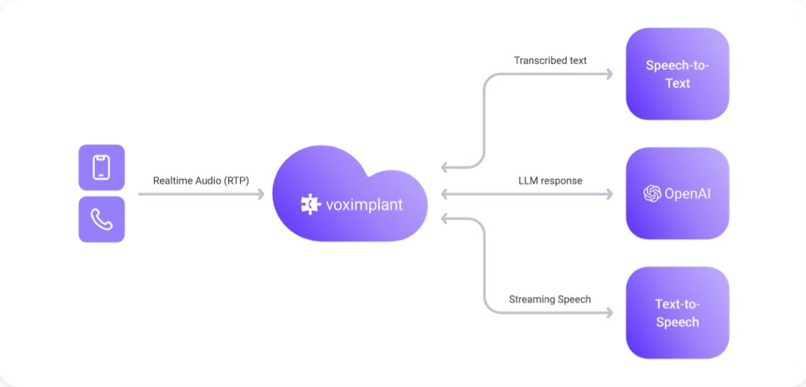
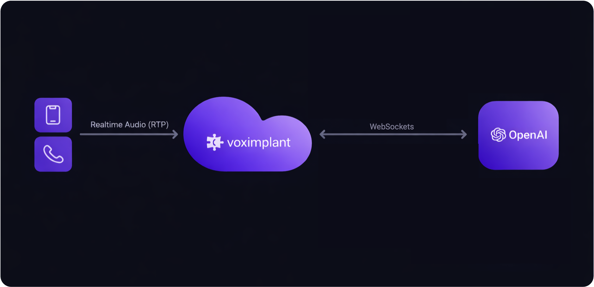
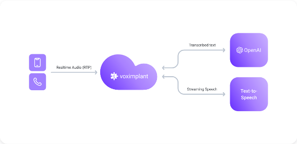
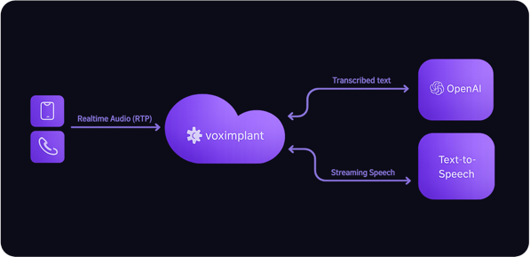
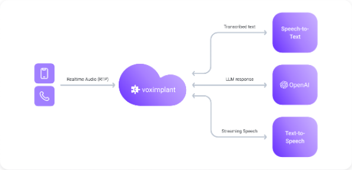
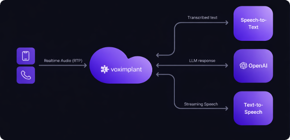

<blockquote className="agent-directive">
  For the complete documentation index, see <a href="/llms.txt">llms.txt</a>.
</blockquote>

VoxEngine supports a wide variety of Voice AI architectures and components.
The right pipeline depends on your priorities -- low latency, interactivity needs, voice choice, and low-level control are some factors to consider.

  <a className="voice-connector-card" href="#speech-to-speech">
      
<em>User↔LLM</em>

      <h3>Speech-to-speech (S2S)</h3>
      
Fully integrated Voice AI that often offers the lowest overall latency.

    Fastest path | Lowest latency
  </a>

  <a className="voice-connector-card" href="#hybrid-cascade">
      
<em>LLM↔TTS</em>

      <h3>Hybrid-cascade</h3>
    
Realtime LLM for speech input and reasoning, with a separate TTS system for output voice.

    More voice choice | Still realtime
  </a>

  <a className="voice-connector-card" href="#full-cascade">
    
<em>STT↔LLM↔TTS</em>

    <h3>Cascaded</h3>
    
Separate STT, LLM, and TTS stages for maximum provider flexibility and pipeline control.

    Most configurable | Most complex
  </a>

## High-level comparison

| Pipeline | Best when you want | Latency | Voice flexibility | Provider flexibility | VoxEngine control |
| --- | --- | --- | --- | --- | --- |
| Speech-to-speech | Streamlined architecture | Lowest | Limited to the realtime provider voice stack | Medium | Medium |
| Hybrid-cascade | Realtime LLM with external TTS | Low | High | High for TTS-only | High |
| Cascaded | Independent control of STT, LLM, and TTS | Higher | High | Highest | Highest |

<Note>
    Some vendors present a speech-to-speech (S2S) API externally, but internally manage a cascaded architecture with separate components with varying degrees of control and configuration.
    See more details below.
</Note>
<Tip>
  * Start with speech-to-speech when you want to get to a working voice agent quickly.
  *  Move to hybrid-cascade when you need more TTS voice choices and control, and can tolerate some additional latency.
  *  Consider full cascade when you need independent control over transcription, reasoning, playback, turn-taking, or
    provider mix and are willing to manage the additional interactions.
</Tip>

## Voximplant connectors and pipeline support

Voximplant always manages the telephony side of the call: routing, answering, bridging media, call control, and any orchestration logic you add in VoxEngine.
Voximplant Voice AI API clients, also called connectors, provide a direct connection from VoxEngine to the provider's environment with a low-latency WebSocket connection.
Voximplant's various connector options differ in how they handle transcription, reasoning, and speech synthesis internally.

LLMs like OpenAI, Gemini, Grok, and Qwen provide direct access to the speech-enabled LLM.
Speech input and output parameters are managed as part of the connector.

Ultravox provides a speech-native LLM, but integrates TTS within their environment, only exposing a Speech-to-Speech interface to Voximplant.
Similarly, ElevenLabs, Cartesia, Deepgram, and Inworld provide a speech-to-speech interface to Voximplant, but handle LLM, STT, and TTS elements internally.
Configuration of these internal elements varies by vendor. Call these integrations "indirect speech-to-speech".

All vendors provide some level of end-of-turn detection, with some vendors providing more explicit control over turn-taking and barge-in.

The table below summarizes support by vendor from the Voximplant connector perspective.
| Agent vendor | Direct S2S | Indirect S2S | Hybrid | Cascaded |
| --- | --- | --- | --- | --- |
| [OpenAI](/voice-ai/openai/overview) | ✓ |  | ✓ | ✓ |
| [Gemini Live](/voice-ai/google/overview) | ✓ |  |  |  |
| [xAI Grok voice agent](/voice-ai/xai/overview) | ✓ |  |  |  |
| [Qwen Cloud](/voice-ai/qwen/overview) | ✓ |  |  |  |
| [Ultravox](/voice-ai/ultravox/overview) |  | ✓ |  |  |
| [ElevenLabs agents](/voice-ai/elevenlabs/overview) |  | ✓ |  |  |
| [Deepgram agents](/voice-ai/deepgram/overview) |  | ✓ |  |  |
| [Cartesia Line agents](/voice-ai/cartesia/overview) |  | ✓ |  |  |
| [Inworld Realtime](/voice-ai/inworld/overview) |  | ✓ |  |  |

## Speech-to-speech

In this pattern, caller audio is bridged to the provider in realtime, and the provider returns speech audio directly back into the call.

  
  

### How it works

- Caller audio is streamed from VoxEngine to a realtime voice agent over WebSockets.
- The provider handles speech recognition, reasoning, and speech generation in one session.
- VoxEngine manages telephony, routing, media bridge, and call control around that session.

### Tradeoffs

  

    <h4>Advantages</h4>
    <ul>
      <li>Lowest end-to-end latency.</li>
      <li>Simple architecture with fewer systems to coordinate.</li>
      <li>Fastest path from prototype to production trial.</li>
      <li>Natural fit for direct realtime connectors with built-in streaming speech.</li>
    </ul>
  

  

    <h4>Disadvantages</h4>
    <ul>
      <li>Voice quality and speech style are limited to the provider's native output voices.</li>
      <li>You have less control over how STT, reasoning, and speech output are separated.</li>
      <li>Switching one stage often means switching the whole stack.</li>
    </ul>
  

### Best for

- You want the fastest possible conversational loop.
- You are happy with the provider's built-in voices.
- You want the simplest operational model.

### Related guides

#### Direct speech-to-speech connectors

These connectors expose the speech-enabled LLM directly to VoxEngine.

  <a className="voice-connector-card compact" href="/voice-ai/openai/overview">
    <h3>OpenAI</h3>
    
Direct realtime speech-to-speech with OpenAI.

  </a>

  <a className="voice-connector-card compact" href="/voice-ai/google/overview">
    <h3>Gemini Live</h3>
    
Direct live audio pipeline with Gemini Live.

  </a>

  <a className="voice-connector-card compact" href="/voice-ai/xai/overview">
    <h3>xAI Grok voice agent</h3>
    
Realtime voice interaction with Grok voice agent sessions.

  </a>

  <a className="voice-connector-card compact" href="/voice-ai/qwen/overview">
    <h3>Qwen Cloud</h3>
    
Realtime speech-to-speech with the Qwen audio model.

  </a>

#### Indirect speech-to-speech connectors

These connectors present a speech-to-speech interface to VoxEngine while managing more of the internal speech and agent stack inside the provider environment.

  <a className="voice-connector-card compact" href="/voice-ai/ultravox/overview">
    <h3>Ultravox</h3>
    
Speech-native realtime agent with native speech input and output.

  </a>

  <a className="voice-connector-card compact" href="/voice-ai/elevenlabs/overview">
    <h3>ElevenLabs agents</h3>
    
Conversational agent sessions with realtime speech handling.

  </a>

  <a className="voice-connector-card compact" href="/voice-ai/deepgram/overview">
    <h3>Deepgram agents</h3>
    
Realtime voice agent flow with Deepgram speech input and output.

  </a>

  <a className="voice-connector-card compact" href="/voice-ai/cartesia/overview">
    <h3>Cartesia Line agents</h3>
    
Speech-to-speech agent flow with Cartesia-managed runtime behavior.

  </a>

  <a className="voice-connector-card compact" href="/voice-ai/inworld/overview">
    <h3>Inworld Realtime</h3>
    
Speech-to-speech sessions with Inworld STT, an LLM, and TTS-2 output.

  </a>

## Hybrid-cascade

Hybrid-cascade - sometimes called half-cascade - keeps the realtime LLM in the loop for user speech input and reasoning, but moves speech output to a separate synthesis provider.
This is often the best compromise between latency and voice flexibility.

  
  

### How it works

- Caller audio is streamed to a realtime LLM.
- The realtime LLM returns text rather than audio (or you transcribe the audio).
- VoxEngine sends the text into a TTS engine and streams the generated speech back to the caller.

### Tradeoffs

  

    <h4>Advantages</h4>
    <ul>
      <li>Much broader choice of output voices and TTS providers.</li>
      <li>Lets you tune speaking style, voice identity, and output pricing separately from the LLM.</li>
      <li>Still supports low-latency streaming when paired with realtime TTS.</li>
      <li>Good balance between orchestration control and implementation simplicity.</li>
    </ul>
  

  

    <h4>Disadvantages</h4>
    <ul>
      <li>More moving parts than direct speech-to-speech.</li>
      <li>Output latency depends on the selected TTS provider and playback strategy.</li>
      <li>Increased cost - you need to pay for realtime LLM and speech synthesis.</li>
    </ul>
  

### Best for

- You want a specific voice provider or voice quality that your LLM provider does not offer.
- You want more control over output speech without moving to a full cascade.
- You need a practical middle ground between speed and flexibility.

### Related guides

  <a className="voice-connector-card compact" href="/voice-ai/openai/half-cascade-cartesia">
    <h3>OpenAI + Cartesia</h3>
    
Realtime LLM with Cartesia realtime TTS.

  </a>

  <a className="voice-connector-card compact" href="/voice-ai/openai/half-cascade-elevenlabs">
    <h3>OpenAI + ElevenLabs</h3>
    
Realtime LLM with ElevenLabs streaming TTS.

  </a>

  <a className="voice-connector-card compact" href="/voice-ai/openai/half-cascade-inworld">
    <h3>OpenAI + Inworld</h3>
    
Realtime LLM with Inworld speech output.

  </a>

  <a className="voice-connector-card compact" href="/voice-ai/speech/grok-tts">
    <h3>Grok Realtime TTS</h3>
    
xAI streaming TTS for half-cascade speech output.

  </a>

## Full cascade

Full cascade separates speech-to-text, reasoning, and text-to-speech into independent stages. This gives you the most control over the pipeline and the most freedom to mix providers.

  
  

### How it works

- VoxEngine transcribes caller audio with an STT integration.
- Your scenario sends text to an LLM or OpenAI-compatible endpoint.
- The text response is synthesized through a TTS provider and streamed back into the call.
- Voice activity detection, turn detection, and barge-in control are handled explicitly in the orchestration layer.

### Tradeoffs

  

    <h4>Advantages</h4>
    <ul>
      <li>Maximum freedom to choose the best STT, LLM, and TTS provider for each stage.</li>
      <li>Strong control over turn-taking, interruption logic, and prompt/response handling.</li>
      <li>Works well when you need custom transcription behavior, domain vocabulary, or provider-specific tuning.</li>
      <li>Easier to swap one layer without redesigning the whole pipeline.</li>
    </ul>
  

  

    <h4>Disadvantages</h4>
    <ul>
      <li>Highest implementation and operational complexity.</li>
      <li>More places to manage latency and streaming coordination.</li>
      <li>Requires deliberate turn-taking and barge-in handling for a natural caller experience.</li>
    </ul>
  

### Best for

- You need full control over transcription, reasoning, and speech generation.
- You want to mix providers based on quality, language support, or cost.
- You need explicit turn-taking logic or custom orchestration around the LLM.

### Related guides

For turn-taking, interruption, and end-of-turn behavior, see the [Speech Flow Control guides](/voice-ai/speech-flow-control/turn-detection). For standalone xAI speech output in cascade pipelines, see [Grok TTS](/voice-ai/speech/grok-tts).

  <a className="voice-connector-card compact" href="/voice-ai/bring-your-own-llm/full-cascade-groq">
    <h3>Responses: Deepgram-Groq-Inworld</h3>
    
Independent STT, LLM, and TTS with explicit turn-taking.

  </a>

  <a className="voice-connector-card compact" href="/voice-ai/bring-your-own-llm/grok-full-cascade">
    <h3>Responses: Microsoft-Grok-Grok TTS</h3>
    
Microsoft STT, xAI Grok text mode, and Grok Realtime TTS.

  </a>

  <a className="voice-connector-card compact" href="/voice-ai/speech-flow-control/agentic-voicedsp">
    <h3>Agentic VoiceDSP</h3>
    
Reference guide for VAD, turn detection, and barge-in orchestration.

  </a>

  <a className="voice-connector-card compact" href="/voice-ai/enhance-and-deploy/telephony-and-voice-ai#run-tts-in-voxengine">
    <h3>Run TTS in VoxEngine</h3>
    
Related guide for playback and TTS orchestration patterns.

  </a>

## Choosing a pipeline

We recommend this progression when you are new to Voice AI:

1. Start with speech-to-speech to validate the call flow and prompt design quickly.
2. Move to hybrid-cascade if you need a different voice or output speech behavior than your speech-LLM provider offers.
3. Move to full cascade when you need full provider selection, explicit turn-taking control, and/or custom orchestration between stages.

That progression keeps the first version simple while leaving room to add flexibility only when the product requirements justify the extra moving parts.
