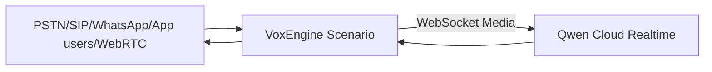

<blockquote className="agent-directive">
  For the complete documentation index, see <a href="/llms.txt">llms.txt</a>.
</blockquote>

## Overview

This example answers an incoming call and connects it to Qwen Cloud with a short prompt, an English voice, and barge-in.

**⬇️ Jump to the [Full VoxEngine scenario](#full-voxengine-scenario).**

## Prerequisites

- Set up an incoming entrypoint for the caller:
  - [Phone number](/platform/getting-started/buy-a-phone-number)
  - [WhatsApp](/voice-ai/network-options/whatsapp)
  - [SIP user / SIP registration](/voice-ai/network-options/sip)
  - [App user](/platform/getting-started/create-users)
- Create a [routing rule](/platform/getting-started/create-a-routing-rule) that points the destination to this scenario.
- Store your Qwen Cloud API key in Voximplant [Secrets](/platform/storage/secret-storage) under `QWEN_API_KEY`.

## Architecture



## Usage highlights

- Create a `VoiceAgentAPIClient` with `QwenCloud.createVoiceAgentAPIClient`.
- The example pins `model` to `qwen-audio-3.1-realtime-plus`.
- On `SessionCreated`, send `sessionUpdate` with `voice`, `instructions`, languages, and `turn_detection`.
- On `SessionUpdated`, bridge audio with `VoxEngine.sendMediaBetween(call, client)` and ask Qwen to greet the caller.
- On `InputAudioBufferSpeechStarted`, call `clearMediaBuffer` so the caller can interrupt playback.

### Turn detection and barge-in

```js
voiceAIClient.addEventListener(
  QwenCloud.VoiceAgentAPIEvents.InputAudioBufferSpeechStarted,
  () => voiceAIClient.clearMediaBuffer()
);
```

## Configure before you run

- Set `QWEN_API_KEY` in Voximplant [Secrets](/platform/storage/secret-storage).
- Change `voice` if you want another Qwen system voice or a cloned voice id. `beth_v3.1` is an English 3.1 voice. The provider default is `longanqian_v3.1`.
- Adjust `SYSTEM_PROMPT` for your brand voice and guardrails.

## Try it

Suggested test prompts:

- "Hello"
- "What can you help me with?"
- "Goodbye."

## Notes

[See the VoxEngine API Reference for more details](/reference/voxengine/qwen-cloud).

## Full VoxEngine scenario

<Code
  src="../../../examples/qwen/voxeengine-qwen-answer-incoming-call.js"
  title="voxeengine-qwen-answer-incoming-call.js"
  language="javascript"
  maxLines={0}
/>
