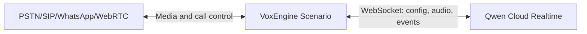

<blockquote className="agent-directive">
  For the complete documentation index, see <a href="/llms.txt">llms.txt</a>.
</blockquote>

Qwen Cloud's realtime audio API is available in VoxEngine as a native connector.
The client streams caller audio to `qwen-audio-3.1-realtime-plus` and plays the model's speech back into the call.

## Benefits

- **Built-in WebSocket connector.** VoxEngine opens the Qwen Cloud session and converts call audio, so the scenario keeps call control, routing, and telephony.
- **Direct speech-to-speech.** One model handles recognition, reasoning, and speech output. The default model is `qwen-audio-3.1-realtime-plus`.
- **Session control from VoxEngine.** Send instructions, voice, languages, and turn detection with `sessionUpdate` after `SessionCreated`.
- **Barge-in.** Clear the playback buffer when Qwen reports `InputAudioBufferSpeechStarted`.
- **Function calling.** Declare tools in the session, run them in the scenario, and return `function_call_output` before the next response.

## Architecture

VoxEngine sits between the caller and Qwen Cloud.
The scenario creates a `VoiceAgentAPIClient`, applies `session.update` before the first audio frame, then bridges media.

Tool calls come back as events. The scenario runs the function and sends the result over the same client.

## Prerequisites

- A Qwen Cloud API key. The client sends it as `Authorization: Bearer`.
- Store that key in Voximplant [Secrets](/platform/storage/secret-storage) under `QWEN_API_KEY`.
- Optional: pass a Qwen Cloud workspace id as `workspace`. The client sends it as `X-DashScope-WorkSpace`.

## Development notes

- Load the module with `require(Modules.QwenCloud)` and create the client with `QwenCloud.createVoiceAgentAPIClient`.
- `model` defaults to `qwen-audio-3.1-realtime-plus`. The examples set it explicitly.
- On `SessionCreated`, call `sessionUpdate` before bridging audio. `turn_detection` can only change before the first audio frame. `voice` is applied on the first `session.update`.
- On `SessionUpdated`, call `VoxEngine.sendMediaBetween(call, client)`.
- Greet the caller by inserting a short user text item with `conversationItemCreate`, then call `responseCreate`. The Qwen `response.create` event accepts `response.modalities` and `response.voice`, so the greeting text goes in the conversation item.
- For barge-in, call `clearMediaBuffer` on `InputAudioBufferSpeechStarted`.
- The examples use the English system voice `beth_v3.1`. The model default is `longanqian_v3.1`. Other 3.1 system voices include `betty_v3.1`, `cally_v3.1`, `longanhuan_v3.1`, `longanlingxin_v3.1`, `longanfengyue_v3.1`, and `xunanchuan_v3.1`. You can pass a cloned voice id in `voice`.
- Set `input_audio_transcription.language` and `output_audio.language` for `qwen-audio-3.1-realtime-plus`. Output language steers speech. Also say the reply language in `instructions` if the spoken text should stay in that language.
- By default, `turn_detection.type` is `server_vad`. Set it to `smart_turn` for semantic turn detection, or set `turn_detection` to `null` for push-to-talk. Push-to-talk then needs `inputAudioBufferCommit` and `responseCreate`.
- `enable_search` and `tools` cannot be enabled together.
- Function tools use a nested `function` object. See [Function calling](/voice-ai/qwen/function-calling).

<Note>
`server_vad` starts a response when the caller stops speaking. `silence_duration_ms` defaults to `800` and can be set from `200` to `6000`.
</Note>

## Examples

- [Example: Answering an incoming call](/voice-ai/qwen/inbound)
- [Example: Placing an outgoing call](/voice-ai/qwen/outbound)
- [Example: Function calling](/voice-ai/qwen/function-calling)

## Links

- [Qwen Cloud module API reference](/reference/voxengine/qwen-cloud)
- [qwen-audio-3.1-realtime-plus](https://www.qwencloud.com/models/qwen-audio-3.1-realtime-plus)
- [Qwen-Audio client events](https://docs.qwencloud.com/api-reference/qwen-audio-realtime/client-events)
- [Qwen-Audio server events](https://docs.qwencloud.com/api-reference/qwen-audio-realtime/server-events)
