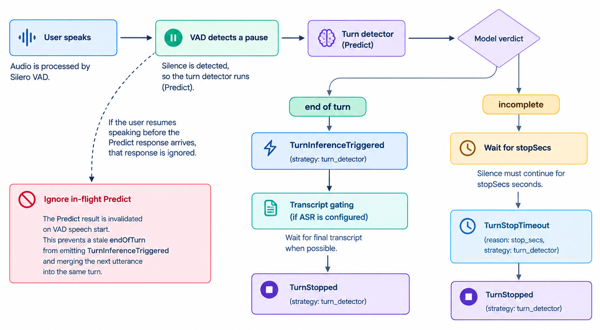

<blockquote className="agent-directive">
  For the complete documentation index, see <a href="/llms.txt">llms.txt</a>.
</blockquote>

## Benefits

[Agentic VoiceDSP](/reference/voxengine/agentic/voice-dsp) combines [Silero VAD](/voice-ai/speech-flow-control/voice-activity-detection), [Pipecat turn detection](/voice-ai/speech-flow-control/turn-detection), and optional [Hush noise suppression](/reference/voxengine/hush/noise-suppression) in one VoxEngine module.

You can still import those modules one by one. VoiceDSP is the path that gives you a single client, one media target, and high-level user-turn events.

Use it when you [build your own LLM application](/voice-ai/bring-your-own-llm/open-ai-api-compatibility). It also fits any speech-processing scenario that needs turn boundaries.

Capability highlights:

- One WebSocket connector for VAD, turn detection, and optional noise suppression.
- Start and stop strategies that emit `TurnStarted`, `TurnInferenceTriggered`, and `TurnStopped`.
- Optional ASR gating so you can start LLM inference before the final transcript arrives.
- Idle and watchdog timers that follow the Pipecat user-turn model.

## How it works

`Agentic.createVoiceDSP` opens a client to the bundled `/agentic/voice_dsp` connector. The connector runs Silero voice-activity detection, Pipecat Smart Turn, and optional Hush noise suppression, then applies your start and stop strategies.

| Connector component | Vendor / stack | Scenario-facing config |
| --- | --- | --- |
| VAD | Silero | [`vadParameters`](/reference/voxengine/agentic#vadparameters) |
| Turn detector | Pipecat Smart Turn | [`turnDetectorParameters`](/reference/voxengine/agentic#turndetectorparameters) |
| Noise suppression | Hush (ONNX, PCM16 at 16 kHz) | [`noiseSuppressionParameters`](/reference/voxengine/agentic#noisesuppressionparameters) — optional; off unless you pass it |

The turn lifecycle follows [Pipecat UserTurnProcessor](https://github.com/pipecat-ai/pipecat/blob/main/src/pipecat/turns/user_turn_processor.py) and [TurnAnalyzerUserTurnStopStrategy](https://github.com/pipecat-ai/pipecat/blob/main/src/pipecat/turns/user_stop/turn_analyzer_user_turn_stop_strategy.py).

### Smart turn flow

1. VAD detects a pause, and the turn detector runs (`Predict`).
2. If the model returns **end of turn**, VoiceDSP emits [`TurnInferenceTriggered`](/reference/voxengine/agentic/voice-dsp-events#turninferencetriggered), then [`TurnStopped`](/reference/voxengine/agentic/voice-dsp-events#turnstopped) after transcript gating when ASR is configured.
3. If the model returns **incomplete**, silence has to continue for [`stopSecs`](/reference/voxengine/agentic#turndetectorparameters-stopsecs) seconds. VoiceDSP then emits [`TurnStopTimeout`](/reference/voxengine/agentic/voice-dsp-events#turnstoptimeout) with `reason: stop_secs`, then `TurnStopped`.

<div className="themed-figure">
  
</div>

If the caller resumes speaking before the `Predict` response arrives, VoiceDSP ignores that response. An in-flight `Predict` is invalidated on VAD speech start, so a stale `endOfTurn` cannot emit `TurnInferenceTriggered` or merge the next utterance into the same turn.

VoiceDSP handles `stopSecs` in the scenario runtime. It does not forward `stopSecs` to the connector.

### Stop-strategy precedence

When several stop strategies are configured, they are ranked so one turn always finalizes with **one** strategy. `TurnInferenceTriggered.strategy` and `TurnStopped.strategy` stay the same:

1. `controller_timeout` — the user-turn-stop watchdog. It always wins, including when a transcript is still pending. It reuses the pending strategy label, or the configured fallback if nothing is pending.
2. `turn_detector` — the model verdict, plus its `stopSecs` fallback, which is still labeled `strategy: 'turn_detector'`. This path is authoritative.
3. `speech_timeout` — a pure fallback.

A `speech_timeout` fallback does not pre-empt or relabel the model `turn_detector` while that detector is engaged for the current segment. That includes a pending `Predict` verdict, a pending `turn_detector` finalize, and the `stopSecs` fallback armed after an `endOfTurn: false` verdict. When `turn_detector` and `speech_timeout` are both configured, the detector (with its `stopSecs` fallback and the `controller_timeout` watchdog) owns every finalization path. `speech_timeout` fires only when `turn_detector` is not configured.

`TurnInferenceTriggered.strategy` and `TurnStopped.strategy` always match a configured stop strategy. If you omit `turn_detector` from `stopStrategies` (tests, or ASR-only stop logic):

- VoiceDSP does not send `Predict`.
- Connector `Turn.Result` is ignored.
- Events never report `strategy: 'turn_detector'`. The watchdog still force-stops with `TurnStopTimeout` `reason: controller_timeout`, labeled with the configured fallback (`speech_timeout`).

### ASR transcript gating

Pass an [ASR](/reference/voxengine/asr) instance to [`Agentic.createVoiceDSP`](/reference/voxengine/agentic#createvoicedsp) when you want transcript-aware turns:

- Transcription-based start strategies ([`transcription`](/reference/voxengine/agentic/voice-dsp-strategies/transcription-start), [`min_words`](/reference/voxengine/agentic/voice-dsp-strategies/min-words-start)) can emit [`TurnStarted`](/reference/voxengine/agentic/voice-dsp-events#turnstarted).
- `TurnStopped` waits for a **final** transcript when it can.
- If the turn analyzer finishes before ASR, `TurnInferenceTriggered` fires first so the scenario can start LLM inference early.
- An ASR grace timer ([`asrGraceTimeout`](/reference/voxengine/agentic#voicedspparameters-asrgracetimeout), default **0.3** seconds) starts at `TurnInferenceTriggered`. Until it expires, later ASR interim or final results update the snapshot that `TurnStopped` uses. A final transcript finalizes the turn immediately. Keep the default shorter than typical ASR final latency so `TurnStopped` does not wait for the ASR final; start the LLM on `TurnInferenceTriggered`. When the timer expires, `TurnStopped` uses the latest snapshot, including interim text.
- After `TurnStopped`, late ASR interim or final results for the closed utterance are ignored until a new speech segment (VAD speech start) or a new turn start. That prevents a ghost `TurnStarted` and content bleed into the next turn.

<Info title="Required for transcription and min_words">
Pass the same ASR instance you send call media to:

```js
Agentic.createVoiceDSP({
  asr,
  startStrategies: [Agentic.VoiceDSPStrategies.createMinWordsStart({ minWords: 3 })],
});
```

Without `asr`, those start strategies never fire. Do not rely on `instanceof` across `Modules.ASR` and `Modules.Agentic`. VoiceDSP accepts any ASR-like object with event listeners.
</Info>

### User turn stop watchdog

[`userTurnStopTimeout`](/reference/voxengine/agentic#voicedspparameters-userturnstoptimeout) (default **5.0** seconds, same idea as Pipecat `user_turn_stop_timeout`) forces turn finalization when a turn stays active and no stop strategy fires. VoiceDSP emits `TurnStopTimeout` with `reason: controller_timeout`, then `TurnStopped`. The inference and stop events reuse the pending strategy, or the configured fallback if none is pending. They never use `turn_detector` unless that strategy is configured.

### User idle

This timer follows Pipecat `UserIdleController`. It is separate from Smart Turn `stopSecs`.

- Set [`userTurnIdleTimeout`](/reference/voxengine/agentic#voicedspparameters-userturnidletimeout) in seconds. **0** disables it.
- Call [`signalAssistantTurnEnded()`](/reference/voxengine/agentic/voice-dsp#signalassistantturnended) when TTS or LLM playback finishes. That clears the assistant-speaking state and starts the idle timer if the caller is not in an active turn.
- Call [`signalAssistantTurnStarted()`](/reference/voxengine/agentic/voice-dsp#signalassistantturnstarted) when the assistant starts speaking. That marks the assistant as speaking and cancels the idle timer.
- `TurnStarted.interrupted` is `true` only when the user turn starts while the assistant is speaking. That requires the signal calls above. It is not a copy of the strategy `enableInterruptions` flag.
- When the assistant is speaking and a start strategy has `enableInterruptions: false`, `TurnStarted` is suppressed.
- User speech or `TurnStarted` also cancels the idle timer.

### Noise suppression

Pass [`noiseSuppressionParameters`](/reference/voxengine/agentic#voicedspparameters-noisesuppressionparameters) to enable Hush inside the bundled connector. The parameter shape matches [`Hush.NoiseSuppressionParameters`](/reference/voxengine/hush#noisesuppressionparameters) (`attenLimDb`). Developer-only `model` and `cpuCount` stay hidden.

- Omit `noiseSuppressionParameters` to leave noise suppression off.
- Do not `require(Modules.Hush)` for this path. Hush runs server-side in the VoiceDSP connector, not as a separate `Hush.createNoiseSuppression` media unit. For the separate unit and its explicit media routing, see the [Hush noise suppression guide](/voice-ai/speech-flow-control/noise-suppression).
- Denoised audio stays inside the connector pipeline, before VAD and turn detection. The scenario still sends call media only to `Agentic.VoiceDSP`.

## Usage

- Create an [`Agentic.VoiceDSP`](/reference/voxengine/agentic/voice-dsp) instance with [`Agentic.createVoiceDSP`](/reference/voxengine/agentic#createvoicedsp) and your parameters.
- Send call media to it with `call.sendMediaTo`.
- Pass an ASR instance when you use transcription-based start strategies (`transcription`, `min_words`).
- Set `turnDetectorParameters.stopSecs` (default **3.0**).
- Optionally set `asrGraceTimeout`, `userTurnStopTimeout`, and `userTurnIdleTimeout`.
- Call `signalAssistantTurnStarted` and `signalAssistantTurnEnded` from your TTS or LLM playback lifecycle.
- Configure start and stop strategies with [`Agentic.VoiceDSPStrategies`](/reference/voxengine/agentic/voice-dsp-strategies/overview) factories.
- Listen to [`Agentic.VoiceDSPEvents`](/reference/voxengine/agentic/voice-dsp-events) and implement your application logic.

<Note>
Silero VAD and Pipecat turn-detector signals stay inside VoiceDSP. Scenarios see the high-level [VoiceDSP events](/reference/voxengine/agentic/voice-dsp-events), not the raw detector events.
</Note>

The scenario below is the reference incoming-call setup: it creates VoiceDSP, sends call media to it, and logs turn events.

```js
/**
 * Base usage of Agentic Voice DSP (Silero VAD + Pipecat Turn + bundled Hush noise suppression).
 * Omit noiseSuppressionParameters to leave noise suppression disabled.
 */

require(Modules.Agentic);

const VAD_THRESHOLD = 0.5;
const VAD_MIN_SILENCE_DURATION_MS = 300;
const VAD_SPEECH_PAD_MS = 0;

const TURN_THRESHOLD = 0.5;
const TURN_PRE_SPEECH_MS = 0;
const TURN_MAX_DURATION_SECS = 8;
const TURN_STOP_SECS = 3.0;
const ASR_GRACE_TIMEOUT = 0.3;
const USER_TURN_STOP_TIMEOUT = 5.0;
const USER_TURN_IDLE_TIMEOUT = 30;
const NOISE_SUPPRESSION_ATTEN_LIM_DB = 0;

const voiceDSPParameters = {
  vadParameters: {
    threshold: VAD_THRESHOLD,
    minSilenceDurationMs: VAD_MIN_SILENCE_DURATION_MS,
    speechPadMs: VAD_SPEECH_PAD_MS,
  },
  turnDetectorParameters: {
    threshold: TURN_THRESHOLD,
    preSpeechMs: TURN_PRE_SPEECH_MS,
    maxDurationSecs: TURN_MAX_DURATION_SECS,
    stopSecs: TURN_STOP_SECS,
  },
  noiseSuppressionParameters: {
    attenLimDb: NOISE_SUPPRESSION_ATTEN_LIM_DB,
  },
  userTurnIdleTimeout: USER_TURN_IDLE_TIMEOUT,
  userTurnStopTimeout: USER_TURN_STOP_TIMEOUT,
  asrGraceTimeout: ASR_GRACE_TIMEOUT,
  startStrategies: [Agentic.VoiceDSPStrategies.createVADStart()],
  stopStrategies: [Agentic.VoiceDSPStrategies.createTurnDetectorStop()],
};

VoxEngine.addEventListener(AppEvents.CallAlerting, async ({ call }) => {
  let voiceDSP;

  try {
    const callBaseHandler = () => {
      voiceDSP?.close();
      VoxEngine.terminate();
    };

    call.addEventListener(CallEvents.Disconnected, callBaseHandler);
    call.addEventListener(CallEvents.Failed, callBaseHandler);

    voiceDSP = await Agentic.createVoiceDSP(voiceDSPParameters);

    voiceDSP.addEventListener(Agentic.VoiceDSPEvents.TurnStarted, (event) => {
      Logger.write('===Agentic.VoiceDSPEvents.TurnStarted===');
      Logger.write(JSON.stringify(event));
    });

    voiceDSP.addEventListener(Agentic.VoiceDSPEvents.TurnInferenceTriggered, (event) => {
      Logger.write('===Agentic.VoiceDSPEvents.TurnInferenceTriggered===');
      Logger.write(JSON.stringify(event));
    });

    voiceDSP.addEventListener(Agentic.VoiceDSPEvents.TurnStopped, (event) => {
      Logger.write('===Agentic.VoiceDSPEvents.TurnStopped===');
      Logger.write(JSON.stringify(event));
      voiceDSP?.signalAssistantTurnEnded();
    });

    voiceDSP.addEventListener(Agentic.VoiceDSPEvents.TurnStopTimeout, (event) => {
      Logger.write('===Agentic.VoiceDSPEvents.TurnStopTimeout===');
      Logger.write(JSON.stringify(event));
    });

    voiceDSP.addEventListener(Agentic.VoiceDSPEvents.TurnIdle, () => {
      Logger.write('===Agentic.VoiceDSPEvents.TurnIdle===');
    });

    voiceDSP.addEventListener(Agentic.VoiceDSPEvents.Error, (event) => {
      Logger.write('===Agentic.VoiceDSPEvents.Error===');
      Logger.write(JSON.stringify(event));
    });

    voiceDSP.addEventListener(Agentic.VoiceDSPEvents.ConnectorInformation, (event) => {
      Logger.write('===Agentic.VoiceDSPEvents.ConnectorInformation===');
      Logger.write(JSON.stringify(event));
    });

    call.answer();
    call.sendMediaTo(voiceDSP);
  } catch (error) {
    Logger.write('===SOMETHING_WENT_WRONG===');
    Logger.write(error);
    VoxEngine.terminate();
  }
});
```

## Links

### Voximplant

- [VoiceDSP API reference](/reference/voxengine/agentic/voice-dsp)
- [VoiceDSP events](/reference/voxengine/agentic/voice-dsp-events)
- [VoiceDSP strategies](/reference/voxengine/agentic/voice-dsp-strategies/overview)
- [Voice activity detection](/voice-ai/speech-flow-control/voice-activity-detection)
- [Turn detection](/voice-ai/speech-flow-control/turn-detection)
- [Hush noise suppression](/reference/voxengine/hush/noise-suppression)

### Upstream technology

- [Silero VAD](https://github.com/snakers4/silero-vad)
- [Pipecat speech input and turn detection](https://docs.pipecat.ai/guides/learn/speech-input#user-turn-detection)
