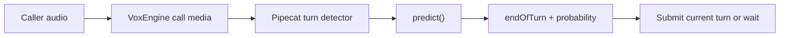

<blockquote className="agent-directive">
  For the complete documentation index, see <a href="/llms.txt">llms.txt</a>.
</blockquote>


## Benefits

Turn detection answers a different question than VAD.
VAD tells you when speech is present. Turn detection tells you whether the caller is probably finished.

Capability highlights:

- Powered by Voximplant's native [Pipecat module](/reference/voxengine/pipecat).
- Exposes a simple end-of-turn signal directly in VoxEngine.
- Designed to sit after VAD and before LLM submission in full-cascade flows. Clean the audio first with [Hush noise suppression](/voice-ai/speech-flow-control/noise-suppression) when background noise causes false turn boundaries.
- Gives you an explicit `endOfTurn` boolean and a confidence score so you can combine model output with local policy across OpenAI and OpenAI-compatible cascade pipelines.

## Architecture



## Pipecat Smart Turn in VoxEngine

For developers already familiar with Pipecat Smart Turn, Voximplant currently exposes a narrower surface area:

- `Pipecat.createTurnDetector({ threshold })`
- `turnDetector.predict()`
- `Pipecat.TurnEvents.Result` with `endOfTurn` and `probability`
- reset, error, and connector-information events

That means the detector is easy to wire into VoxEngine today, but most production flows still combine it with VAD, STT, and some local policy for grace periods or fallback timing.

## What Voximplant exposes

```js
require(Modules.Pipecat);

const turnDetector = await Pipecat.createTurnDetector({
  threshold: 0.5,
});

call.sendMediaTo(turnDetector);

vad.addEventListener(Silero.VADEvents.Result, (event) => {
  if (event.speechEndAt) {
    turnDetector.predict();
  }
});
```

The module surface is intentionally small:

- `Pipecat.createTurnDetector(parameters)`
- `turnDetector.predict()`
- `turnDetector.reset()`
- `turnDetector.close()`
- `turnDetector.id()` and `turnDetector.webSocketId()` for diagnostics

## Turn detector parameters

These are the parameters Voximplant currently exposes on `Pipecat.createTurnDetector()`.

| Parameter   | Type     | Default | What it controls                                                                                                                                                            |
| ----------- | -------- | ------: | --------------------------------------------------------------------------------------------------------------------------------------------------------------------------- |
| `threshold` | `number` |   `0.5` | End-of-turn probability threshold. If the detector score is above this value, `endOfTurn` becomes `true`. Higher values are more conservative; lower values submit earlier. |

## Turn detector events

| Event                                     | Payload                    | How to use it                                                                                                                          |
| ----------------------------------------- | -------------------------- | -------------------------------------------------------------------------------------------------------------------------------------- |
| `Pipecat.TurnEvents.Result`               | `endOfTurn`, `probability` | Main prediction event. `endOfTurn` is the detector's yes/no decision; `probability` is the underlying score in the range `[0.0, 1.0]`. |
| `Pipecat.TurnEvents.Reset`                | none                       | Emitted after `turnDetector.reset()`. Useful when resetting state after a submit or interruption.                                      |
| `Pipecat.TurnEvents.Error`                | `reason`                   | Connector/runtime error path. Log and fail fast or switch to a simpler fallback strategy.                                              |
| `Pipecat.TurnEvents.ConnectorInformation` | `data`                     | Connector metadata and diagnostics. Useful for version and endpoint visibility.                                                        |

## Development notes

- **Turn detection is not VAD**. VAD answers “is the caller speaking right now?” Pipecat Smart Turn answers “is the caller probably done?”
- **`predict()` is explicit**. In Voximplant's current API, you choose when to ask for a prediction. A common pattern is to call it after `speechEndAt`.
- **`threshold` is a policy dial**. Lower values react sooner but increase false end-of-turns. Higher values reduce premature submits but can make the system feel slower.
- **Use `probability` for app-level policy**. Even though the module only exposes one detector parameter today, the returned score is useful for deciding whether to wait for more STT or extend a timeout for short fragments.
- **Pipecat users should expect a slimmer API**. Voximplant does not currently expose the full native Pipecat Smart Turn configuration surface, so local helper logic is still useful in production pipelines.
- **Turn detection becomes more important as you mix providers**. In a full-cascade flow, the LLM may be OpenAI, Groq, or another OpenAI-compatible backend, but the turn boundary still needs to be decided locally and quickly.

## Example

```js
turnDetector.addEventListener(Pipecat.TurnEvents.Result, (event) => {
  if (event.endOfTurn) {
    submitCurrentTurn();
    return;
  }

  startFallbackTimeout();
});
```

## Links

### Voximplant

- [VAD and Turn Detection product page](https://voximplant.com/products/turn-detection)
- [VAD and Turn Detection guide](/voice-ai/speech-flow-control/turn-detection)
- [Pipecat module API reference](/reference/voxengine/pipecat)
- [Noise Suppression](/voice-ai/speech-flow-control/noise-suppression)
- [Agentic VoiceDSP](/voice-ai/speech-flow-control/agentic-voicedsp)

### Upstream technology

- [Pipecat](https://pipecat.ai/)
