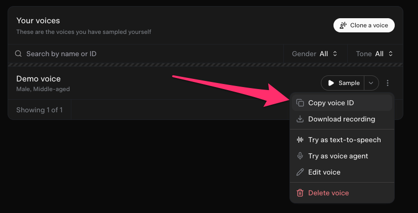

Use [XAI.createRealtimeTTSPlayer](/reference/voxengine/xai#createrealtimettsplayer) to synthesize text as it arrives, for example from an LLM. Voximplant manages the xAI WebSocket connection and sends the generated audio to the call.

<Note>
For an agent that receives caller audio and generates responses directly, use the [Grok Voice Agent API](/voice-ai/xai/overview). To combine separate STT, Grok reasoning, and TTS, see [Microsoft-Grok-Grok TTS](/voice-ai/bring-your-own-llm/grok-full-cascade).
</Note>

## Setup

Create a [VoxEngine scenario](/platform/getting-started/create-a-scenario) and assign it to an application's [routing rule](/platform/getting-started/create-a-routing-rule). Route an incoming phone number, SIP user, WebRTC user, or app user to the rule. Require `Modules.XAI` in the scenario.

Pass `voice` and `language` in `connectionParameters` when creating the player. Both should be non-empty strings. The example uses `eve` and English (`en`). Voximplant fixes the audio format for telephony to PCM at 16 kHz.

### Optional: Bring your own xAI API key

The `apiKey` parameter is optional. To use your own xAI account, store its API key in Voximplant [Secrets](/platform/storage/secret-storage) as `XAI_API_KEY`. The example reads it synchronously with `VoxEngine.getSecretValue('XAI_API_KEY')` and passes it only when present. Omit the secret to use Voximplant's provider credentials and TTS billing.

With your own key, xAI bills provider usage to your account; Voximplant connectivity charges also apply. See [Voximplant pricing](https://voximplant.com/pricing) for current rates.

## Custom voices

Create a custom voice in the [xAI console](https://console.x.ai/) or with the [Custom Voices API](https://docs.x.ai/developers/model-capabilities/audio/custom-voices). Use your own xAI API key with access to that voice. In the console, open the voice card's three-dot menu and choose **Copy voice ID**. Pass the copied string as `connectionParameters.voice` when creating the player.

## Speech tags

xAI supports inline tags such as `[pause]`, `[laugh]`, and `[exhale]`, plus wrappers such as `<whisper>...</whisper>`, `<fast>...</fast>`, and `<emphasis>...</emphasis>`. Use them sparingly to shape delivery. The scenario includes pauses, emphasis, and a whispered aside. See the [xAI speech tag reference](https://docs.x.ai/developers/model-capabilities/audio/text-to-speech#speech-tags) for the current set.

## Stream text into a call

The example waits for the incoming call to connect, creates a player, and streams six utterances on one connection. `streamText()` splits each utterance into chunks while preserving spaces and punctuation. It sends each chunk as `text.delta`, then sends `text.done` to finish the utterance. The chunks simulate text arriving from an application; a real LLM stream can supply its deltas directly.

<Code
  src="../../../examples/grok/voxeengine-grok-tts.js"
  title="voxeengine-grok-tts.js"
  language="javascript"
  maxLines={0}
/>

Listeners are registered before sending text. The sample logs the shared player lifecycle events, playback errors, and each utterance's `timeToFirstByte` in milliseconds. It stops the player and cancels both timers on disconnect, error, completion, or the 60-second demo deadline.

## Playback and interruptions

Send native xAI message objects with [player.send()](/reference/voxengine/xai/realtime-tts-player#send): use `text.delta` with a `delta` string for each chunk, followed by `text.done` to flush the accumulated text. Sending `text.done` keeps the connection open for another utterance.

Listen for [PlayerEvents.AudioChunksPlaybackFinished](/reference/voxengine/player-events#audiochunksplaybackfinished) before advancing to the next utterance or ending the call. xAI sends `audio.done` when synthesis finishes; Voximplant reports the event after the generated audio chunks finish playing. The event's `timeToFirstByte` measures the delay from sending the request to receiving the first audio byte. It does not measure playback duration.

To interrupt an utterance, call [player.clearBuffer()](/reference/voxengine/xai/realtime-tts-player#clearbuffer). The integration sends `text.clear` to xAI and clears buffered playback. Connect this operation to your application's speech detection or interruption signal. A TTS player does not detect caller speech itself.

If the demo is still running after 23 seconds, its timer simulates an interruption and sends a replacement utterance. For caller-driven barge-in and end-of-turn detection, use the [cascaded pipeline example](/voice-ai/bring-your-own-llm/grok-full-cascade). Call [player.stop()](/reference/voxengine/xai/realtime-tts-player#stop) when the player is no longer needed.

## Connection options

The optional `connectionParameters` fields `speed`, `optimize_streaming_latency`, and `text_normalization` are forwarded to the provider. Omit them to retain xAI defaults. The example sets `optimize_streaming_latency: 1`; compare quality and latency for your application before choosing a value.

The [xAI streaming TTS API](https://docs.x.ai/developers/model-capabilities/audio/text-to-speech#streaming-tts-websocket) also documents codecs, sample rates, MP3 bit rates, and timestamp alignment for direct provider connections. Voximplant's player uses fixed PCM at 16 kHz; those provider options are not configurable player controls.

## See also

- [Microsoft-Grok-Grok TTS pipeline](/voice-ai/bring-your-own-llm/grok-full-cascade)
- [XAI module reference](/reference/voxengine/xai)
- [XAI.RealtimeTTSPlayer reference](/reference/voxengine/xai/realtime-tts-player)
- [Player shared methods](/reference/voxengine/player)
- [PlayerEvents](/reference/voxengine/player-events)
- [Grok Voice Agent API](/voice-ai/xai/overview)
- [Voximplant Secrets](/platform/storage/secret-storage)
