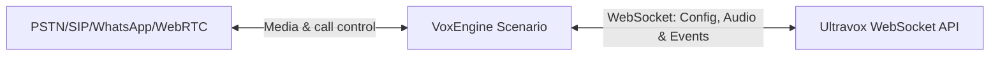

<blockquote className="agent-directive">
  For the complete documentation index, see <a href="/llms.txt">llms.txt</a>.
</blockquote>

## Benefits

Voximplant includes a native Ultravox connector so you can bridge live phone calls to Ultravox’s WebSocket API with minimal setup.

<Info title="Note">
  Ultravox also has a direct SIP integration with Voximplant, which makes it easy to bring PSTN/SIP calls into Ultravox from Voximplant’s telephony stack.
  See the Voximplant announcement and Ultravox SIP docs for details:
  https://voximplant.com/blog/ultravox-adds-sip-to-its-voice-ai-services-using-voximplant
</Info>

## Architecture

A VoxEngine scenario answers or places a call, creates an Ultravox WebSocket session, and bridges audio both ways via `VoxEngine.sendMediaBetween`.

## Prerequisites

- Ultravox account and API key from [Ultravox](https://docs.ultravox.ai/).
- Ultravox call configuration ready for your flow (for example `systemPrompt`, model, and voice).

## Development notes

- **Native VoxEngine module**: load with `require(Modules.Ultravox)` and create a `Ultravox.WebSocketAPIClient` via `Ultravox.createWebSocketAPIClient(...)`.
- **Session setup**: choose `Ultravox.HTTPEndpoint.CREATE_CALL` (or `CREATE_AGENT_CALL`) and provide `authorizations` (for example `X-API-Key`) plus a request `body` with `systemPrompt`, `model`, and `voice`.
- **Audio bridge**: connect the call and Ultravox using `VoxEngine.sendMediaBetween(call, voiceAIClient)`.
- **Transcripts**: `Ultravox.WebSocketAPIEvents.Transcript` contains `role` plus `text`/`delta` fields; use it for logging and barge‑in logic.
- **Tool invocations**: handle `Ultravox.WebSocketAPIEvents.ClientToolInvocation` and respond with `voiceAIClient.clientToolResult(...)`.
- **Barge‑in**: call `voiceAIClient.clearMediaBuffer()` when you detect user speech or when the server requests buffer clearing.

## Examples

- [Example: Answering an incoming call](/voice-ai/ultravox/inbound)
- [Example: Placing an outbound call](/voice-ai/ultravox/outbound)
- [Example: Function calling](/voice-ai/ultravox/function-calling)

## Links

### Voximplant

- Ultravox SIP integration announcement: https://voximplant.com/blog/ultravox-adds-sip-to-its-voice-ai-services-using-voximplant
- Voice AI product overview: https://voximplant.ai/

### Ultravox

- Voximplant integration guide: https://docs.ultravox.ai/integrations/voximplant
- SIP integration: https://docs.ultravox.ai/telephony/sip
- Data messages reference (transcripts, tool invocation, etc.): https://docs.ultravox.ai/apps/datamessages
