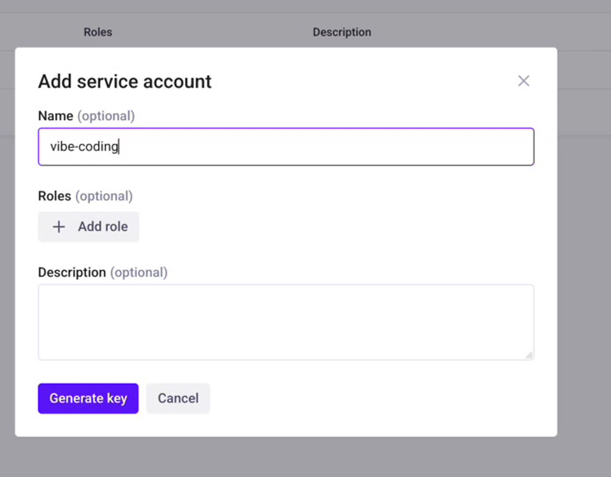
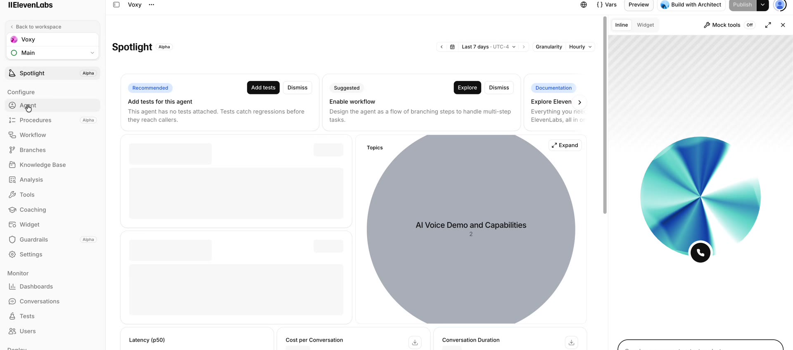
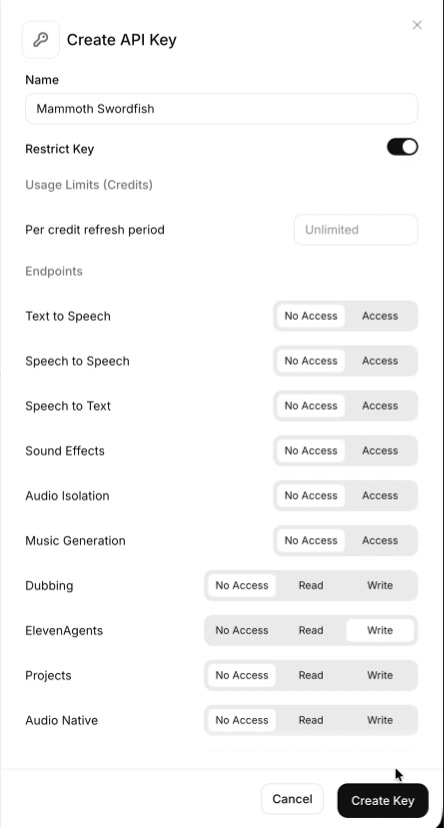
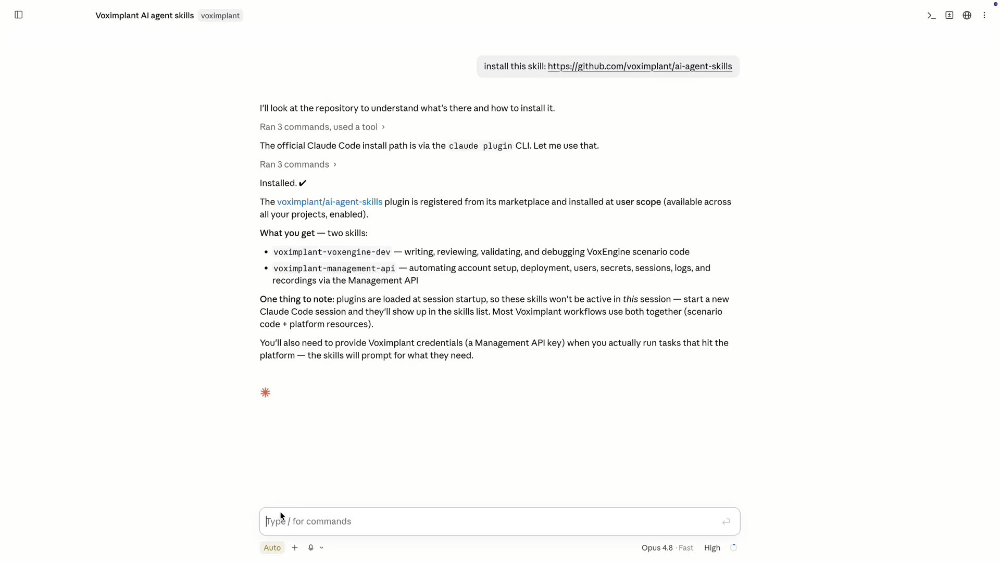
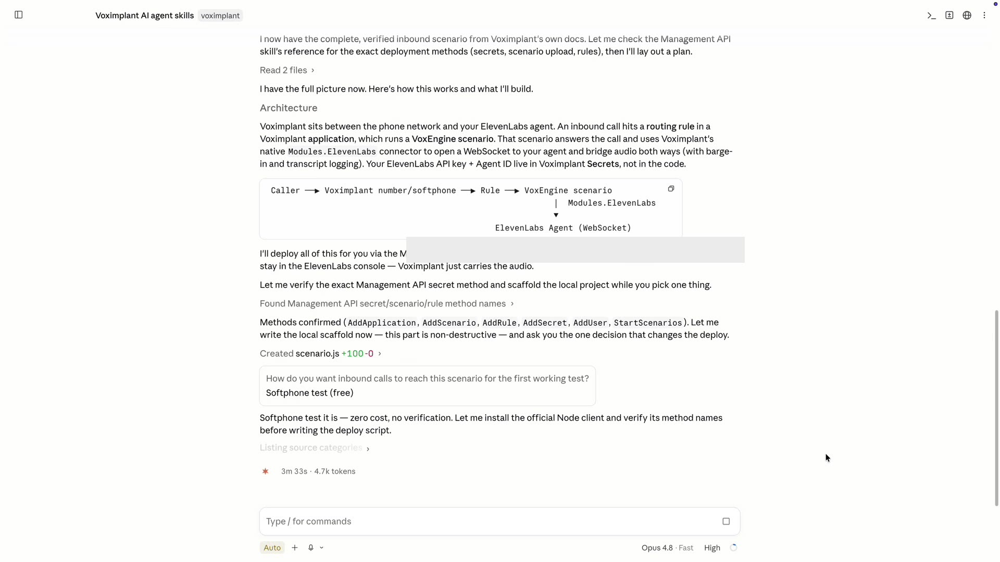
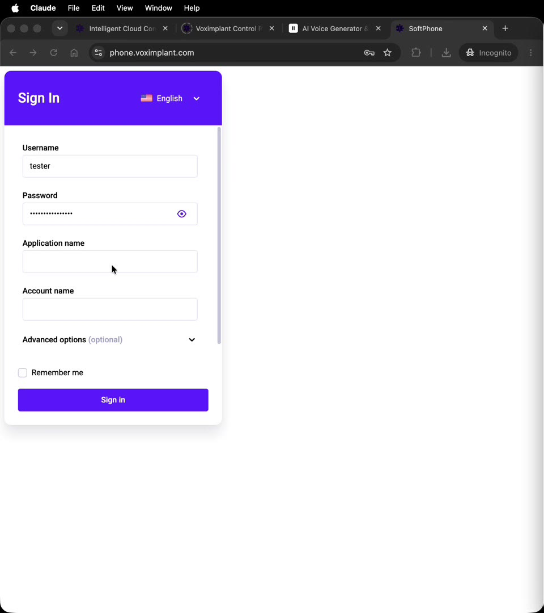
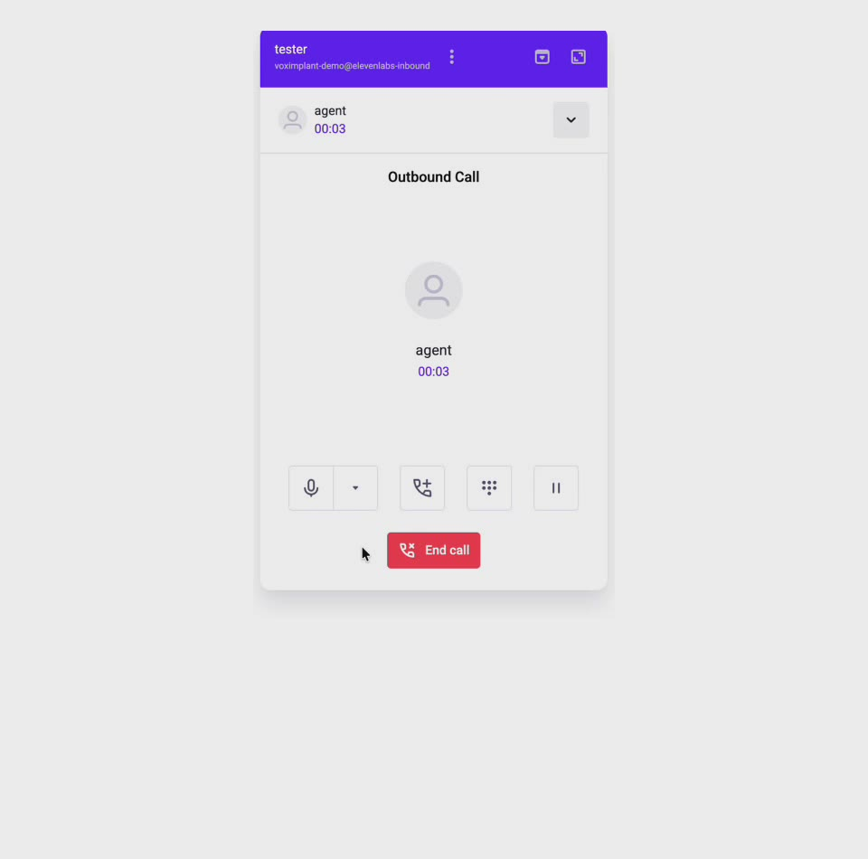

<blockquote className="agent-directive">
  For the complete documentation index, see <a href="/llms.txt">llms.txt</a>.
</blockquote>

Use Claude Code and Voximplant AI Agent Skills to connect an existing ElevenLabs agent to inbound calls. Claude writes the VoxEngine scenario, configures a separate test application after your approval, deploys it, and gives you credentials for a browser-based test call.

The walkthrough takes about 10–15 minutes once your Voximplant and ElevenLabs accounts are ready. You do not need to buy a phone number.

<Info>
  This guide starts with an ElevenLabs agent that is already configured. Its prompt, voice, and tools remain in ElevenLabs; Voximplant provides the telephony, routing, and VoxEngine orchestration.
</Info>

{/* VAIOP-225: Enable this block when Chad's final video has a public YouTube ID.

## Video walkthrough

Video link: [Build a voice agent with Claude Code and Voximplant](https://www.youtube.com/watch?v=VIDEO_ID)

<llms-ignore>
<iframe
  width="100%"
  height="360"
  src="https://www.youtube.com/embed/VIDEO_ID"
  title="Build a voice agent with Claude Code and Voximplant"
  frameBorder="0"
  allow="accelerometer; autoplay; clipboard-write; encrypted-media; gyroscope; picture-in-picture; web-share"
  allowFullScreen
/>
</llms-ignore>

*/}

## Before you start

You need:

- A [Voximplant account](https://manage.voximplant.com/auth/sign_up).
- A dedicated local project folder. An empty folder is recommended for this walkthrough.
- Claude Code, signed in and able to access your local project folder.
- An existing [ElevenLabs agent](https://elevenlabs.io/app/agents/agents).
- An ElevenLabs Agent ID and an API key with **ElevenAgents: Write** access.

<Warning>
  Never paste your main Voximplant password, browser cookies, or a service account private key into chat. Keep credentials in local ignored files, and let Claude pass file paths to tools without reading private key contents into the conversation.
</Warning>

## Part 1: Set up Voximplant

### Prepare the project folder

Create a dedicated folder for the project. For the cleanest walkthrough, start with an empty one. Add this `.gitignore` before placing credentials in the folder:

```bash title=".gitignore"
.env
*_private.json
voximplant-service-account.json
```

This prevents the common credential filenames used in this guide from being committed.

### Create a service account

<Steps>
  <Step title="Open Service accounts">
    Sign in to the [Voximplant control panel](https://manage.voximplant.com), then go to **Settings → Service accounts**.
  </Step>
  <Step title="Add an account">
    Select **Add** and give the service account a recognizable name such as `vibe-coding`.
  </Step>
  <Step title="Choose a role">
    For the simplest first walkthrough, assign the **Developer** role so Claude can create and configure the test resources. For a production workflow, use narrower task-specific roles.
  </Step>
  <Step title="Generate the key">
    Generate and download the JSON key. Save it in your project folder as `voximplant-service-account.json`.
  </Step>
</Steps>

<Frame caption="Create a dedicated service account for the walkthrough">
  
</Frame>

Claude needs only the filename or path. Do not open the JSON file or paste its contents into the conversation.

## Part 2: Prepare ElevenLabs

Open your agent in the [ElevenLabs Agents console](https://elevenlabs.io/app/agents/agents) and copy its Agent ID.

<Frame caption="Open the existing agent you want to connect to Voximplant">
  
</Frame>

Then create a restricted API key. Disable access to unrelated endpoints and grant **Write** access to **ElevenAgents**.

<Frame caption="Restrict the API key to the permissions required by the walkthrough">
  
</Frame>

Create a local `.env` file in the project folder:

```bash title=".env"
ELEVENLABS_AGENT_ID=your_agent_id
ELEVENLABS_API_KEY=your_api_key
```

Claude stores these values in Voximplant Secrets during deployment, so they are not hardcoded in the scenario.

## Part 3: Build with Claude Code

### Install Voximplant AI Agent Skills

Open Claude Code and paste this prompt:

```text
Install the Voximplant AI Agent Skills plugin from
https://github.com/voximplant/ai-agent-skills.
Use the official Claude Code plugin installation flow, install it for my user,
verify that both Voximplant skills are installed, and tell me what to do next.
```

Claude examines the repository, registers its plugin marketplace, and installs the plugin. Review and approve the commands if Claude asks for permission.

The plugin contains two complementary skills:

- `voximplant-voxengine-dev` writes and validates the VoxEngine scenario.
- `voximplant-management-api` creates resources, deploys the scenario, configures secrets, and retrieves call evidence for debugging.

<Frame caption="Claude Code installs both Voximplant skills from the repository link">
  
</Frame>

Start a new Claude Code session so the plugin loads, then open your project folder.

For additional installation methods, see the [Voximplant AI Agent Skills README](https://github.com/voximplant/ai-agent-skills#install-in-claude-code).

### Start with one prompt

Paste this prompt into the new Claude Code session:

```text
Help me use Voximplant with my existing ElevenLabs agent to handle inbound calls.
The Voximplant service account JSON and ElevenLabs credentials are in this folder.
Use both Voximplant AI Agent Skills. Choose beginner-friendly defaults, create an
isolated test application, and use the free softphone test. Show me the exact
resources you plan to create or change and ask for confirmation before making
platform changes.
```

Claude may ask follow-up questions before it builds the app. Review any account-changing commands before approving them.

<Frame caption="Claude explains the architecture and offers a free softphone test">
  
</Frame>

Claude then builds and deploys the scenario, configures the test application, stores the ElevenLabs credentials in Voximplant Secrets, and returns the four softphone sign-in values.

## Part 4: Place a test call

Open [phone.voximplant.com](https://phone.voximplant.com/) in Chrome, Edge, or Safari. Do not use Claude's built-in browser because it may not provide microphone access.

Enter the four values Claude returns into four separate fields:

- **Username**
- **Password**
- **Application name**
- **Account name**

<Frame caption="The Voximplant browser phone uses four separate sign-in fields">
  
</Frame>

After signing in:

1. Enter `1` as the destination—the test routing rule accepts any value.
2. Start the call.
3. Allow microphone access if the browser asks.
4. Speak to the ElevenLabs agent.

<Frame caption="A successful test connects the browser call to the ElevenLabs agent">
  
</Frame>

## You’re done!

If the call connects and you can talk to your ElevenLabs agent, everything is working. Congratulations—your agent can now answer calls through Voximplant!

## If the call fails

You do not need to search the control panel manually. Tell Claude what happened and let both skills run the build-test-debug loop:

```text
The test call failed. Use voximplant-management-api to find the latest call for
this test application and retrieve its logs. Then use voximplant-voxengine-dev
to identify the code or routing problem, propose a focused fix, ask before any
platform changes, deploy the approved fix, and tell me how to repeat the test.
```

Useful details include the approximate call time, destination, and what you heard or saw. Do not paste passwords or private keys.

Common first-test issues:

- **The plugin is not available:** start a new Claude Code session after installation.
- **Softphone sign-in fails:** verify that all four fields are separate and match the application Claude created.
- **The browser cannot use the microphone:** open the web phone in a normal browser tab and grant microphone permission.
- **The call ends or stays silent:** ask Claude to inspect the latest call and logs before changing the scenario.

## Next steps

After the softphone test works, ask Claude to extend the same project:

- Bind an inbound PSTN number.
- Place outbound calls.
- Connect SIP devices or infrastructure.
- Add web or mobile calling clients.
- Integrate WhatsApp calling.
- Switch to another Voice AI provider.

Phone numbers may require verification and incur charges.
