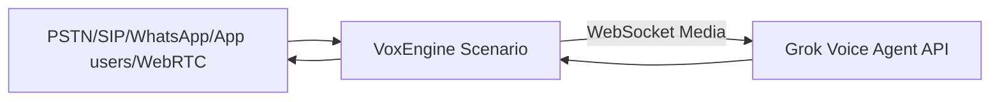

<blockquote className="agent-directive">
  For the complete documentation index, see <a href="/llms.txt">llms.txt</a>.
</blockquote>


## Overview

This minimal example answers an incoming call and connects it to the Grok Voice Agent API with only core settings and barge-in support—no extra tools or function calling.

**⬇️ Jump to the [Full VoxEngine scenario](#full-voxengine-scenario).**

## Prerequisites

- Set up an incoming entrypoint for the caller:
  - [Phone number](/platform/getting-started/buy-a-phone-number)
  - [WhatsApp](/voice-ai/network-options/whatsapp)
  - [SIP user / SIP registration](/voice-ai/network-options/sip)
  - [App user](/platform/getting-started/create-users)
- Create a [routing rule](/platform/getting-started/create-a-routing-rule) that points the destination (phone number / WhatsApp / SIP username / app user alias) to this scenario.
- Store your xAI API key in Voximplant [Secrets](/platform/storage/secret-storage) under `XAI_API_KEY`.

## Architecture



## Usage highlights

- Create a `VoiceAgentAPIClient` with `XAI.createVoiceAgentAPIClient(...)`.
- Select the Grok voice model with `model: "grok-voice-latest"`, or set `GROK_MODEL` to another xAI Voice Agent model supported by your account.
- Configure the session with `voice`, `turn_detection`, and a short `instructions` prompt.
- Bridge audio with `VoxEngine.sendMediaBetween(call, client)`.
- Enable barge-in by clearing the media buffer when the caller starts speaking.

### Turn detection & barge-in

When `InputAudioBufferSpeechStarted` fires, clear the media buffer so the caller can interrupt the agent:

```js
voiceAgentAPIClient.addEventListener(
  XAI.VoiceAgentAPIEvents.InputAudioBufferSpeechStarted,
  () => voiceAgentAPIClient.clearMediaBuffer()
);
```

## Configure before you run

- Set `XAI_API_KEY` in Voximplant [Secrets](/platform/storage/secret-storage).
- Change `GROK_MODEL` if you want to use a different Grok voice model.
- Adjust the `SYSTEM_PROMPT` in the example to match your brand voice and guardrails.

## Try it

Suggested test prompts:

- "Hello"
- "What can you help me with?"
- "Goodbye."

## Notes

[See the VoxEngine API Reference for more details](/reference/voxengine/xai).

## Full VoxEngine scenario

<Code
  src="../../../examples/grok/voxeengine-grok-answer-incoming-call.js"
  title="voxeengine-grok-answer-incoming-call.js"
  language="javascript"
  maxLines={0}
/>
