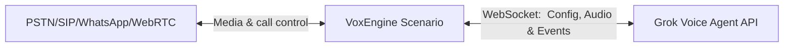

<blockquote className="agent-directive">
  For the complete documentation index, see <a href="/llms.txt">llms.txt</a>.
</blockquote>

xAI's Grok Voice Agent API is available in Voximplant as a native **VoxEngine** connector,
so you can build real-time voice agents with telephony-grade audio streaming and call control.

<Note>
Use [xAI realtime TTS](/voice-ai/speech/grok-tts) for standalone speech output, or [Microsoft-Grok-Grok TTS](/voice-ai/bring-your-own-llm/grok-full-cascade) to combine separate STT, Grok reasoning, and TTS.
</Note>

## Benefits

- **Built-in WebSocket connector**: Voximplant handles WebSocket media, audio formatting, sample rate, and packet sizing so you can focus on call logic.
  https://voximplant.com/blog/grok-voice-agent-api-now-available-in-voximplant
- **Real-time voice interactions**: Grok streams responses as they're generated for low-latency conversations.
  https://voximplant.com/blog/grok-voice-agent-api-now-available-in-voximplant
- **All-in-one speech stack**: STT and TTS are part of the Grok Voice Agent API (no separate providers required).
  https://voximplant.com/blog/grok-voice-agent-api-now-available-in-voximplant
- **Context-aware responses** with `file_search`, `web_search`, and `x_search`.
  https://voximplant.com/blog/grok-voice-agent-api-now-available-in-voximplant

## Prerequisites

- xAI account with Voice Agent API access.
- xAI API key from your xAI account.

## Demo video

Outbound calling with xAI's Grok Voice API demo:

Video link: [How to Use Grok Voice Agent for Outbound Calls](https://www.youtube.com/watch?v=GxPJ2Yrl7DM)

<llms-ignore>
<iframe
    width="100%"
    height="360"
    src="https://www.youtube.com/embed/GxPJ2Yrl7DM"
    title="How to Use Grok Voice Agent for Outbound Calls (Voximplant Tutorial)"
    frameBorder="0"
    allow="accelerometer; autoplay; clipboard-write; encrypted-media; gyroscope; picture-in-picture; web-share"
    allowFullScreen
/>
</llms-ignore>

## Architecture

Voximplant's Grok Voice Agent API integration uses a WebSocket connection to stream audio between VoxEngine and Grok.
The Voice AI connector handles connection establishment, media conversion, playback, and audio capture.

Tool calls detected by Grok are signaling in events where you can implement custom logic and provide a response in your VoxEngine scenario.

## Development notes

- The Grok Voice Agent API uses WebSockets only; Voximplant manages the connection.
  https://voximplant.com/blog/grok-voice-agent-api-now-available-in-voximplant
- Load the module with `require(Modules.XAI)` and create a `VoiceAgentAPIClient` inside VoxEngine.
  https://voximplant.com/blog/grok-voice-agent-api-now-available-in-voximplant
- Use `VoxEngine.sendMediaBetween(call, client)` to bridge call audio to Grok.
  [Grok Voice Agent API client guide](/voice-ai/xai/overview)
- For barge-in, clear the media buffer on `InputAudioBufferSpeechStarted`.
  https://voximplant.com/blog/grok-voice-agent-api-now-available-in-voximplant
- Store your xAI API key in Voximplant [Secrets](/platform/storage/secret-storage) under `XAI_API_KEY`.
  [Grok Voice Agent API client guide](/voice-ai/xai/overview)
- Choose the Grok voice model with the optional `model` parameter in `XAI.createVoiceAgentAPIClient(...)`. The examples explicitly use `grok-voice-latest`; change `GROK_MODEL` if your xAI account should use another Voice Agent model.
  https://docs.x.ai/developers/model-capabilities/audio/speech-to-speech

## Links

- [xAI realtime TTS](/voice-ai/speech/grok-tts) — stream text into a call with a standalone TTS player.
- [Microsoft-Grok-Grok TTS pipeline](/voice-ai/bring-your-own-llm/grok-full-cascade)
- Blog post: https://voximplant.com/blog/grok-voice-agent-api-now-available-in-voximplant
- [Grok Voice Agent API client guide](/voice-ai/xai/overview)
- [Grok VoxEngine module reference](/reference/voxengine/xai)
- xAI Grok Voice Agent API announcement: https://x.ai/blog/grok-voice-agent
- xAI Voice Agent API docs: https://docs.x.ai/docs/guides/voice/agent
- Example repository: https://github.com/voximplant/grok-voice-agent-example
